## OSPLL (Reference Oversampling PLL)

> J. -H. Seol, K. Choo, D. Blaauw, D. Sylvester and T. Jang, "Reference Oversampling PLL Achieving −256-dB FoM and −78-dBc Reference Spur," in *IEEE Journal of Solid-State Circuits*, vol. 56, no. 10, pp. 2993-3007, Oct. 2021 [[https://sci-hub.se/10.1109/JSSC.2021.3089930](https://sci-hub.se/10.1109/JSSC.2021.3089930)]
>
> Taekwang Jang SSCS DL talk : Ultra-low noise Phase-locked Loop Technique

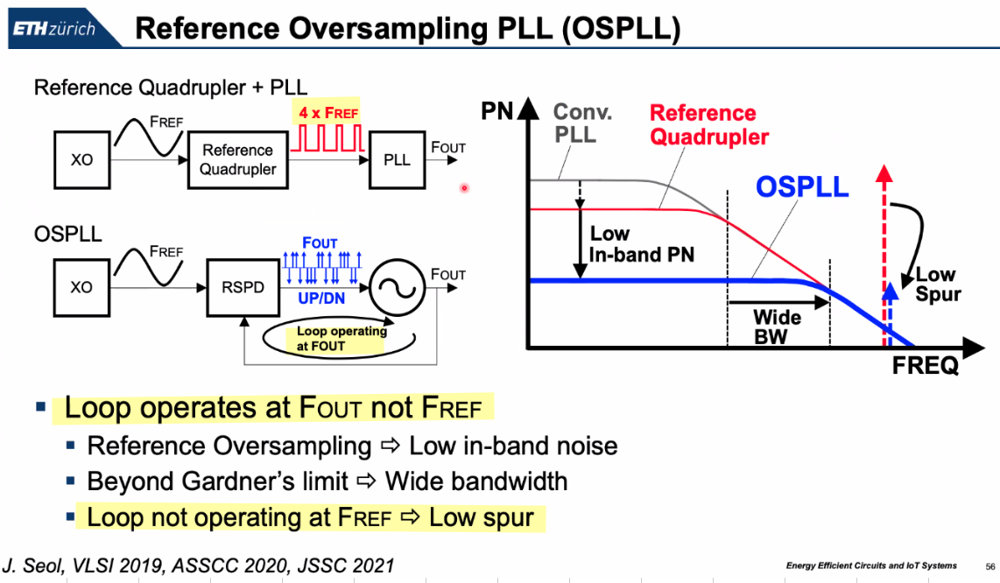

> K. J. Wang, A. Swaminathan and I. Galton, "Spurious Tone Suppression Techniques Applied to a Wide-Bandwidth 2.4 GHz Fractional-N PLL," in *IEEE Journal of Solid-State Circuits*, vol. 43, no. 12, pp. 2787-2797, Dec. 2008 [[https://sci-hub.se/10.1109/JSSC.2008.2005716](https://sci-hub.se/10.1109/JSSC.2008.2005716)]
>
> 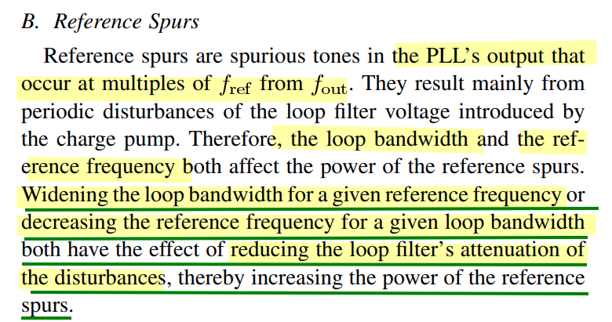

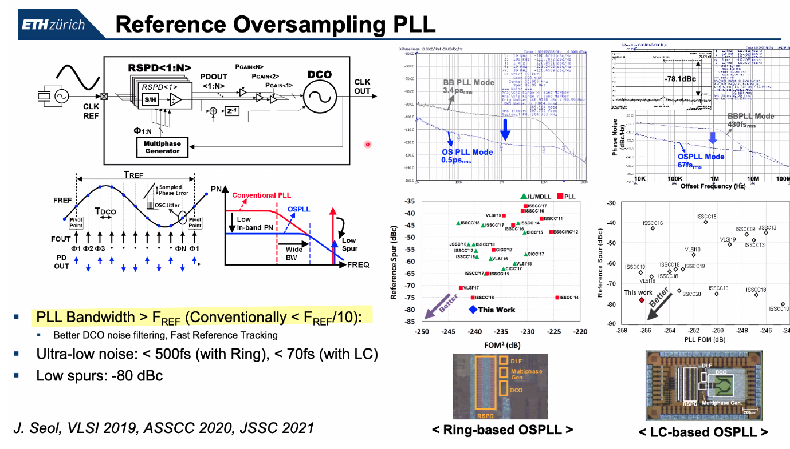

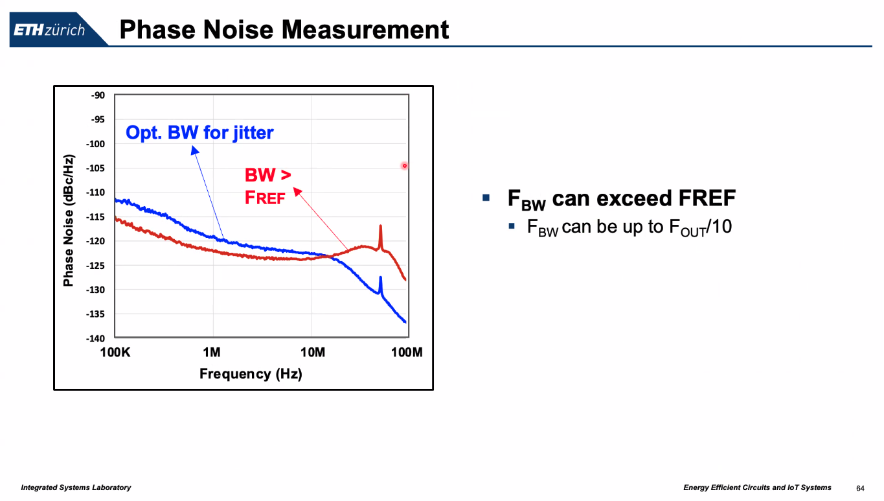

## MUX Structure

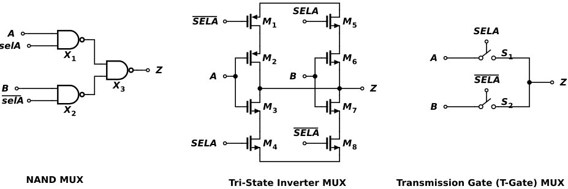

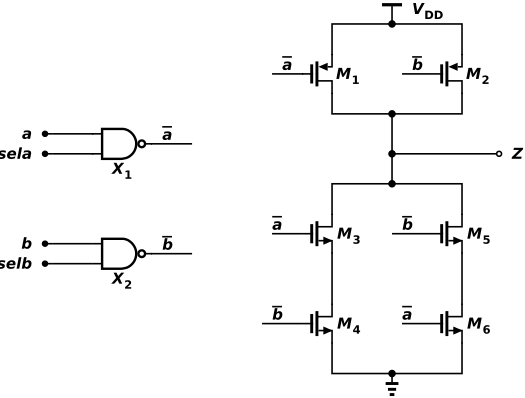

## Reference Spur

**spurs** are carrier or clock frequency spectral imperfections measured in the frequency domain just like phase noise. However, unlike phase noise they are *discrete* frequency components.

- Spurs are deterministic

- Spur power is independent of bandwidth

- Spurs contribute bounded peak jitter in the time domain

***Sources of Spurs:***

- External (coupling from other noisy block)
  Supply, substrate, bond wires, etc.
- Internal (int-N/fractional-N operation)
  - **Frac spur**: Fractional divider (multi-modulus and frequency accumulation)
  - **Ref. spur**: PFD/charge pump/analog loop filter non-idealities, clock coupling

## Integer-N PLL

**integer-N PLL frequency synthesizers**

- the *frequency resolution*, is equal to the *reference frequency*, meaning that *only integer multiples of the reference frequency can be synthesized*

- *Stability requirements* limit the loop bandwidth to about *one tenth of the reference frequency*; therefore

  - decreasing the reference frequency increases the settling time as the loop bandwidth also has to be decreased
  - a reduced loop bandwidth allows less suppression of the VCO’s inherent phase noise

- Another drawback of the integer-N PLL is the *trade-off between phase noise and settling time* when the *divider ratio becomes large* (The contributions to the output phase noise of almost all PLL building blocks, except the VCO, are **multiplied by the division ratio**)

  > [[https://people.engr.tamu.edu/spalermo/ecen620/lecture03_ee620_pll_system.pdf](https://people.engr.tamu.edu/spalermo/ecen620/lecture03_ee620_pll_system.pdf)]
  >
  > 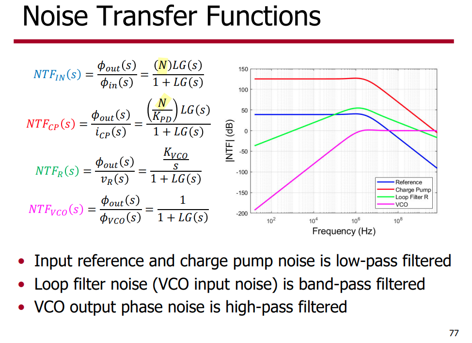

- if a small reference frequency is chosen, t*he reference spur in the output phase noise is located at a smaller offset frequency*

##  Fractional-N

1. ***Dither Feedback Divider Ratio by a delta-sigma modulator***

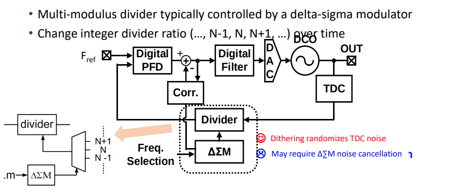

2. ***Frequency Accumulation***

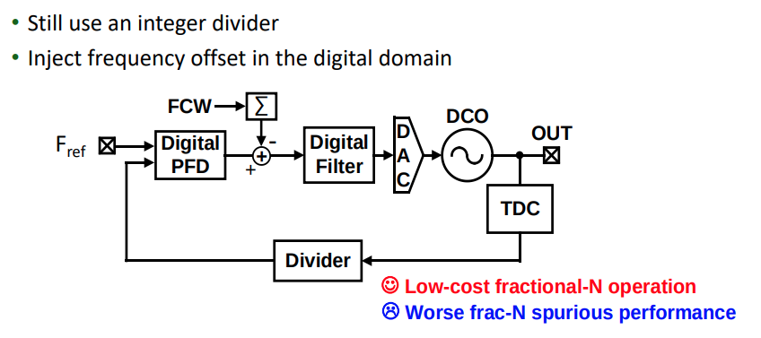

## Switched Capacitor Banks

Q: why $R_b$ ?

A:  *TODO* &#128197;

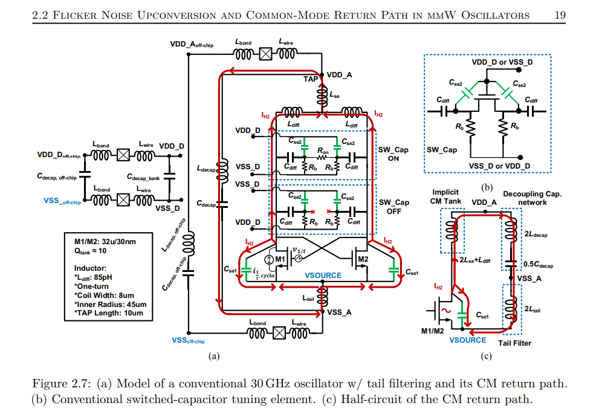

> Hu, Yizhe. "Flicker noise upconversion and reduction mechanisms in RF/millimeter-wave oscillators for 5G communications." PhD diss., 2019.
>
> S. D. Toso, A. Bevilacqua, A. Gerosa and A. Neviani, "A thorough analysis of the tank quality factor in LC oscillators with switched capacitor banks," *Proceedings of 2010 IEEE International Symposium on Circuits and Systems*, Paris, France, 2010, pp. 1903-1906

## False locking

*TODO* &#128197;

- divider failure
- even-stage ring oscillator ( multipath ring oscillators)
- DLL: harmonic locking,  stuck locking

## clock edge impact

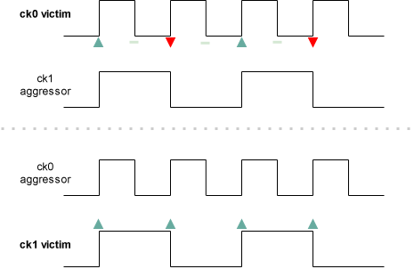

> ck1 is div2 of ck0

- edge of ck0 is affected differently by ck1

- edge of ck1 is affected equally by ck0

## Why Type 2 PLL ?

> **Type**: # of integrators within the loop
>
> **Order**: # of poles in the *closed-loop* transfer function
>
> *Type $\leq$ Order*

1. That is, to have a wide bandwidth, a high loop gain is required
2. More importantly, the type 1 PLL has the problem of a ***static phase error*** for the change of an input frequency

---

*Type 1 PLL with input phase step* $\Delta \phi \cdot u(t)$
$$\begin{align}
\Delta \phi\cdot u(t) - K\int_0^{t}\phi _e (\tau)d\tau &= \phi _e (t) \\
\phi _e (0) &= \Delta \phi
\end{align}$$

we obtain $\phi _e (t) = \Delta \phi \cdot e^{-Kt}\cdot u(t)$

and $\phi _e(\infty) = 0$

---

> Daniel Boschen. GRCon24 - Quick Start on Control Loops with Python Workshop [[https://events.gnuradio.org/event/24/contributions/599/attachments/187/480/Boschen%20Control%20Presentation.pdf](https://events.gnuradio.org/event/24/contributions/599/attachments/187/480/Boschen%20Control%20Presentation.pdf)]

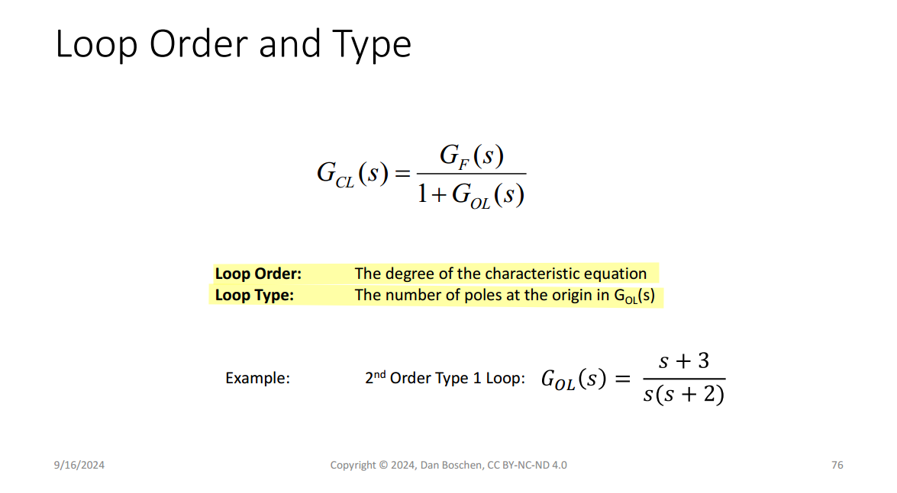

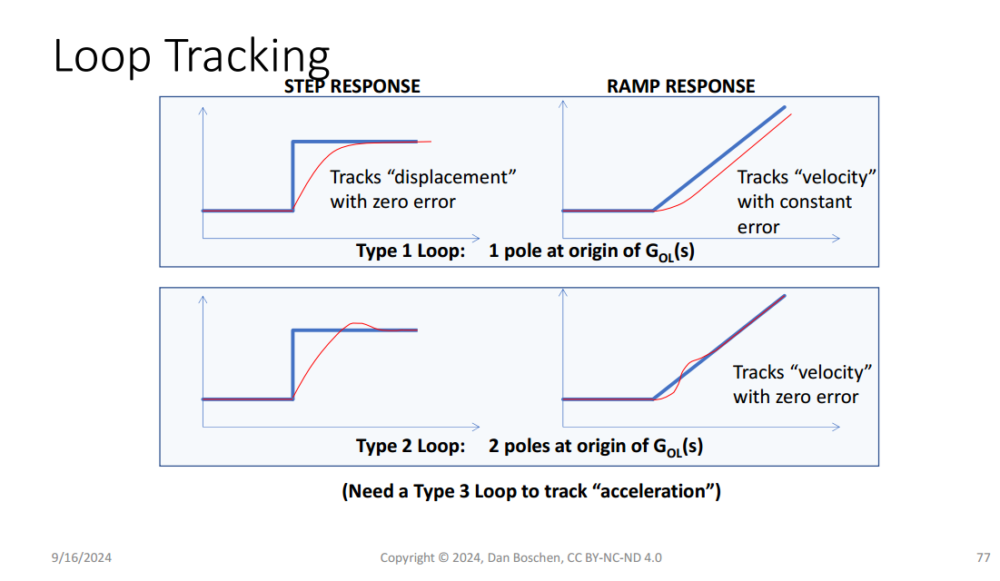

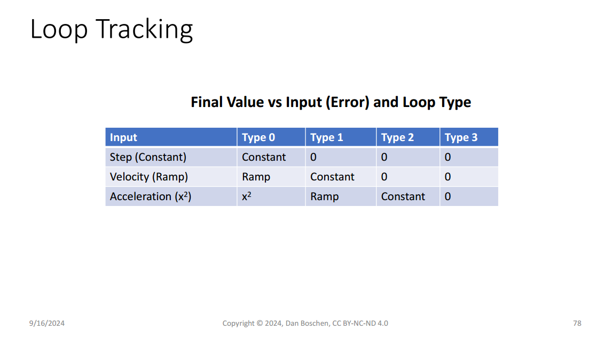

## reference

Dennis Fischette, Frequently Asked PLL Questions [[https://www.delroy.com/PLL_dir/FAQ/FAQ.htm](https://www.delroy.com/PLL_dir/FAQ/FAQ.htm)]

Ian Galton, ISSCC 2010 SC3: Fractional-N PLLs [[https://www.nishanchettri.com/isscc-slides/2010%20ISSCC/Short%20Course/SC3.pdf](https://www.nishanchettri.com/isscc-slides/2010%20ISSCC/Short%20Course/SC3.pdf)]

Mike Shuo-Wei Chen, ISSCC 2020 T6: Digital Fractional-N Phase Locked Loop Design [[https://www.nishanchettri.com/isscc-slides/2020%20ISSCC/TUTORIALS/T6Visuals.pdf](https://www.nishanchettri.com/isscc-slides/2020%20ISSCC/TUTORIALS/T6Visuals.pdf)]

Arora, Mohit. “Clock Dividers Made Easy.” (2002). [[https://www.mikrocontroller.net/attachment/177198/Clock_Dividers_Made_Easy.pdf](https://www.mikrocontroller.net/attachment/177198/Clock_Dividers_Made_Easy.pdf)]
