## Asynchronous vs Synchronous Divider

> Sam Palermo, ECEN620: Network Theory Broadband Circuit Design Fall 2025 Lecture 8: Divider Circuits  [[https://people.engr.tamu.edu/spalermo/ecen620/lecture08_ee620_dividers.pdf](https://people.engr.tamu.edu/spalermo/ecen620/lecture08_ee620_dividers.pdf)]
>
> Michael Perrott August 12, 2008, Short Course On Phase-Locked Loops and Their Applications Day 2, PM Lecture Basic Building Blocks (Part II) High Speed Frequency Dividers, Phase Detectors, Charge Pumps, and Loop Filter Design [[https://cppsim.org/PLL_Lectures/day2_pm.pdf](https://cppsim.org/PLL_Lectures/day2_pm.pdf)]

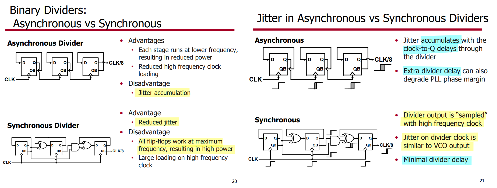

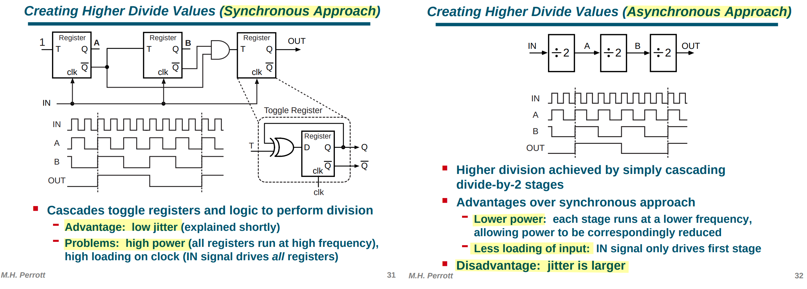

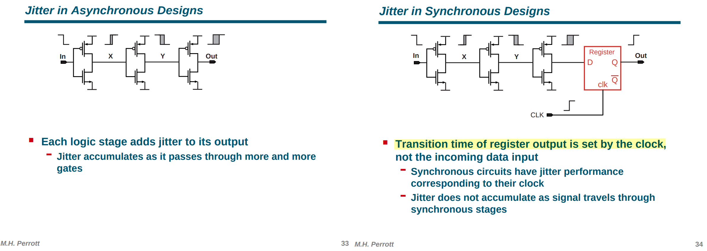

---

***divide-by-3***

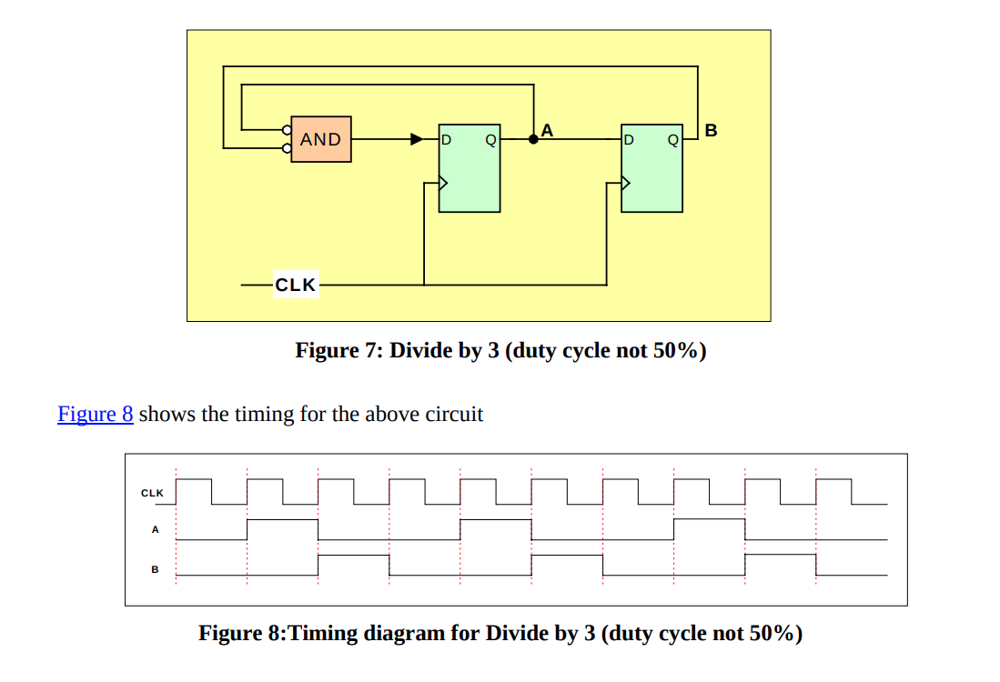

***divide-by-7***

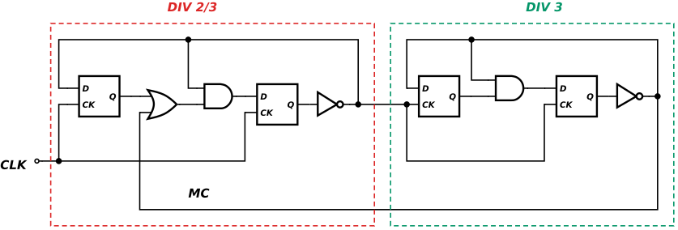

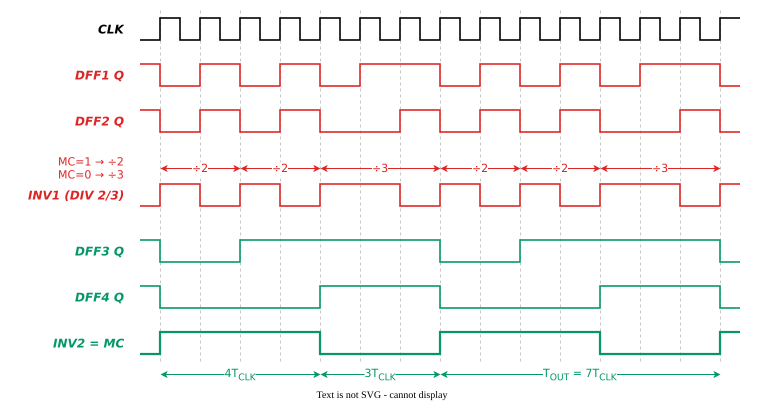

**No lock-up**: every one of all 16 starting states (4 DFF) of the four flip-flops settles into this same period-7 pattern

## Dual-Modulus Dividers

***divide-by-2/3***

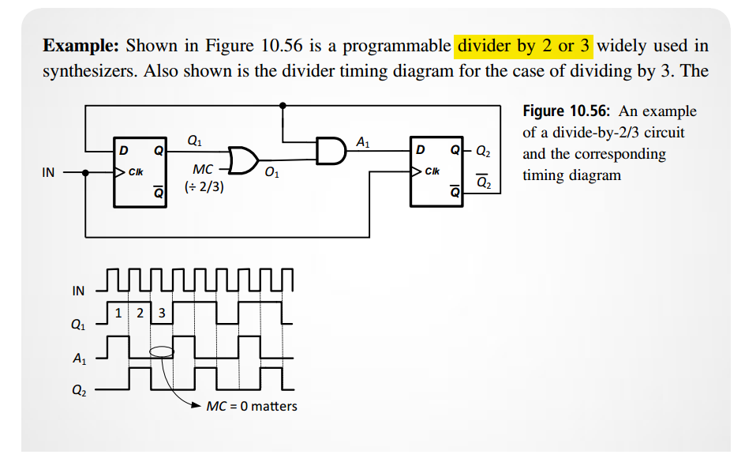

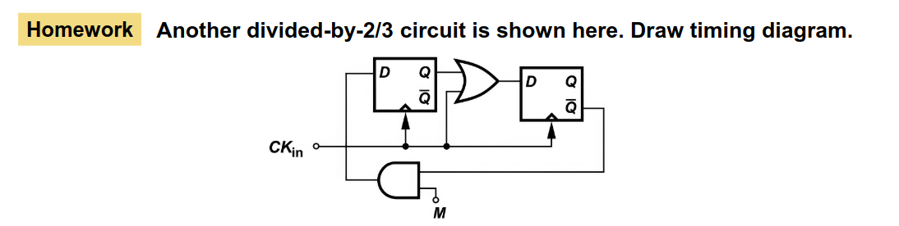

***divide-by-3 w/ 50% duty cycle***

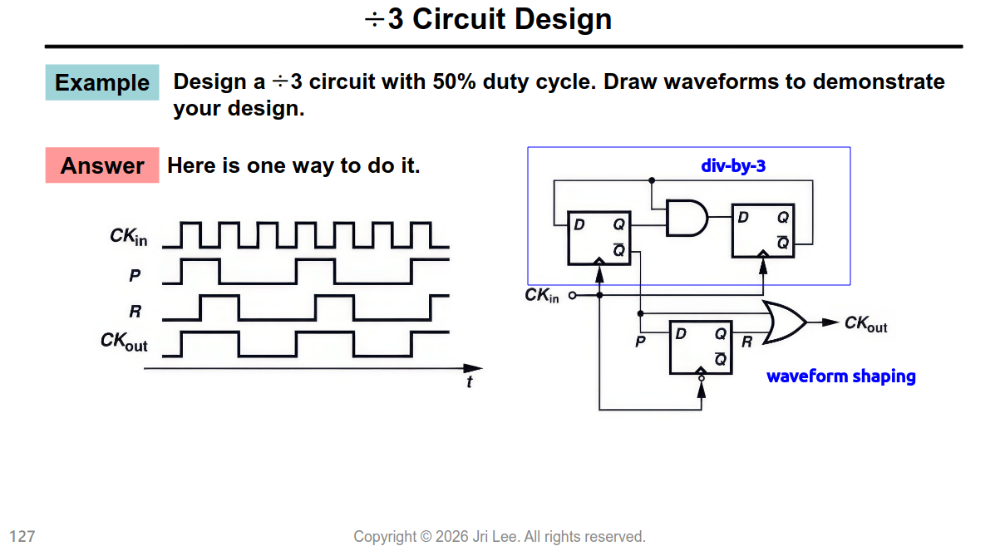

***divide-by-4/5***

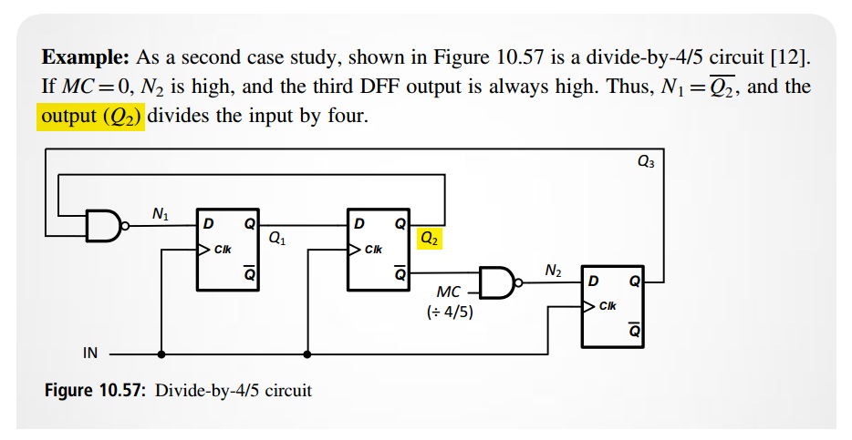

***divide-by-4/5 w/ 50% duty cycle***

Use one mode bit $M$: **$M=0$ selects divide-by-4; $M=1$ selects divide-by-5**

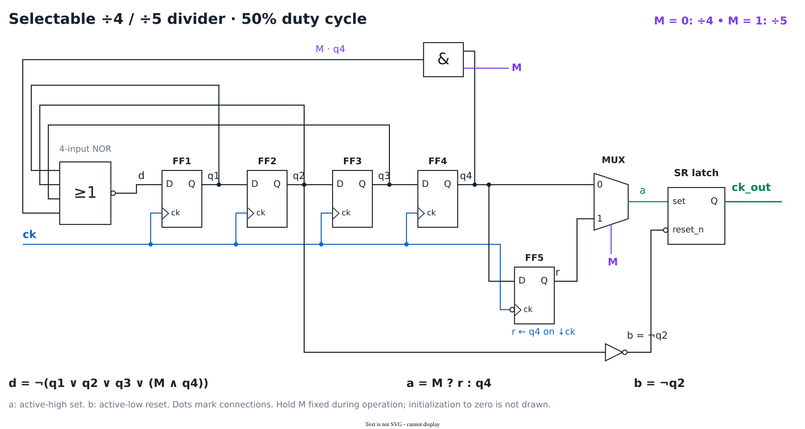

| Mode      | Feedback                       | Set input $a$ | Repeating state sequence $(q_1q_2q_3q_4)$ | Output high / low |
| --------- | ------------------------------ | ------------- | ----------------------------------------- | ----------------- |
| $M=0$: ÷4 | $d=\overline{q_1+q_2+q_3}$     | $q_4$         | $1000\to0100\to0010\to0001\to1000$        | $2T / 2T$         |
| $M=1$: ÷5 | $d=\overline{q_1+q_2+q_3+q_4}$ | $r$           | $1000\to0100\to0010\to0001\to0000\to1000$ | $2.5T / 2.5T$     |

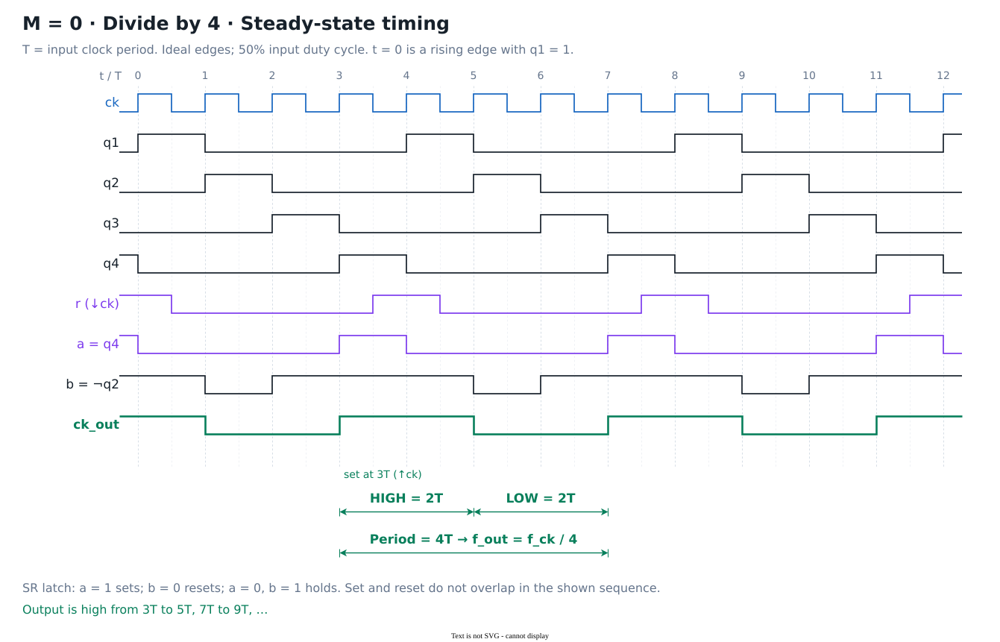

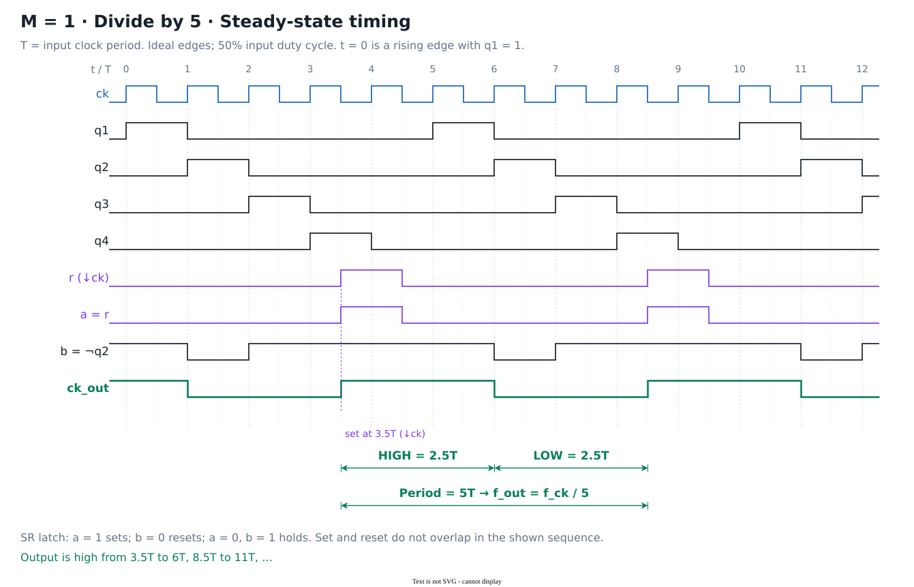

 ***Divide-by-8/9***

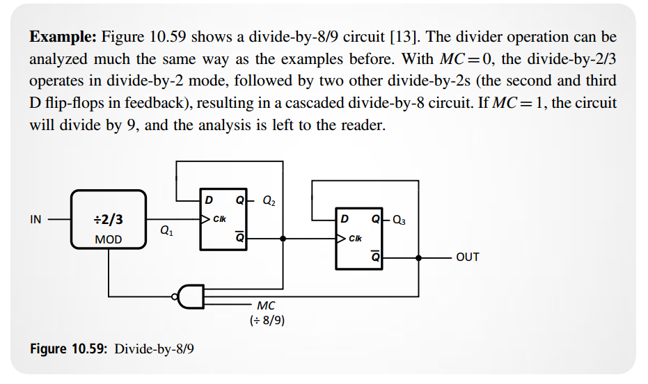

 ***Divide-by-15/16***

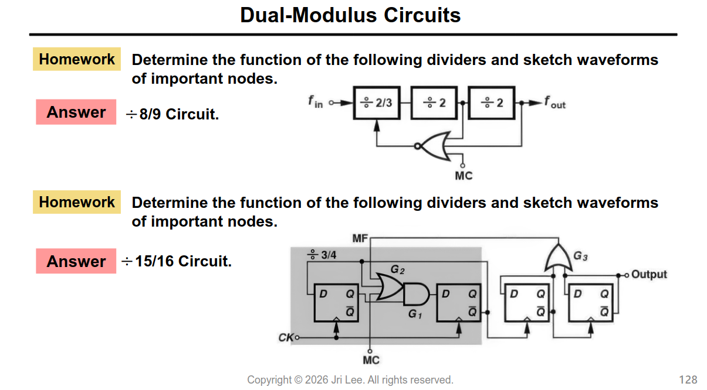

## Multi-Modulus Dividers (MMD)

> B. Razavi, "The Design of a Millimeter-Wave Frequency Divider [The Analog Mind]," in *IEEE Solid-State Circuits Magazine*, vol. 14, no. 4, pp. 6-16, Fall 2022 [[https://www.seas.ucla.edu/brweb/papers/Journals/BR_SSCM_Fall_2022.pdf](https://www.seas.ucla.edu/brweb/papers/Journals/BR_SSCM_Fall_2022.pdf)]
>
> —, "The Design of a Millimeter-Wave Frequency Synthesizer [The Analog Mind]," in *IEEE Solid-State Circuits Magazine*, vol. 15, no. 2, pp. 6-13, Spring 2023 [[https://www.seas.ucla.edu/brweb/papers/Journals/BR_SSCM_2_2023.pdf](https://www.seas.ucla.edu/brweb/papers/Journals/BR_SSCM_2_2023.pdf)]

***wide-range programmable divider using a cascade of divide-by-2/3s***

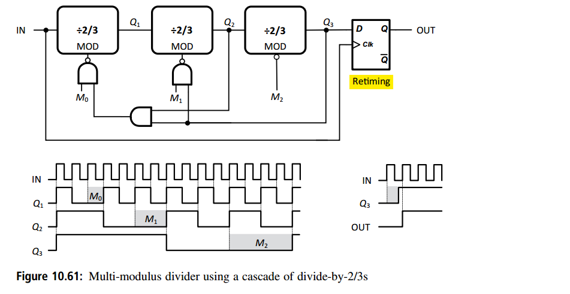

***extra one cycle delay*** vs ***reducing accumulated noise*** from the last retiming DFF

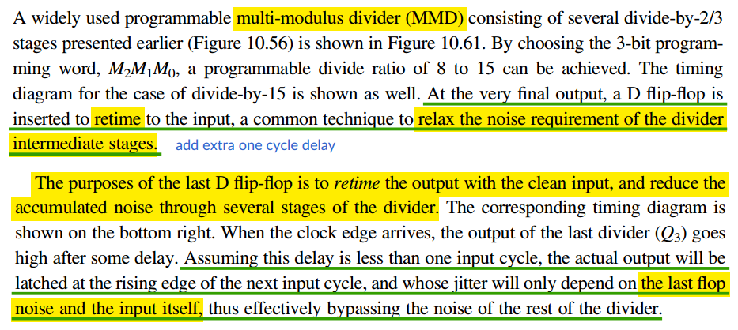

---

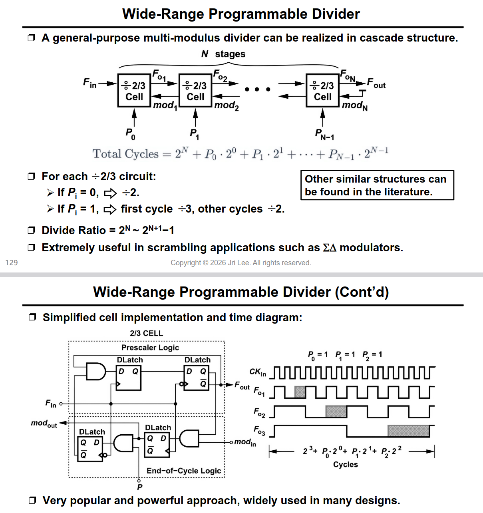

## divide-by-1.5

> US9065449B2 High-speed divide-by-1.5 circuit with 50 percent duty cycle [[https://patents.google.com/patent/US9065449B2](https://patents.google.com/patent/US9065449B2)]
>
> Xu, Haojie & Luo, Bao & Jin, Gaofeng & Feng, Fei & Guo, Huanan & Gao, Xiang & Deo, Anupama. (2022). A Flexible 0.73-15.5 GHz Single LC VCO Clock Generator in 12 nm CMOS. IEEE Transactions on Circuits and Systems II: Express Briefs. 69. 4238 - 4242. [[https://www.researchgate.net/publication/382240520_A_Flexible_073-155_GHz_Single_LC_VCO_Clock_Generator_in_12_nm_CMOS](https://www.researchgate.net/publication/382240520_A_Flexible_073-155_GHz_Single_LC_VCO_Clock_Generator_in_12_nm_CMOS)]

divide-by-3 + frequency doubler

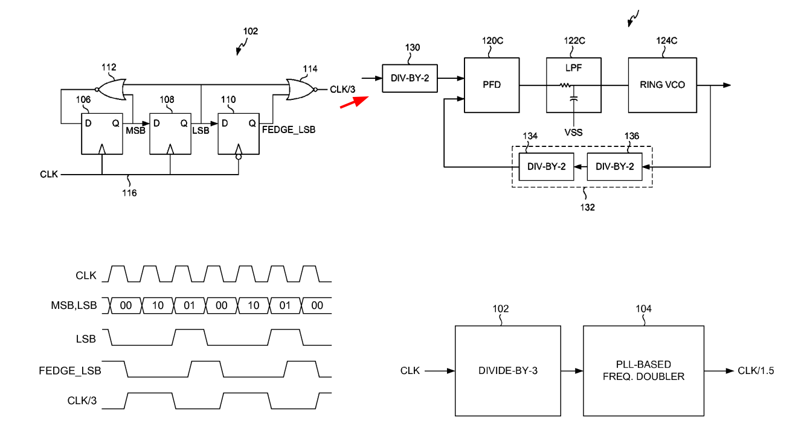

---

divide-by-3 + combinational logic

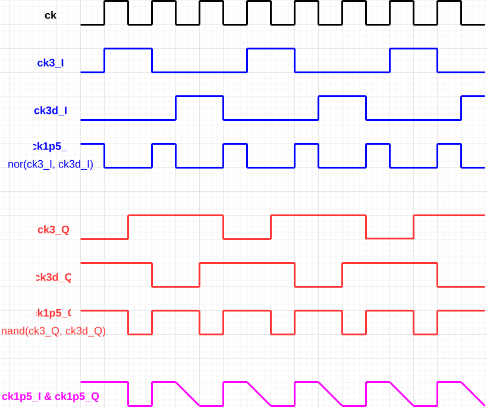

Using PI, ck1p5 & ck1p5_Q with 50% duty cycle

## Frequency Divider Effect

> Gunnman, Kiran, and Mohammad Vahidfar. *Selected Topics in RF, Analog and Mixed Signal Circuits and Systems*. Aalborg: River Publishers, 2017
>
> Arora, Mohit. “Clock Dividers Made Easy.” (2002). [[https://www.mikrocontroller.net/attachment/177198/Clock_Dividers_Made_Easy.pdf](https://www.mikrocontroller.net/attachment/177198/Clock_Dividers_Made_Easy.pdf)]
>
> Darabi H. Radio Frequency Integrated Circuits and Systems. 2nd ed. Cambridge University Press; 2020.

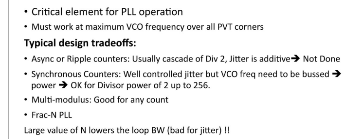

Large values of N lowers the loop BW which is bad for jitter

### Noise in dividers (jitter generation)

> S. Levantino, L. Romano, S. Pellerano, C. Samori and A. L. Lacaita, "Phase noise in digital frequency dividers," in *IEEE Journal of Solid-State Circuits*, vol. 39, no. 5, pp. 775-784, May 2004 [[https://sci-hub.se/10.1109/JSSC.2004.826338](https://sci-hub.se/10.1109/JSSC.2004.826338)]
>
> Lacaita, Andrea Leonardo, Salvatore Levantino, and Carlo Samori. *Integrated frequency synthesizers for wireless systems*. Cambridge University Press, 2007.

*TODO* &#128197;

---

> Enrico Rubiola. Phase Noise and Jitter in Digital Electronics [[https://rubiola.org/pdf-slides/2016T-EFTF--Noise-in-digital-electronics.pdf](https://rubiola.org/pdf-slides/2016T-EFTF--Noise-in-digital-electronics.pdf)]

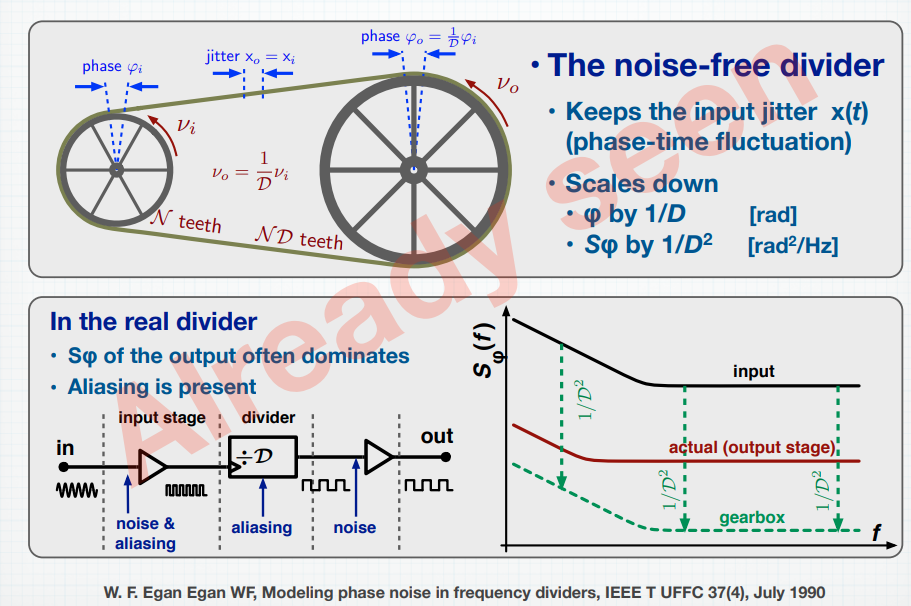

---

> W. F. Egan, "Modeling phase noise in frequency dividers," in IEEE Transactions on Ultrasonics, Ferroelectrics, and Frequency Control, vol. 37, no. 4, pp. 307-315, July 1990 [[https://sci-hub.se/10.1109/58.56498](https://sci-hub.se/10.1109/58.56498)]
>
> PLL + PSS + PNOISE convergence [[https://community.cadence.com/cadence_technology_forums/f/custom-ic-design/48474/pll-pss-pnoise-convergence/1376833](https://community.cadence.com/cadence_technology_forums/f/custom-ic-design/48474/pll-pss-pnoise-convergence/1376833)]

---

Signal Source Analyzer: measurement is based on time-average(or frequency-domain) method

real-time digital oscilloscope: measure sampled jitter directly

> [[https://community.cadence.com/cadence_technology_forums/f/custom-ic-design/41797/inconsistent-phase-noise-results-of-divide-by-2-phase-using-different-pnoise-method/1360890](https://community.cadence.com/cadence_technology_forums/f/custom-ic-design/41797/inconsistent-phase-noise-results-of-divide-by-2-phase-using-different-pnoise-method/1360890)]

### phase margin impact

 **type-I PLLs**

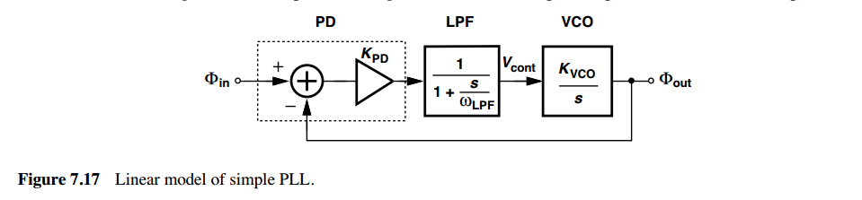

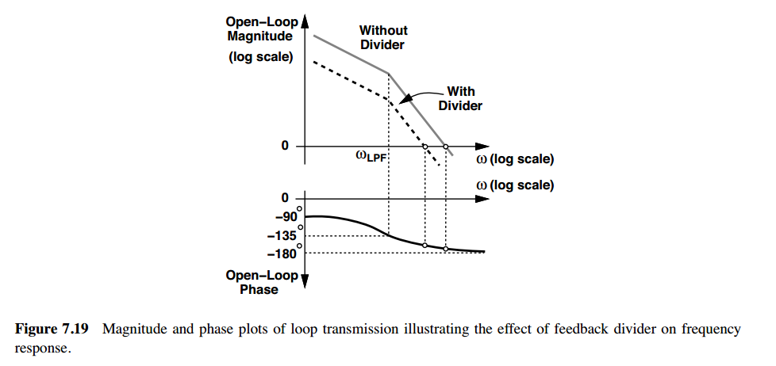

 frequency divider weakens the feedback and ***increases** the phase margin*

---

**type-II PLLs**

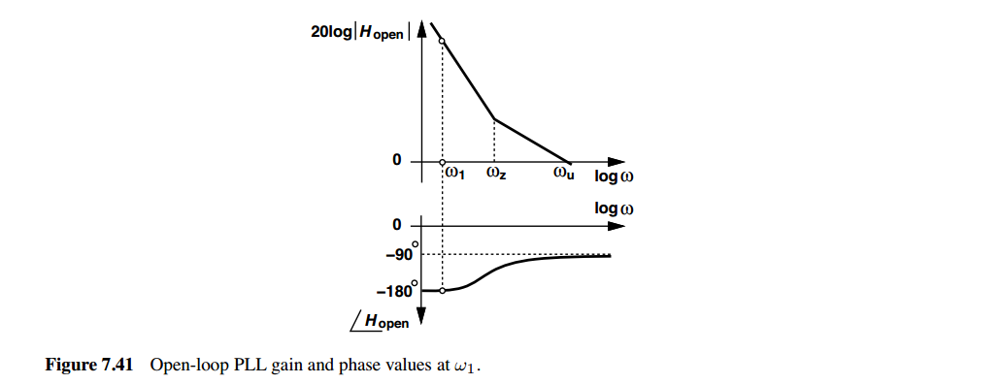

 frequency divider weakens the feedback and ***decrease** the phase margin*

### phase noise & jitter

> [[Timing 101: The Case of the Jitterier Divided-Down Clock, Silicon Labs]](https://community.silabs.com/s/share/a5U1M000000knweUAA/timing-101-the-case-of-the-jitterier-divideddown-clock?language=en_US)
>
> [[How division impacts spurs, phase noise, and phase]](https://www.planetanalog.com/how-division-impacts-spurs-phase-noise-and-phase/)
>
> [[Phase Noise Theory: Ideal Frequency Multipliers and Dividers]](http://www.ko4bb.com/~bruce/IdealFreqMultDiv.html)

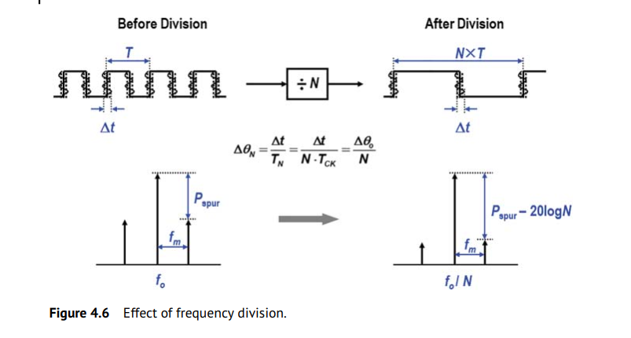

- Multiplying the frequency of a signal by a factor of N using an **ideal** frequency multiplier increases the phase noise of the multiplied signal by $20\log(N)$ dB.
- Similarly dividing a signal frequency by $N$ reduces the phase noise of the output signal by $20\log(N)$  dB

> The sideband offset from the carrier in the frequency multiplied/divided signal is the same as for the original signal.

#### $20\log (N)$ Rule

If the carrier frequency of a clock is divided down by a factor of $N$ then we expect the phase noise to decrease by $20\log(N)$.The primary assumption here is a *noiseless* conventional digital divider.

> The $20\log(N)$ rule only applies to *phase noise* and *not integrated phase noise or phase jitter*. Phase jitter should generally measure about the **same**.

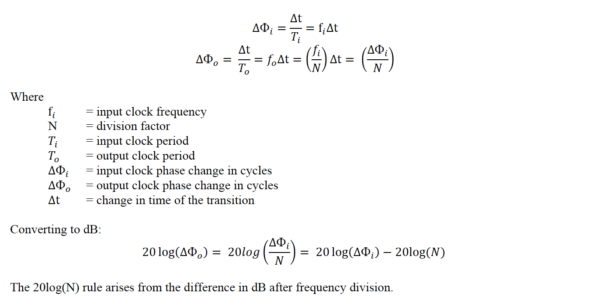

#### What About Phase Jitter?

We integrate *SSB* phase noise *L*(f) [dBc/Hz] to obtain rms phase jitter in seconds as follows for “brick wall” integration from f1 to f2 offset frequencies in Hz and where f0 is the carrier or clock frequency.

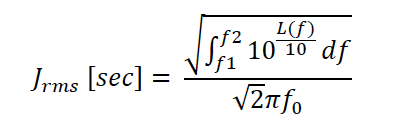

Note that the rms phase jitter in seconds is inversely proportional to f0. When frequency is divided down, the phase noise, *L*(f), goes down by a factor of 20log(N). However, since the frequency goes down by N also, the phase jitter expressed in units of time is constant.

Therefore, phase noise curves, related by 20log(N), with the same phase noise shape over the *jitter bandwidth*, are expected to yield the same phase jitter in seconds.

## Effective Divide Ratio

> Sam Palermo, ECEN620: Network Theory Broadband Circuit Design Fall 2025, *Lecture 10: Fractional-N Frequency Synthesizers* [[https://people.engr.tamu.edu/spalermo/ecen620/lecture10_ee620_fracn_freq_synth.pdf](https://people.engr.tamu.edu/spalermo/ecen620/lecture10_ee620_fracn_freq_synth.pdf)]

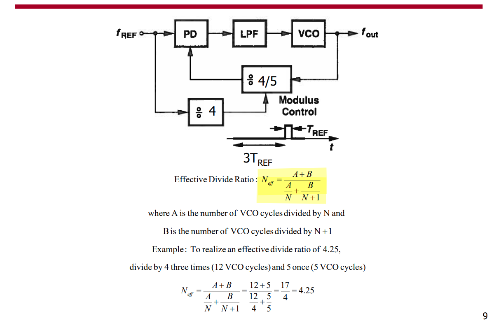

with $M_{ref}$, the number of reference clock cycles
$$
A\cdot \frac{T_{ref}}{N} + B\cdot \frac{T_{ref}}{N+1} = M_{ref} T_{ref} \qquad N_{vco} = A +B
$$

yield effective divide ratio
$$
N_{eff} = \frac{N_{vco}}{M_{ref}} = \boxed{ \frac{A+B}{\frac{A}{N} + \frac{B}{N+1}} } = \textcolor{red}{\frac{\frac{A}{N}}{\frac{A}{N} + \frac{B}{N+1}}}\cdot N + \textcolor{blue}{\frac{\frac{B}{N+1}}{\frac{A}{N} + \frac{B}{N+1}}}\cdot (N+1)
$$

## reference

