## FFE in DSP

> M. A. Kossel *et al*., "8.3 An 8b DAC-Based SST TX Using Metal Gate Resistors with 1.4pJ/b Efficiency at 112Gb/s PAM-4 and 8-Tap FFE in 7nm CMOS," *2021 IEEE International Solid-State Circuits Conference (ISSCC)*, San Francisco, CA, USA, 2021, pp. 130-132 [[https://sci-hub.ru/10.1109/ISSCC42613.2021.9365784](https://sci-hub.ru/10.1109/ISSCC42613.2021.9365784)]
>
> Z. Guo et al., "6.2 A 112.5Gb/s ADC-DSP-Based PAM-4 Long-Reach Transceiver with >50dB Channel Loss in 5nm FinFET," 2022 IEEE International Solid-State Circuits Conference (ISSCC), San Francisco, CA, USA, 2022, pp. 116-118 [[https://sci-net.xyz/10.1109/ISSCC42614.2022.9731650](https://sci-net.xyz/10.1109/ISSCC42614.2022.9731650)]

*TODO* &#128197;

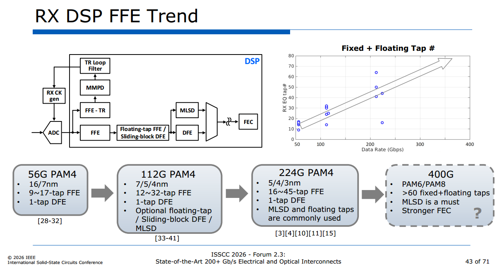

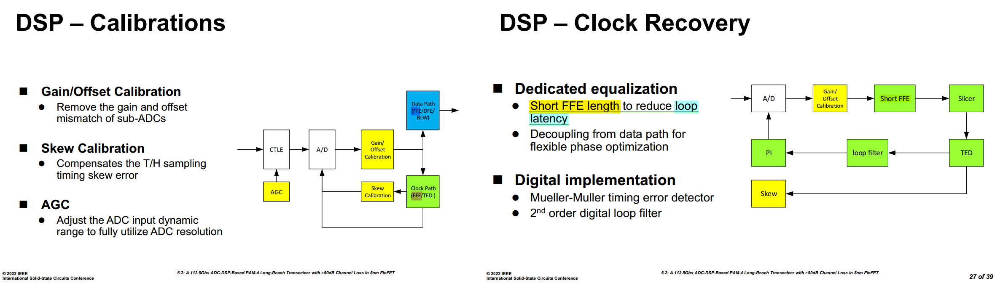


## 1+αD partial FFE response

> D. Pfaff *et al*., "7.3 A 224Gb/s 3pJ/b 40dB Insertion Loss Transceiver in 3nm FinFET CMOS," *2024 IEEE International Solid-State Circuits Conference (ISSCC)*, San Francisco, CA, USA, 2024, pp. 128-130 [[https://sci-net.xyz/10.1109/ISSCC49657.2024.10454537](https://sci-net.xyz/10.1109/ISSCC49657.2024.10454537)]

<span style="background-color:yellow">**Full State MLSD**, **Reduced State MLSD**</span>

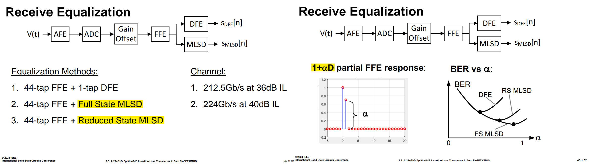

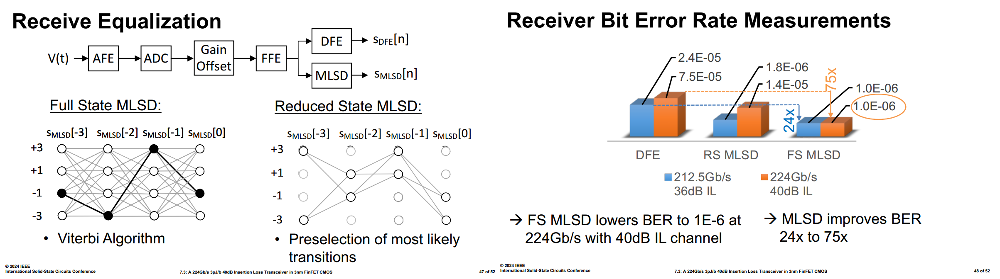


## DFE in DSP

> Synopsys Italia, Tech Talk: Introduction to DSP-based SerDes [[https://youtu.be/puEP0DlVZGI](https://youtu.be/puEP0DlVZGI)]
>
> Chen, Kuan-Chang (2022) *Energy-Efficient Receiver Design for High-Speed Interconnects.* Dissertation (Ph.D.), California Institute of Technology. [[https://thesis.caltech.edu/14318/09/chen_kuan-chang_2022_thesis_final.pdf](https://thesis.caltech.edu/14318/09/chen_kuan-chang_2022_thesis_final.pdf)]


### Loop-Unrolling DFE

> Y. Lu and E. Alon, "Design Techniques for a 66 Gb/s 46 mW 3-Tap Decision Feedback Equalizer in 65 nm CMOS," in IEEE Journal of Solid-State Circuits, vol. 48, no. 12, pp. 3243-3257, Dec. 2013 [[https://sci-hub.ru/10.1109/JSSC.2013.2278804](https://sci-hub.ru/10.1109/JSSC.2013.2278804)]

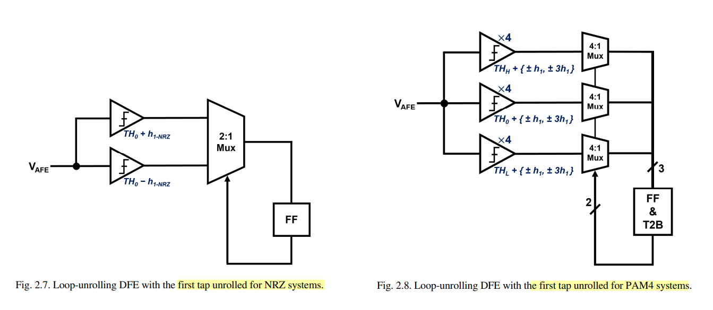

Corresponding to the three distinct voltage thresholds in the *PAM4* systems, it would need *12 slicers, 3 multiplexers*, and *one thermometer-to-binary decoder* in each deserialized data path, even if only one tap of the DFE is unrolled


### Look-Ahead DFE

> K. K. Parhi, "Pipelining of parallel multiplexer loops and decision feedback equalizers," 2004 IEEE International Conference on Acoustics, Speech, and Signal Processing, Montreal, QC, Canada, 2004, pp. V-21 [[https://sci-hub.ru/10.1109/ICASSP.2004.1327037](https://sci-hub.ru/10.1109/ICASSP.2004.1327037)]

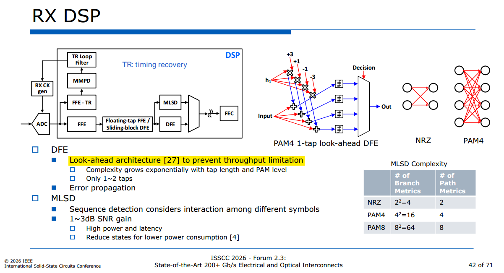

The look-ahead multiplexing technique brings the key benefit that the timing constraint can be significantly relaxed, as the iteration bound is ***doubled*** at the expense of extra hardware

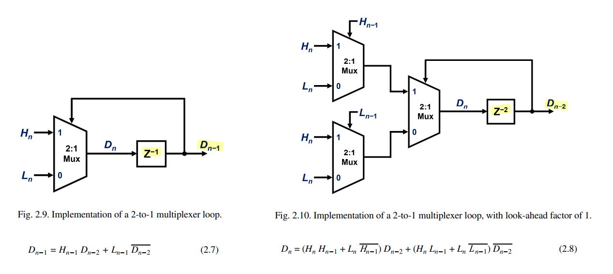


### Sliding-Block DFE

> J. Bailey et al., "A 112-Gb/s PAM-4 Low-Power Nine-Tap Sliding-Block DFE in a 7-nm FinFET Wireline Receiver," in IEEE Journal of Solid-State Circuits, vol. 57, no. 1, pp. 32-43, Jan. 2022 [[https://sci-hub.jp/10.1109/JSSC.2021.3109167](https://sci-hub.jp/10.1109/JSSC.2021.3109167)]

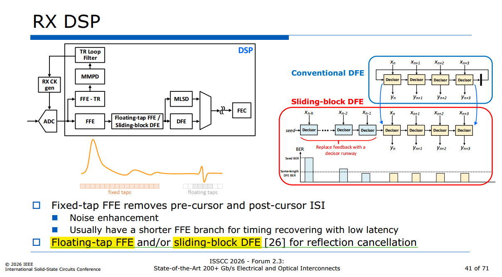

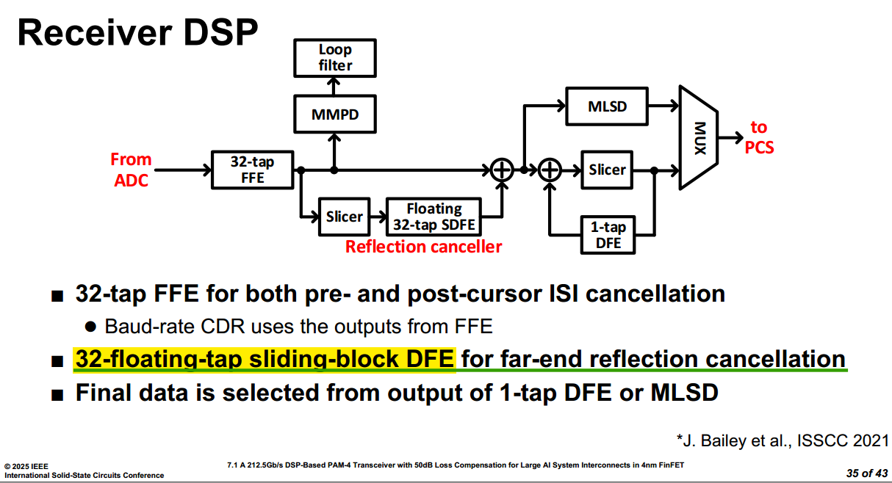


## time-division data conversion

<span style="color:white; background-color:black">**wide_to_narrow**</span>

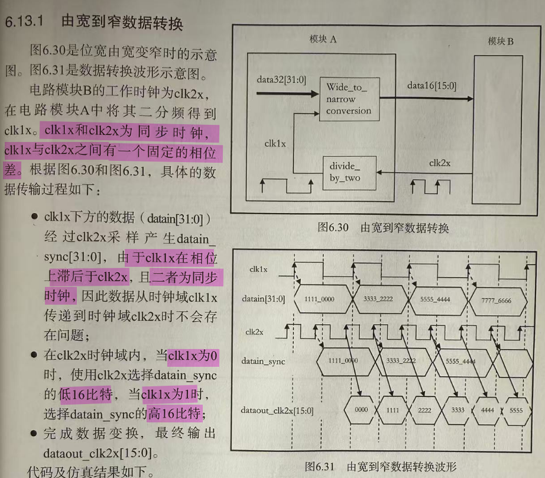

```verilog
module wide_to_narrow
(
    clk2x,
    clk1x,
    datain,
    dataout_clk2x
);

input         clk2x;
input         clk1x;
input  [31:0] datain;
output [15:0] dataout_clk2x;

// **********************************************

reg  [31:0] datain_sync;
reg  [15:0] dataout_clk2x;
wire [15:0] dataout_clk2x_nxt;

// Flop the data first with clk2x. Reset is not required as it is a datapath and
// default (reset) value of the flops are don't care.
// ************************************************

always @(posedge clk2x)
begin
    datain_sync <= datain;
end

// Select the lower and upper halves from datain_sync
// ************************************************

assign dataout_clk2x_nxt = !clk1x ? datain_sync[15:0] : datain_sync[31:16];

// Flop the selected 16 bit data with clk2x and drive out
// ************************************************

always @(posedge clk2x)
begin
    dataout_clk2x <= dataout_clk2x_nxt;
end

endmodule
```

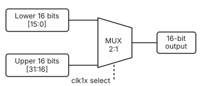


<span style="color:white; background-color:black">**narrow_to_wide**</span>

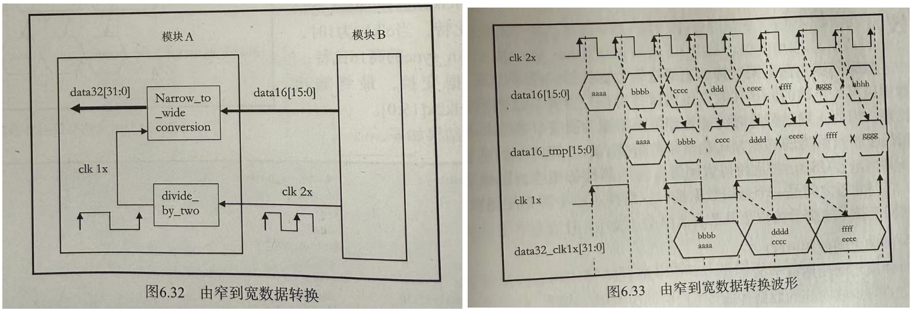

```verilog
module narrow_to_wide
(
    clk2x,
    clk1x,
    data16,
    data32_clk1x
);

input         clk2x;
input         clk1x;
input  [15:0] data16;
output [31:0] data32_clk1x;

// ************************************************

reg [15:0] data16_tmp;
reg [31:0] data32_clk1x, data32_clk1x_nxt;

/*
Store temporary data into a register so that we can use 16 bits
of incoming data along with the 16 bits of tmp data stored in
previous cycle to form 32 bits of data.

These 32 bits of data is flopped with clk1x, and this happens
for every two-clock periods of clk2x.

When data is passed from 2x (fast) to the 1x (slow) domain,
make sure that there is enough delay in the data path to avoid
set-up/hold violation in the immediate rising edge of 1x clock.
The data should have more delay in the path to pass beyond
the immediate rising edge of 1x clock.
*/

// ************************************************

always @(posedge clk2x)
begin
    data16_tmp <= #2 data16;
end

// Form the 32-bit data
assign data32_clk1x_nxt = {data16[15:0], data16_tmp[15:0]};

// Flop the selected 16 bit data with clk2x and drive out
always @(posedge clk1x)
begin
    data32_clk1x <= data32_clk1x_nxt;
end

endmodule
```

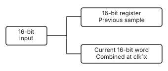


## MASH 1-1-1 in DSP

> MASH-1-1-1 Noise-Shaping Truncator (DLF → DAC) [[https://github.com/raytroop/dsmwk](https://github.com/raytroop/dsmwk)]

Digital block between a **20-bit digital loop filter (DLF) output** and an **8-bit DAC input**. The 12 truncated LSBs are pushed through a MASH-1-1-1 delta-sigma modulator so the truncation error is 3rd-order noise-shaped instead of lost:

```
dac(z) = dlf(z)/2^12  -  (1 - z^-1)^3 · q(z)              (× z^-1 latency)

q ≜ e3/2^12 ∈ [0,1) LSB₈,  σ² ≈ 1/12 LSB₈²
```

where `e3` is the stage-3 accumulator residue in raw 20-bit-LSB counts (0…4095, quantizer step 2¹²) and `q` is the same error referred to the 8-bit output grid — the unit-step quantization noise of the effective 1-LSB₈ quantizer.

> <span style="color:blue">dac(z) = dlf<sub>MSB8</sub> (z)/2<sup>12</sup> + dlf<sub>LSB12</sub> (z)/2<sup>12</sup>+ q(z) · (1 - z<sup>-1</sup>)<sup>3</sup> = dlf(z)/2<sup>12</sup> +   q(z) · (1 - z<sup>-1</sup>)<sup>3</sup></span>


```
 dlf_in[19:12] ─────────────────────────────────┐
                                                ▼
 dlf_in[11:0] ──► ACC1 ──c1──────────────────► (+) ──sat[0,255]──► reg ──► dac_out[7:0]
                   │r1                          ▲
                   └──► ACC2 ──c2──(1-z⁻¹)──────┤
                         │r2                    │
                         └──► ACC3 ──c3──(1-z⁻¹)²
```


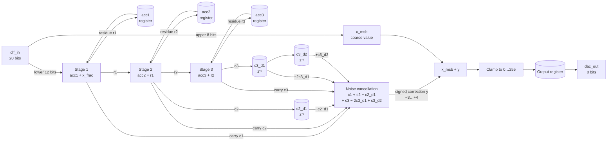


| Branch    | Expression                             | Range        |
| --------- | -------------------------------------- | ------------ |
| stage 1   | `c1`                                   | {0, 1}       |
| stage 2   | `(1−z⁻¹)·c2` = `c2 − c2_d1`            | {−1, 0, +1}  |
| stage 3   | `(1−z⁻¹)²·c3` = `c3 − 2·c3_d1 + c3_d2` | [−2, +2]     |
| **total** | `y`                                    | **[−3, +4]** |


```verilog
 wire signed [5:0] y =
          $signed({5'b0, c1})
        + $signed({5'b0, c2})   - $signed({5'b0, c2_d1})
        + $signed({5'b0, c3})   - $signed({4'b0, c3_d1, 1'b0})  // 2*c3_d1
        + $signed({5'b0, c3_d2});
```

Each carry is a bare bit `{0,1}`. `{5'b0, c1}` zero-extends it to 6 bits (value unchanged), and `$signed(...)` marks it for signed arithmetic. The term `{4'b0, c3_d1, 1'b0}` is `c3_d1` with a zero appended — a shift-left-by-1, i.e. `2·c3_d1` (value 0 or 2) — so the multiply costs nothing.

The reachable values of `y` and their actual bit patterns:

| value | `y[5:0]` |      | value | `y[5:0]` |
| ----: | -------- | ---- | ----: | -------- |
|    +4 | `000100` |      |     0 | `000000` |
|    +3 | `000011` |      |    −1 | `111111` |
|    +2 | `000010` |      |    −2 | `111110` |
|    +1 | `000001` |      |    −3 | `111101` |

Worked example: `c1=0, c2=0, c2_d1=1, c3=0, c3_d1=1, c3_d2=0` → `y = 0 + (0−1) + (0−2+0) = −3` → `111101`.


***clamp [-3, 259] to [0, 255]***

For `msb ∈ [3, 251]`, `x_msb + y` never leaves [0,255], the mux always takes the pass-through leg, and `dac_sat ≡ dac_sum` bit-for-bit.

```verilog
//-------------------------------------------------------------------------
// Recombine and saturate: dac = clamp(x_msb + y, 0, 2^OUT_W-1)
//   sum range [-3, 2^OUT_W-1+4] -> (OUT_W+2)-bit signed is sufficient
//   (needs 2^(OUT_W+1) >= 2^OUT_W + 4, true for any OUT_W >= 2)
//-------------------------------------------------------------------------
// explicit sign-extension of y to adder width (assumes OUT_W >= 5)
wire signed [OUT_W+1:0] y_ext   = {{(OUT_W-4){y[5]}}, y};
wire signed [OUT_W+1:0] dac_sum = $signed({2'b0, x_msb}) + y_ext;

wire [OUT_W-1:0] dac_sat =
      dac_sum[OUT_W+1] ? {OUT_W{1'b0}} :   // negative  -> 0
      dac_sum[OUT_W]   ? {OUT_W{1'b1}} :   // > max     -> 2^OUT_W-1
      dac_sum[OUT_W-1:0];
```

In a locked PLL the DLF integrator sits mid-range and the **clamp never fires** — cost: zero. It engages only during acquisition/slew, where noise is irrelevant and its job is exactly right: drive the DAC monotonically to the rail without wrapping


---

---

<span style="color:blue">***overall ENOB calculation***</span>

```
SNR  = P_sig / (P_q,in + P_dsm)          (powers add — sources are independent)
ENOB = (SNR_dB − 1.76) / 6.02
```

with everything in the same units (<span style="color:blue">LSB₈²</span> is convenient) and — critically — **both noise terms integrated in-band only** (0 … f_bw, i.e. what survives the analog filter):

| Term                                | Expression (<span style="color:blue">LSB₈²</span>, fs = f_clk) |
| ----------------------------------- | ------------------------------------------------------------ |
| Signal (full-scale sine convention) | `P_sig = FS²/8 = 256²/8 = 8192`                              |
| DSM shaped noise, in-band           | `P_dsm = (1/12)·(π⁶/7)·OSR⁻⁷`                                |
| Input quantization noise, in-band   | <span style="color:blue">P_q,in = (2⁻¹²)²/12 · κ</span>      |

**Sanity check at OSR = 50** (static input, κ=1): `P_q,in = 4.97e-9`, `P_dsm = 1.47e-11` → SNR = 122.1 dB → **ENOB = 19.98** — the DSM costs only 0.13 dB against the ideal 20.00. At OSR = 10: DSM dominates, ENOB = 16.1 


## RTL module

> Wei Yet, MakerCode RTL Challenge [[https://github.com/Weiyet/MakerCode_RTLChallenge](https://github.com/Weiyet/MakerCode_RTLChallenge)]

### decimation_filter

<span style="color:white; background-color:black">**Filter Equation**</span>

```
filtered[n] = (1*x[n] + 3*x[n-1] + 3*x[n-2] + 1*x[n-3]) / 8
y[k] = filtered[k*DECIMATION_FACTOR]
```

```bash
iverilog -g2012 -o sim.vvp solution.sv tb.sv

vvp sim.vvp +VCDFILE=output.vcd


```


```verilog
module decimation_filter #(
    parameter DATA_WIDTH = 8,
    parameter DECIMATION_FACTOR = 4
)(
    input  wire                       clk,
    input  wire                       reset,
    input  wire signed [DATA_WIDTH-1:0]    data_in,
    input  wire                       data_valid_in,
    output wire signed [DATA_WIDTH-1:0]    data_out,
    output wire                       data_valid_out
);

    localparam COUNTER_WIDTH = $clog2(DECIMATION_FACTOR);
    
    // FIR filter coefficients: [1, 3, 3, 1] (normalized by 8)
    reg signed [DATA_WIDTH-1:0] x1, x2, x3;
    reg signed [DATA_WIDTH+3:0] filtered;
    reg [COUNTER_WIDTH-1:0] sample_counter;
    reg valid_out_reg;
    reg signed [DATA_WIDTH-1:0] output_reg;
    
    always @(posedge clk) begin
        if (reset) begin
            x1 <= {DATA_WIDTH{1'b0}};
            x2 <= {DATA_WIDTH{1'b0}};
            x3 <= {DATA_WIDTH{1'b0}};
            sample_counter <= {COUNTER_WIDTH{1'b0}};
            valid_out_reg <= 1'b0;
            output_reg <= {DATA_WIDTH{1'b0}};
        end else if (data_valid_in) begin
            // Update delay line
            x3 <= x2;
            x2 <= x1;
            x1 <= data_in;
            
            // Apply FIR filter: (1*x[n] + 3*x[n-1] + 3*x[n-2] + 1*x[n-3]) / 8
            filtered = data_in + (x1 << 1) + x1 + (x2 << 1) + x2 + x3;
            
            // Increment sample counter
            if (sample_counter == DECIMATION_FACTOR - 1) begin
                sample_counter <= {COUNTER_WIDTH{1'b0}};
                valid_out_reg <= 1'b1;
                output_reg <= filtered >>> 3;  // Divide by 8
            end else begin
                sample_counter <= sample_counter + 1'b1;
                valid_out_reg <= 1'b0;
            end
        end else begin
            valid_out_reg <= 1'b0;
        end
    end
    
    assign data_out = output_reg;
    assign data_valid_out = valid_out_reg;

endmodule
```

Line 34 uses **non-blocking** assignment:

```systemverilog
x1 <= data_in;   // line 34: scheduled, NOT applied yet
...
filtered = data_in + (x1<<1) + x1 + ...;  // line 37: x1 still holds OLD value
```

Non-blocking assignments don't take effect until the **end** of the current time step (after all the blocking statements in the block have run). So at line 37:

- `x1` still holds its **previous** value — i.e. the sample from the *last* `data_valid_in` cycle, which is `x[n-1]`.
- `data_in` is the **current** sample, `x[n]`.

They are different values. That's deliberate and necessary for the FIR math to be correct:

```
filtered = 1*x[n]   + 3*x[n-1] + 3*x[n-2] + 1*x[n-3]
         = data_in  + 3*x1     + 3*x2     + 1*x3
```

| Symbol    | Value at line 37 | Filter tap |
| --------- | ---------------- | ---------- |
| `data_in` | x[n] (current)   | coeff 1    |
| `x1`      | x[n-1]           | coeff 3    |
| `x2`      | x[n-2]           | coeff 3    |
| `x3`      | x[n-3]           | coeff 1    |

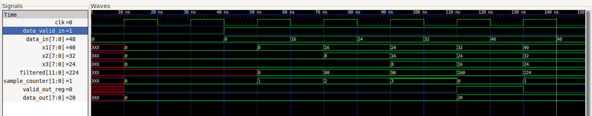


### gray-code


```verilog
function automatic logic [3:0] bin2gray(input logic [3:0] bin);
    bin2gray = bin ^ (bin >> 1);
endfunction
```


```verilog
function automatic logic [3:0] bin2gray(input logic [3:0] bin);
    assign bin2gray[3] = bin[3];
    assign bin2gray[2] = bin[3] ^ bin[2];
    assign bin2gray[1] = bin[2] ^ bin[1];
    assign bin2gray[0] = bin[1] ^ bin[0];
endfunction
```


## Sign Extension In Verilog

> [[https://www.ece.ucdavis.edu/~bbaas/281/notes/Handout.sign.extension.pdf]](https://www.ece.ucdavis.edu/~bbaas/281/notes/Handout.sign.extension.pdf)

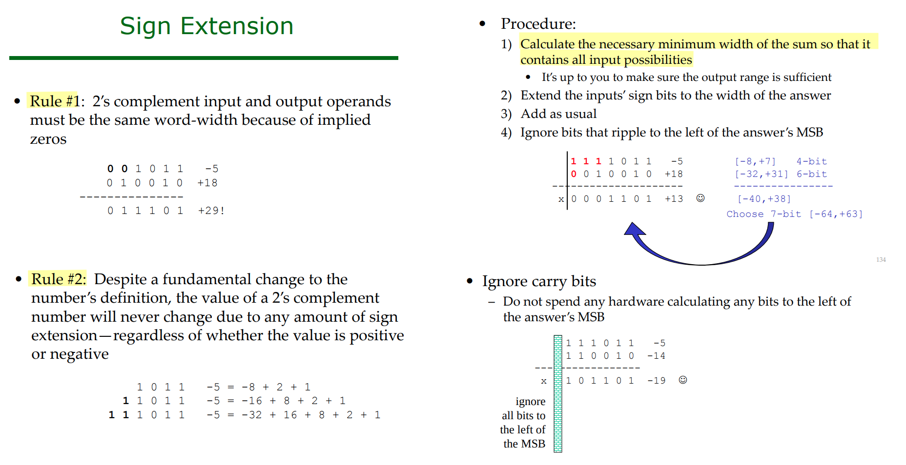

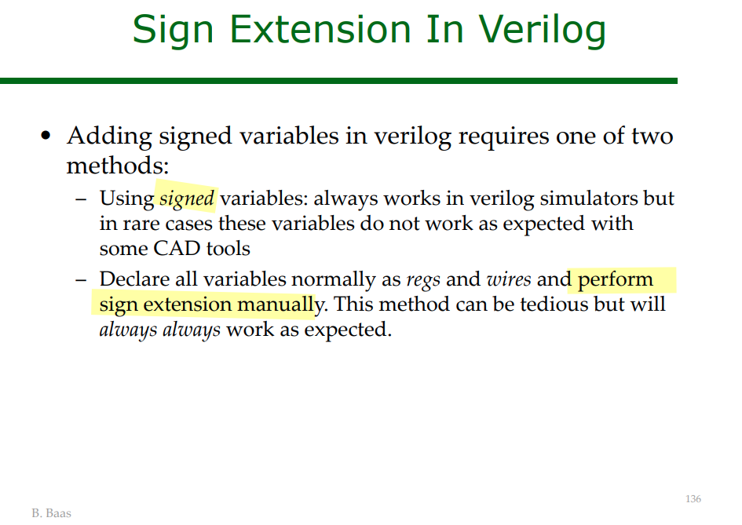

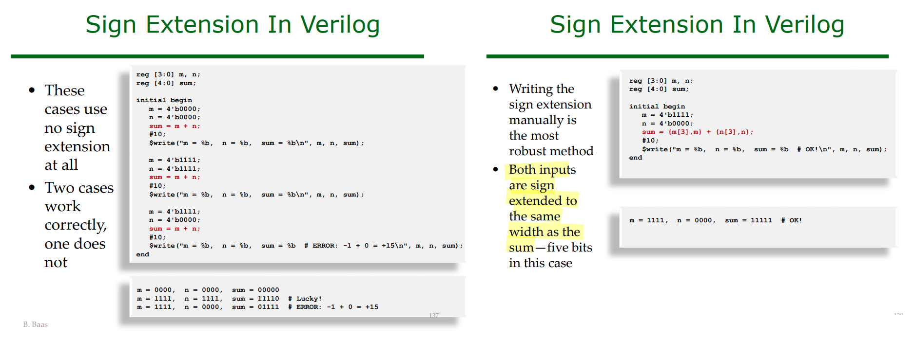


## reference

K. K. Mishra, Advanced Chip Design: Practical Examples in Verilog. CreateSpace Independent Publishing Platform, 2013

Wei Yet, MakerCode RTL Challenge [[https://github.com/Weiyet/MakerCode_RTLChallenge](https://github.com/Weiyet/MakerCode_RTLChallenge)]

Bevan Baas, EEC281 VLSI Digital Signal Processing,  [[https://www.ece.ucdavis.edu/~bbaas/281/](https://www.ece.ucdavis.edu/~bbaas/281/)]

Mark Horowitz. EE371: Advanced VLSI Circuit Design Spring 2006-2007 [[https://web.stanford.edu/class/archive/ee/ee371/ee371.1066/](https://web.stanford.edu/class/archive/ee/ee371/ee371.1066/)]

Tinoosh Mohsenin. CMPE 691: Digital Signal Processing Hardware Implementation [[https://userpages.cs.umbc.edu/tinoosh/cmpe691/](https://userpages.cs.umbc.edu/tinoosh/cmpe691/)]

Keshab K. Parhi [[http://www.ece.umn.edu/users/parhi/](http://www.ece.umn.edu/users/parhi/)]

謝秉璇. 2019 積體電路設計導論 [[link](https://nthuee.org/archive//%E7%A9%8D%E9%AB%94%E9%9B%BB%E8%B7%AF%E8%A8%AD%E8%A8%88%E5%B0%8E%E8%AB%96/2019%E8%AC%9D%E7%A7%89%E7%92%87/)]

E-Hung Chen, MTK, ISSCC 2026 Forum *F2.3: State-of-the-Art 200+ Gb/s Electrical and Optical Interconnects*
