<span style="color:blue"> ***why fixed-point arithmetic?***</span>

<span style="color:blue">Because the **dynamic range of the incoming physical signal** is tightly controlled by an Analog Front End (AFE) using Automatic Gain Control (AGC), **a massive floating-point dynamic range isn't necessary**</span>


## Number Systems

> Harris, David Money, and Sarah L. Harris. *Digital Design and Computer Architecture*. 2nd ed. Morgan Kaufmann, 2013. [[pdf](https://github.com/last-genius/comp_arch_list/blob/master/books/Digital%20Design%20and%20Computer%20Architecture.%20ARM%20Edition%20by%20Sarah%20Harris%2C%20David%20Harris.pdf)]

***integers***

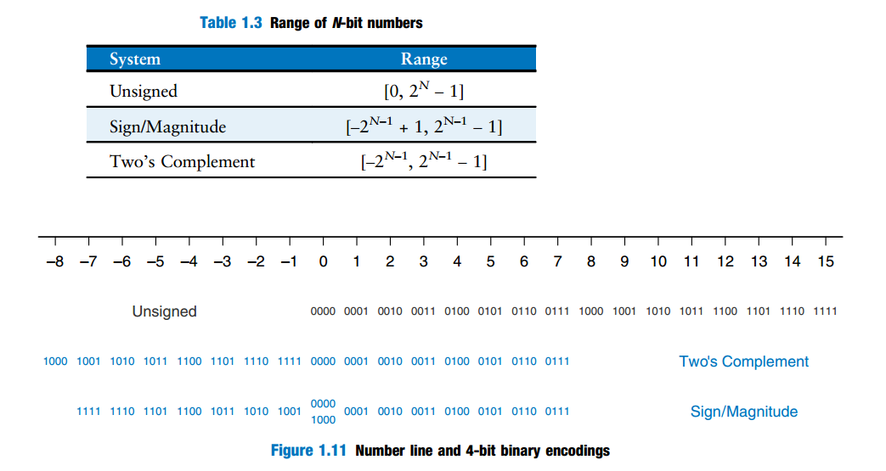

***rational number***

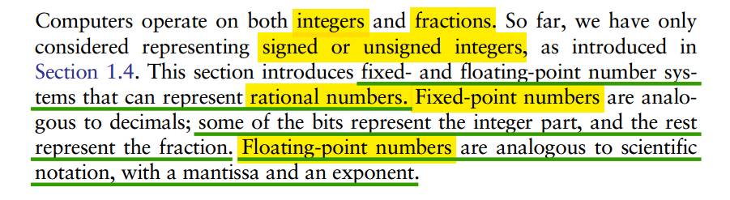

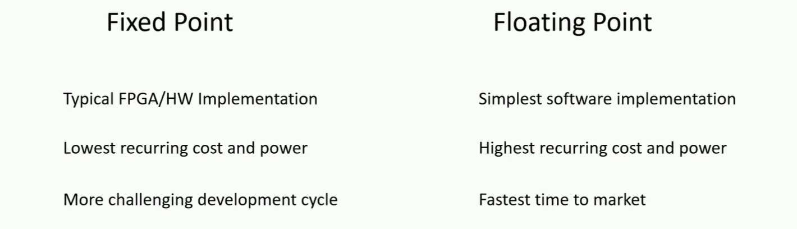


### 2's Complement

> [[https://bpb-us-w2.wpmucdn.com/sites.coecis.cornell.edu/dist/4/81/files/2019/06/4740_lecture23ALU-circuits.pdf](https://bpb-us-w2.wpmucdn.com/sites.coecis.cornell.edu/dist/4/81/files/2019/06/4740_lecture23ALU-circuits.pdf)]

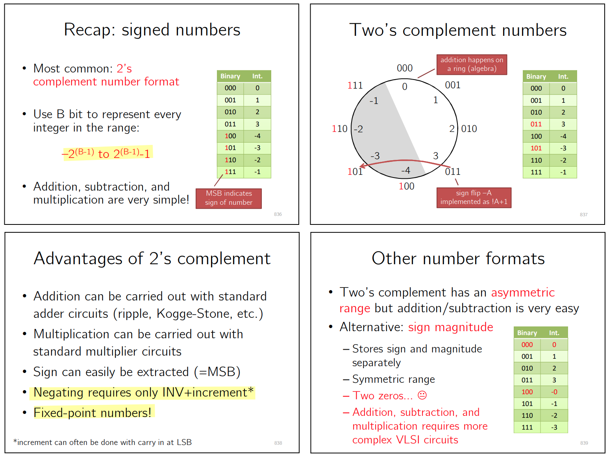


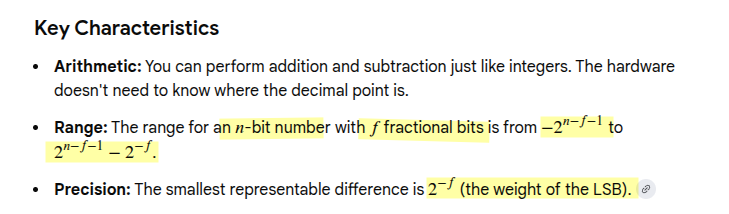


---

---

***2's complement negative number***

> Flip all bits then Add **1**

N-bit signed number
$$
A = -M_{N-1}2^{N-1}+\sum_{k=0}^{N-2}M_k2^k
$$
Flip all bits
$$\begin{align}
A_{flip} &= -(1-M_{N-1})2^{N-1} +\sum_{k=0}^{N-2}(1-M_k)2^k \\
&= M_{N-1}2^{N-1}-\sum_{k=0}^{N-2}M_k2^k -2^{N-1}+\sum_{k=0}^{N-2}2^k \\
&= M_{N-1}2^{N-1}-\sum_{k=0}^{N-2}M_k2^k -1
\end{align}$$

Add **1**
$$
A_- = A_{flip}+1 = M_{N-1}2^{N-1}-\sum_{k=0}^{N-2}M_k2^k = -A
$$


### Fixed Point Number

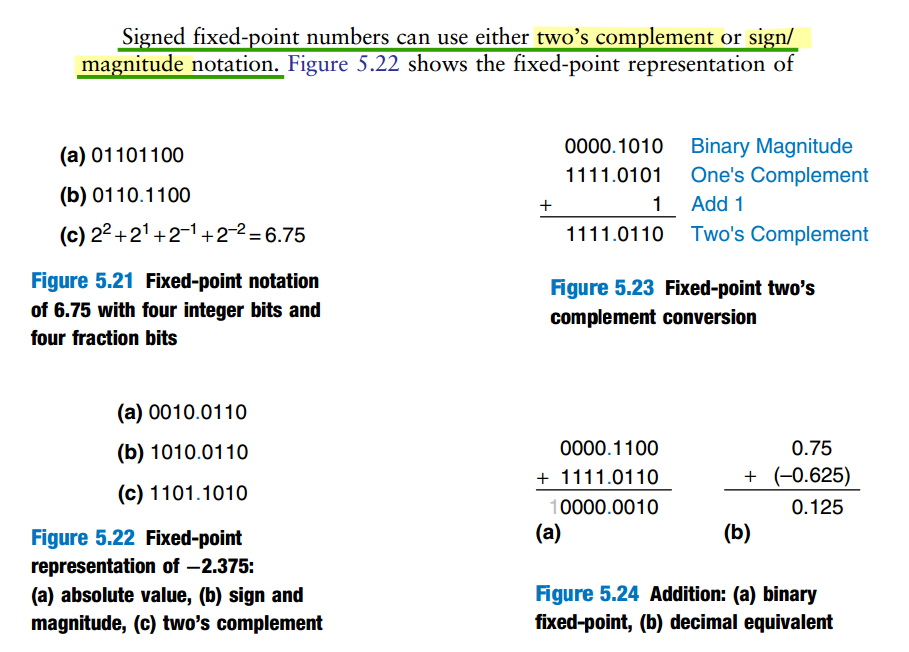


### $Q$-Format

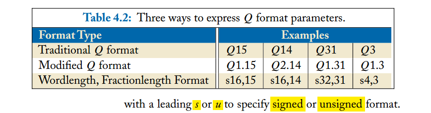

The **Q notation** is a way to specify the parameters of a **binary fixed point number format**

`Q0.3` is a notation for a **fixed-point binary number format**.
$$
\boxed{Q0.3
=
\text{sign bit}
+
0\text{ integer bits}
+
3\text{ fractional bits}}
$$


---

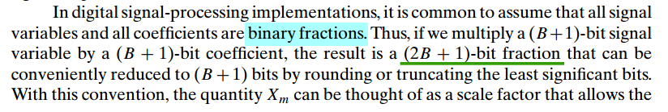

The useful **fixed-point multiplication** rule is
$$
Q_{F_1} \times Q_{F_2}
\;\Rightarrow\;
F_{\text{product}} = F_1 + F_2
$$
where $F_1$ and $F_2$ are the numbers of fractional bits of the two operands

4-bit words are

```
a      = 0.100  -> 0100
y_hat  = 0.111  -> 0111
```

Now temporarily ignore the binary point and multiply the integer bit patterns:

```
      0100        (= 4)
    × 0111        (= 7)
    -------
      0100
     0100
    0100
   0000
    -------
   0011100        (= 28)
```


---

---

***Different sources use slightly different $Q$-format conventions***

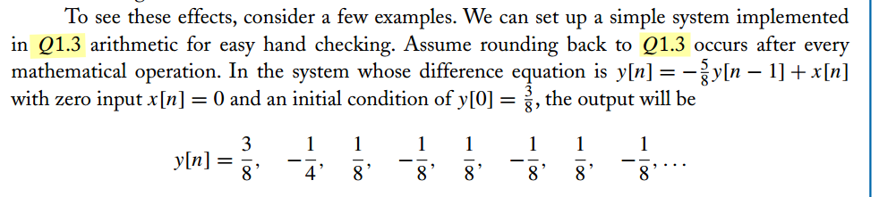

**$Q1.3$ means that the `1` includes the sign bit.**
$$
Q1.3
=
\underbrace{1\text{ bit}}_{\text{sign / integer side}}
+
\underbrace{3\text{ fractional bits}}_{\text{fractional side}}
$$
So it is a **4-bit two's-complement fixed-point number**: 

```
 b3 . b2 b1 b0
 ↑      ↑ ↑ ↑
sign    3 fractional bits
```


### Floating-point Number in IEEE 754 Format

> Floating-point data in IEEE 754 Format [[https://github.com/IC-Design-Lab/IC-Design/blob/main/Training/Floating-point%20data%20in%20IEEE%20754%20Format.pdf](https://github.com/IC-Design-Lab/IC-Design/blob/main/Training/Floating-point%20data%20in%20IEEE%20754%20Format.pdf)]
>
> Rajaraman, V.. “IEEE standard for floating point numbers.” *Resonance* 21 (2016): 11 - 30. [[https://www.ias.ac.in/article/fulltext/reso/021/01/0011-0030](https://www.ias.ac.in/article/fulltext/reso/021/01/0011-0030)]
>
> IEEE Standard for Floating-Point Arithmetic [[https://www-users.cse.umn.edu/~vinals/tspot_files/phys4041/2020/IEEE%20Standard%20754-2019.pdf](https://www-users.cse.umn.edu/~vinals/tspot_files/phys4041/2020/IEEE%20Standard%20754-2019.pdf)]
>
> Dennis Forbes. Understanding Floating-Point Numbers [[https://dennisforbes.ca/blog/features/floating_point/understanding-floating-point-numbers/](https://dennisforbes.ca/blog/features/floating_point/understanding-floating-point-numbers/)]
>
> Bevan Baas, EEC 281 - VLSI Digital Signal Processing Winter 2025 [[FLOATING POINT](https://www.ece.ucdavis.edu/~bbaas/281/notes/Handout.float.pt.pdf)] [[ FLOATING POINT <---> FIXED POINT CONVERSION ](https://www.ece.ucdavis.edu/~bbaas/281/notes/Handout.float.convert.pdf)]

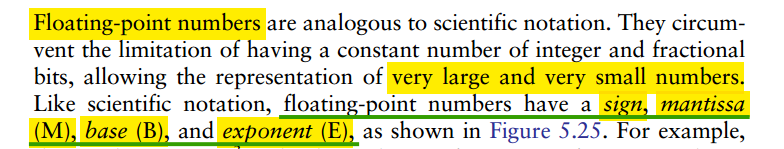

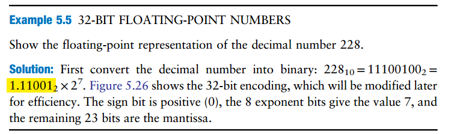

|                                      |                                |                                                              |
| ------------------------------------ | ------------------------------ | ------------------------------------------------------------ |
| **32-bit floating-point version 1**  | store *implicit leading one*   | 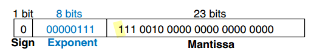 |
| **32-bit floating-point version 2**  | discard *implicit leading one* | 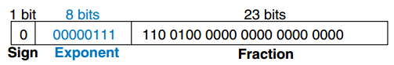 |
| **IEEE 754 floating point notation** | ***biased exponent***          | 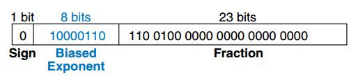 |

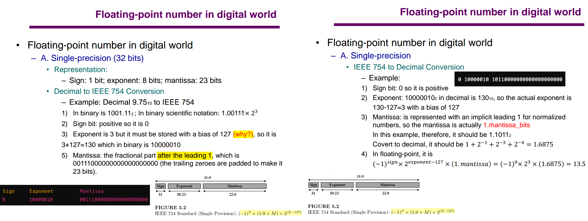

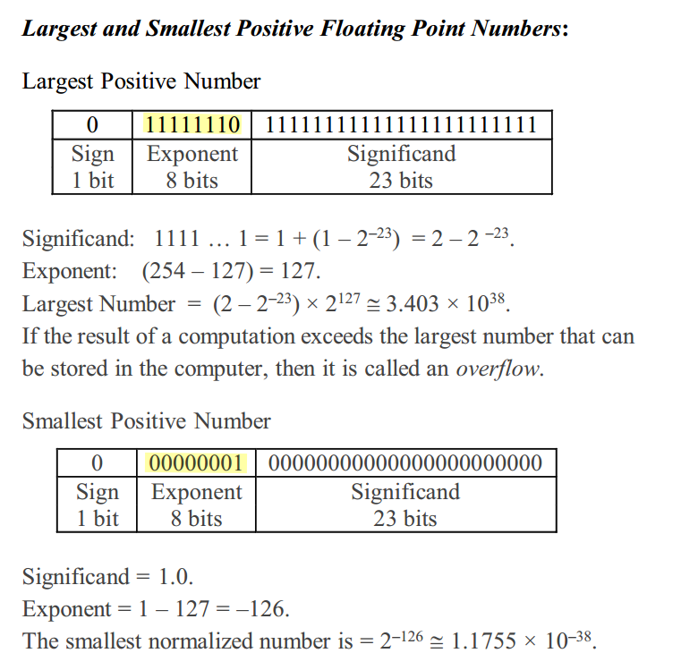
$$
\boxed{
\begin{aligned}
E=0 &: \quad \text{zero or subnormal},\\
1\le E\le254 &: \quad \text{normal finite number},\\
E=255 &: \quad \infty \text{ or NaN}.
\end{aligned}
}
$$


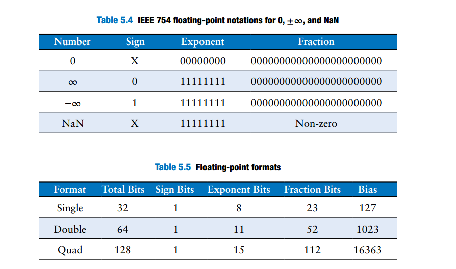


## Multipliers

> B. Baas, [[HARDWARE MULTIPLIERS](https://www.ece.ucdavis.edu/~bbaas/281/notes/Handout.mult.pdf)] [[FIXED-INPUT MULTS ](https://www.ece.ucdavis.edu/~bbaas/281/notes/Handout.fixed.input.mults.pdf)] [[MULTIPLICATION SCALING](https://www.ece.ucdavis.edu/~bbaas/281/notes/Handout.mult.scaling.pdf)]
>

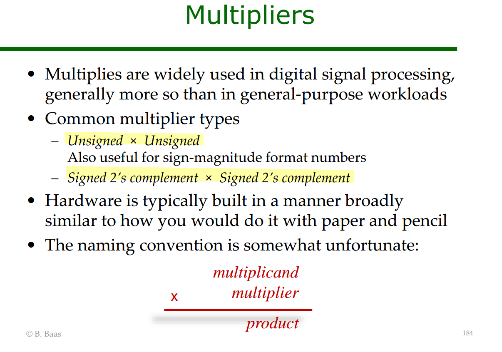


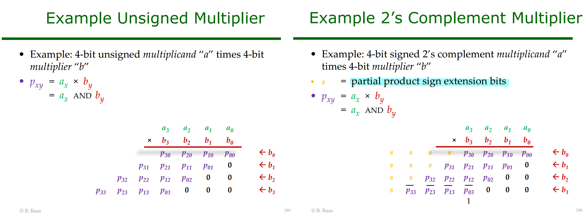

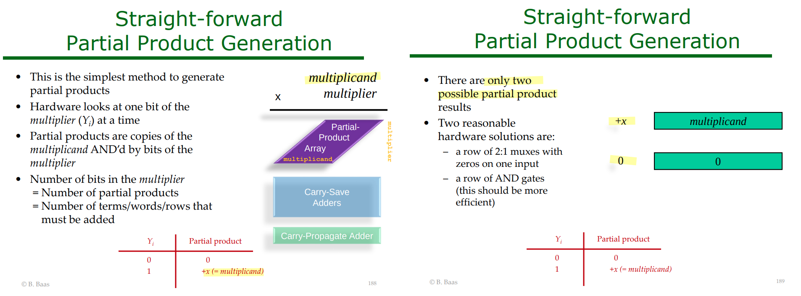


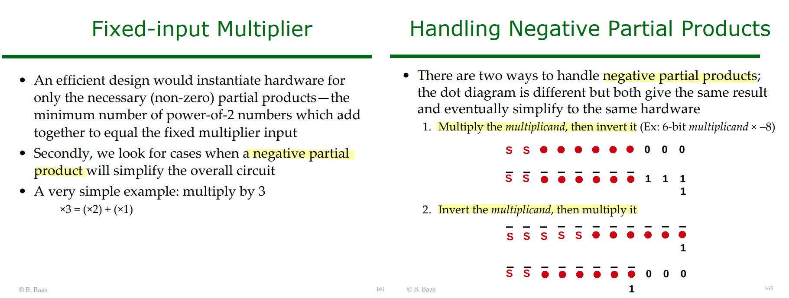

**negate last partial product** when multiplier[MSB]=1, i.e. multiplier is negative

1. Multiply the multiplicand, then invert it
2. Invert the multiplicand, then multiply it

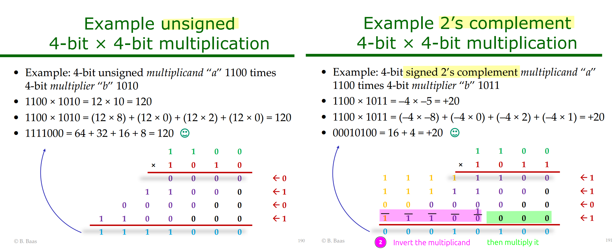


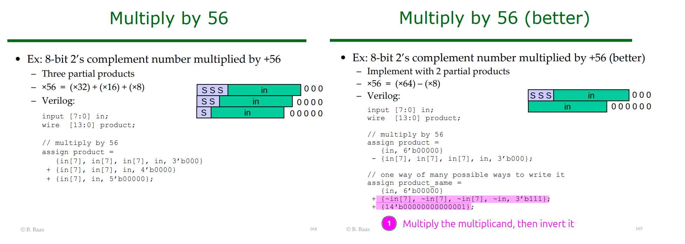


---

***Multiplication Scaling***

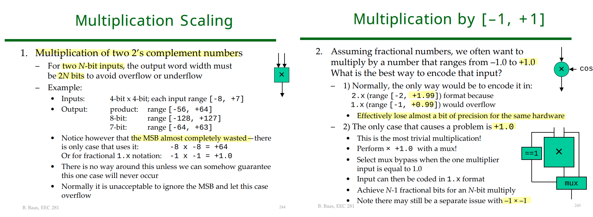


---


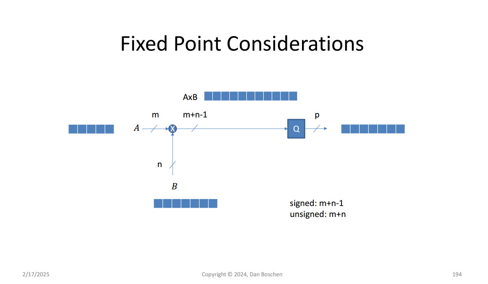


| Operands          | Nominal full product width |
| ----------------- | -------------------------: |
| Unsigned          |                      $m+n$ |
| Signed fractional |                    $m+n-1$ |

For **signed fractional multiplication**,

$$
Q1.(m-1)\times Q1.(n-1)
\rightarrow Q1.(m+n-2)
$$

Therefore, the total number of bits is

$$
1+(m+n-2)=m+n-1.
$$

There is one special corner case:

$$
(-1)\times(-1)=+1
$$

but a signed fractional format such as $Q1.(m+n-2)$ has the range

$$
-1
\le x \le
1-2^{-(m+n-2)},
$$

so it cannot represent exactly $+1$.

Therefore:

- Normally, signed fractional multiplication requires

$$
\boxed{m+n-1\text{ bits}}
$$

- To guarantee no overflow even for

$$
(-1)(-1)=+1,
$$

you need

$$
\boxed{m+n\text{ bits}}.
$$

Equivalently, if the operands have widths

$$
B_0+1
\quad\text{and}\quad
B_1+1,
$$

then the normal signed fractional product width is

$$
(B_0+1)+(B_1+1)-1
=
\boxed{B_0+B_1+1}.
$$

The only exception is again

$$
(-1)(-1)=+1.
$$


## FIR Filter Scaling

> Bevan Baas, EEC 281 - VLSI Digital Signal Processing Winter 2025 [[FIR FILTER HARDWARE](https://www.ece.ucdavis.edu/~bbaas/281/notes/Handout.fir.hardware.pdf)]

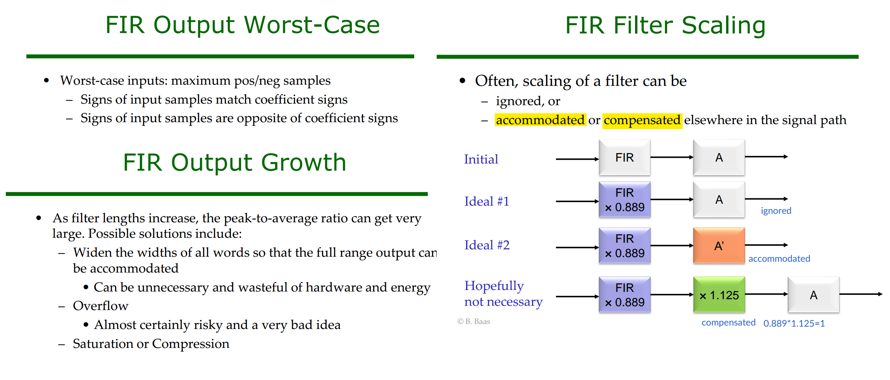


## Finite-wordlength Effects

> Tianshuang Qiu; Ying Guo, "7. Finite-Precision Numerical Effects in Digital Signal Processing," in *Signal Processing and Data Analysis* , De Gruyter, 2018, pp.236-248
>
> Antoniou, Andreas. “Digital Signal Processing: Signals, Systems, and Filters.” (2005). [[pdf](https://fmipa.umri.ac.id/wp-content/uploads/2016/03/Andreas-Intoniou-Digital-signal-processing.9780071454247.31527.pdf)]
>
> Alan V Oppenheim, Ronald W. Schafer. Discrete-Time Signal Processing, 3rd edition
>
> Bevan Baas, EEC 281 - VLSI Digital Signal Processing Winter 2025 [[QUANTIZATION NOISE AS A FUNCTION OF WORD SIZE](https://www.ece.ucdavis.edu/~bbaas/281/notes/Handout.quant.pdf)] [[SATURATION&COMPRESSION](https://www.ece.ucdavis.edu/~bbaas/281/notes/Handout.saturation.pdf)] [[ROUNDING](https://www.ece.ucdavis.edu/~bbaas/281/notes/Handout.rounding.pdf)]


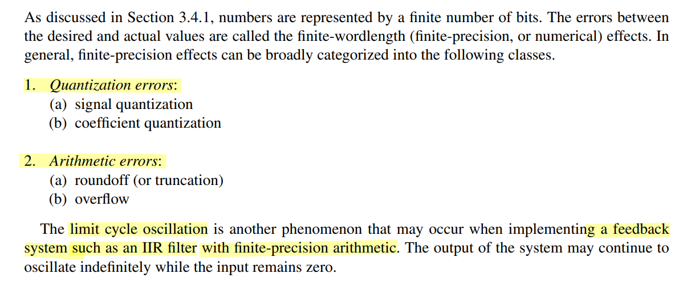

### Coefficient Quantization

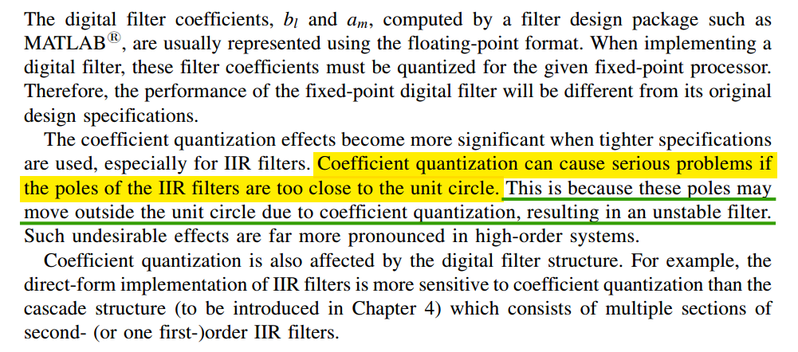


###  Roundoff Noise


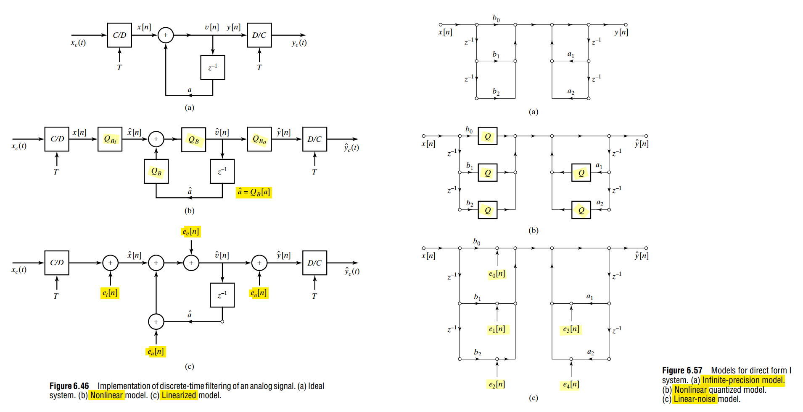


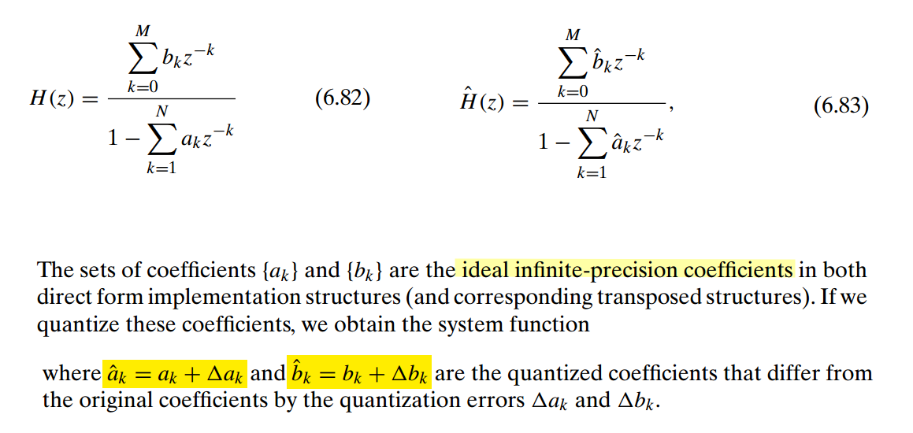

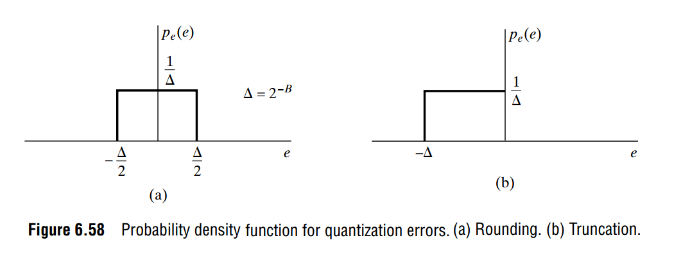

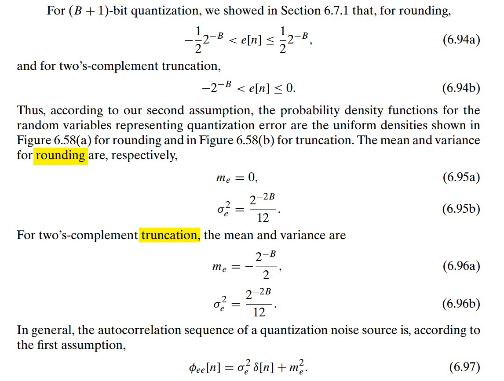

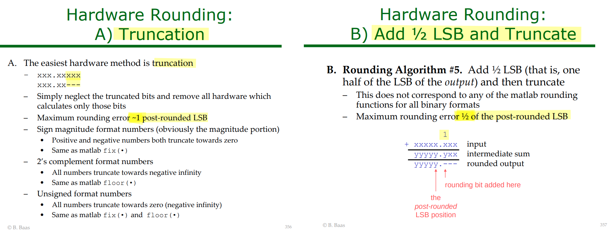

---


***Direct-Form I (DF-I) implementation of a digital filter IIR***

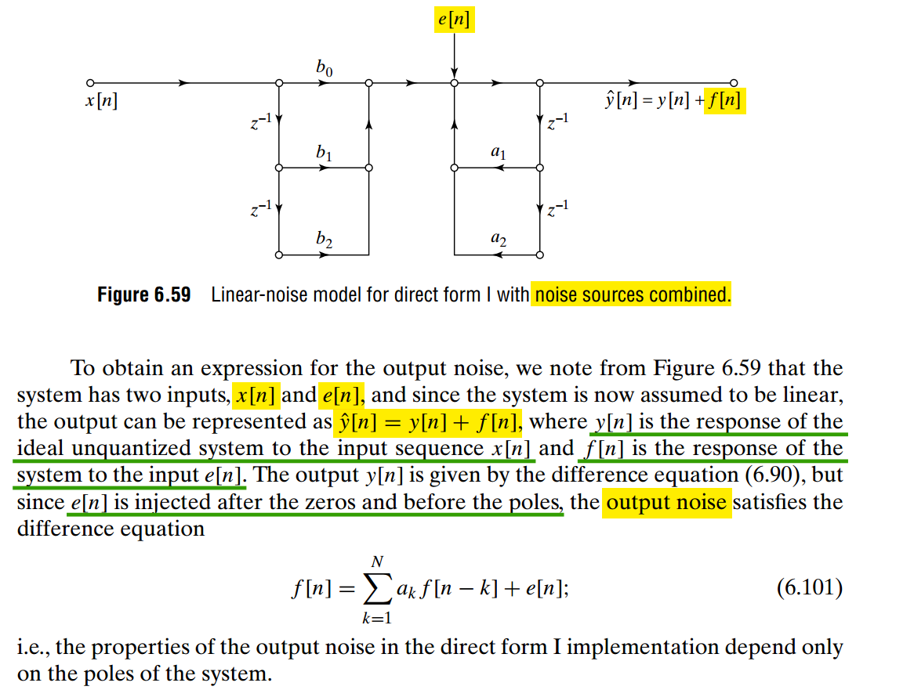

Equation (6.101) follows directly by writing the difference equation for the **quantized system** and subtracting the difference equation for the **ideal system**.

For the direct-form-I filter in Fig. 6.59, the ideal output satisfies

$$
y[n]
=
\sum_{k=0}^{M} b_k x[n-k]
+
\sum_{k=1}^{N} a_k y[n-k].
\tag{1}
$$

The combined quantization noise $e[n]$ is injected **after the $b_k$ section (zeros) and before the $a_k$ feedback section (poles)**. Therefore the actual output $\hat y[n]$ satisfies

$$
\hat y[n]
=
\sum_{k=0}^{M} b_k x[n-k]
+
\sum_{k=1}^{N} a_k \hat y[n-k]
+
e[n].
\tag{2}
$$

The book defines

$$
\boxed{\hat y[n]=y[n]+f[n]}
$$

where $f[n]$ is the **output component caused by the quantization noise**

Substitute

$$
\hat y[n]=y[n]+f[n]
$$

into (2):

$$
y[n]+f[n]
=
\sum_{k=0}^{M}b_kx[n-k]
+
\sum_{k=1}^{N}a_k\left(y[n-k]+f[n-k]\right)
+
e[n].
$$

Expand:

$$
y[n]+f[n]
=
\underbrace{
\sum_{k=0}^{M}b_kx[n-k]
+
\sum_{k=1}^{N}a_ky[n-k]
}_{=\,y[n]}
+
\sum_{k=1}^{N}a_kf[n-k]
+
e[n].
$$

Using the ideal-system equation (1),

$$
y[n]+f[n]
=
y[n]
+
\sum_{k=1}^{N}a_kf[n-k]
+
e[n].
$$

Cancel $y[n]$ from both sides:

$$
\boxed{
f[n]
=
\sum_{k=1}^{N}a_k f[n-k]+e[n]
}
\tag{6.101}
$$

That is exactly Eq. (6.101).

***Why do the $b_k$ coefficients disappear?***

This is the important point.

The signal path is

$$
x[n]
\rightarrow
\underbrace{B(z)}_{\text{zeros}}
\rightarrow
\boxed{+\,e[n]}
\rightarrow
\underbrace{\frac{1}{A(z)}}_{\text{poles}}
\rightarrow
\hat y[n].
$$

The noise is inserted **after $B(z)$**, so it never passes through the zeros. It only passes through the all-pole feedback section.

In the $z$-domain, Eq. (6.101) gives

$$
F(z)
=
\sum_{k=1}^{N}a_kz^{-k}F(z)+E(z).
$$

Thus,

$$
F(z)
\left(
1-\sum_{k=1}^{N}a_kz^{-k}
\right)
=
E(z),
$$

and therefore

$$
\boxed{
\frac{F(z)}{E(z)}
=
\frac{1}
{1-\displaystyle\sum_{k=1}^{N}a_kz^{-k}}
}
$$

So the **output quantization-noise transfer function contains only the poles**, which is what the sentence immediately after (6.101) means.

For the second-order example in the figure,

$$
\boxed{
f[n]=a_1f[n-1]+a_2f[n-2]+e[n].
}
$$

The coefficients $b_0,b_1,b_2$ have no effect on $f[n]$ because $e[n]$ is injected after that part of the filter.


### Limit Cycles in feedback system


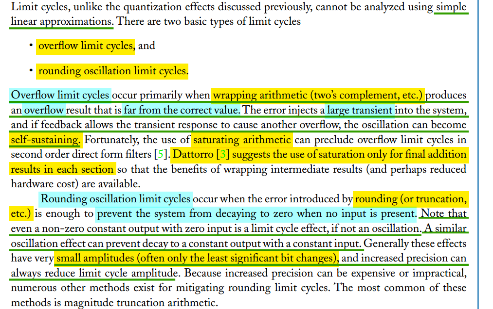


#### Limit Cycles Owing to Round-off & Truncation


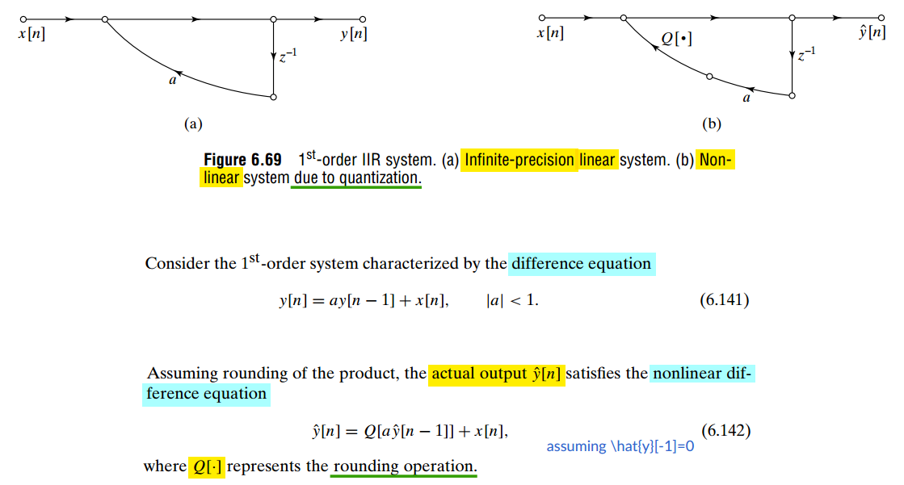

For **infinite-precision linear system** $y[n] = a y[n-1] + x[n],$

with zero initial condition $y[-1]=0$, the impulse response is
$$
y[n] = \frac{7}{8} a^n u[n]
$$
because after the impulse at $n=0$, we have $x[n]=0$ for all $n\ge 1$.

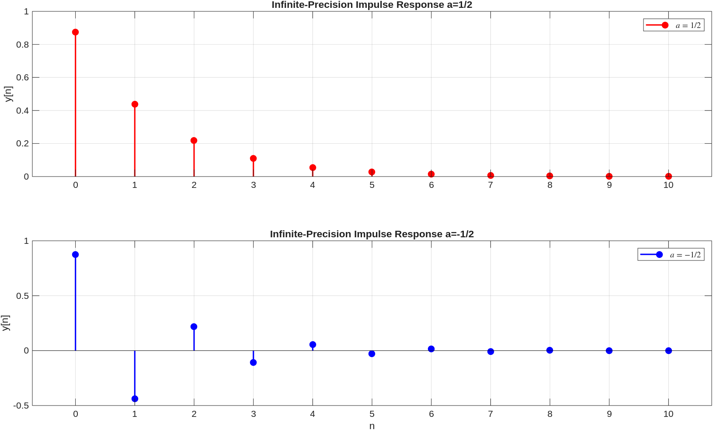

For **nonlinear system** $\hat{y}[n] = Q[a \hat{y}[n-1]] + x[n],$

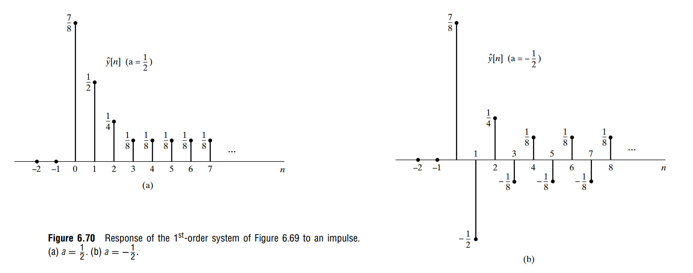

The nonzero **steady oscillation** or **constant value** is created entirely by the **rounding operation (nonlinear)** $Q[\cdot]$


#### Limit Cycles Owing to Overflow

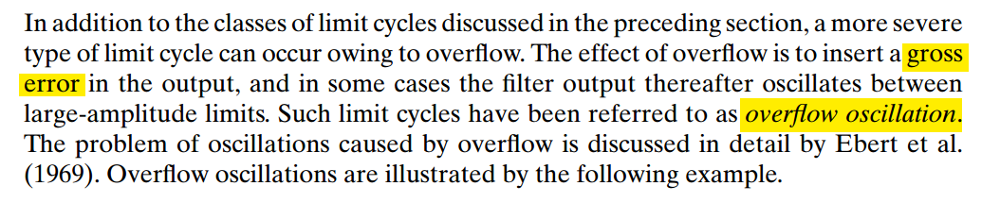

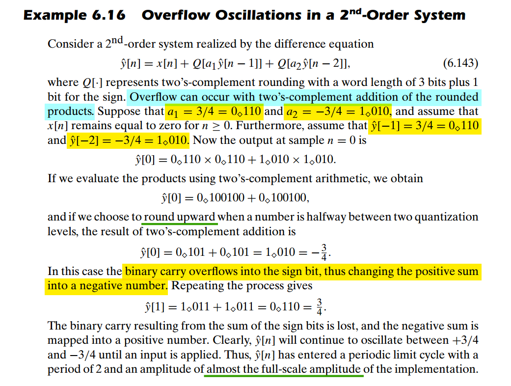

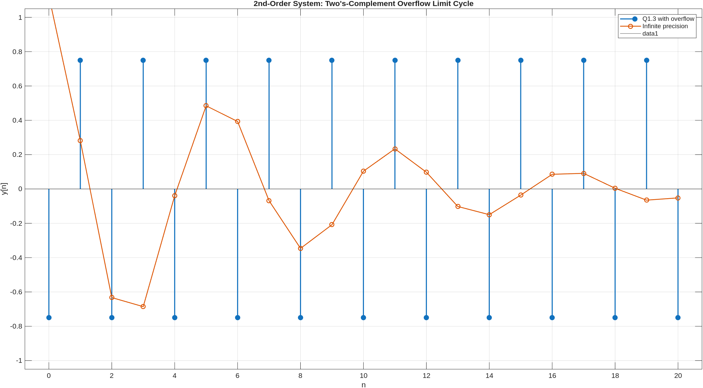


```matlab
%% Parameters
a1 =  3/4;
a2 = -3/4;

% Q1.3:
% 1 sign/integer bit + 3 fractional bits
F  = 3;               % fractional bits
WL = 4;               % total word length
S  = 2^F;             % scale factor = 8

% Initial conditions
% y[-2] = -3/4
% y[-1] = +3/4
y_m2 = -3/4;
y_m1 =  3/4;

N = 20;
n = 0:N;


%% ------------------------------------------------------------
%  Finite-precision Q1.3 system
% -------------------------------------------------------------

yq = zeros(size(n));

% Store the two previous states
ym2 = y_m2;
ym1 = y_m1;

for k = 1:length(n)

    % Products
    p1 = a1 * ym1;
    p2 = a2 * ym2;

    % Round products back to Q1.3.
    % Halfway cases are rounded away from zero:
    %
    %   +9/16 -> +5/8
    %   -9/16 -> -5/8
    %
    p1q = sign(p1) * floor(abs(p1)*S + 0.5) / S;
    p2q = sign(p2) * floor(abs(p2)*S + 0.5) / S;

    % Addition
    s = p1q + p2q;

    % Two's-complement overflow / wraparound
    %
    % Convert to integer representation first
    sint = round(s*S);

    % Wrap to WL-bit signed two's-complement range
    sint = mod(sint + 2^(WL-1), 2^WL) - 2^(WL-1);

    % Convert back to Q1.3
    yq(k) = sint / S;

    % Update states
    ym2 = ym1;
    ym1 = yq(k);
end


%% ------------------------------------------------------------
%  Infinite-precision system
% -------------------------------------------------------------

yinf = zeros(size(n));

ym2 = y_m2;
ym1 = y_m1;

for k = 1:length(n)

    yinf(k) = a1*ym1 + a2*ym2;

    ym2 = ym1;
    ym1 = yinf(k);
end

```


---

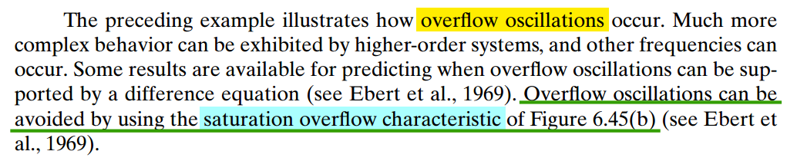

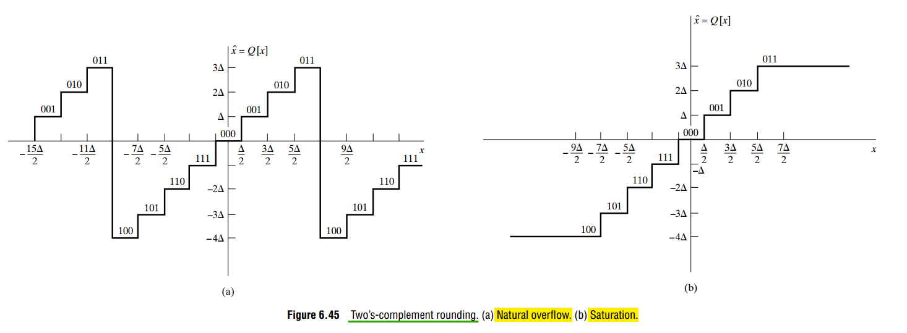


```verilog
//-------------------------------------------------------------------------
// Recombine and saturate: dac = clamp(x_msb + y, 0, 2^OUT_W-1)
//   sum range [-3, 2^OUT_W-1+4] -> (OUT_W+2)-bit signed is sufficient
//   (needs 2^(OUT_W+1) >= 2^OUT_W + 4, true for any OUT_W >= 2)
//-------------------------------------------------------------------------
// explicit sign-extension of y to adder width (assumes OUT_W >= 5)
wire signed [OUT_W+1:0] y_ext   = {{(OUT_W-4){y[5]}}, y};
wire signed [OUT_W+1:0] dac_sum = $signed({2'b0, x_msb}) + y_ext;

wire [OUT_W-1:0] dac_sat =
      dac_sum[OUT_W+1] ? {OUT_W{1'b0}} :   // negative  -> 0
      dac_sum[OUT_W]   ? {OUT_W{1'b1}} :   // > max     -> 2^OUT_W-1
      dac_sum[OUT_W-1:0];
```


#### Avoiding Limit Cycles

The suppression of limit cycles is a broad topic with all the complexity to be expected in a *nonlinear system* behavior.

The most basic tools of **saturation arithmetic** and **magnitude truncation — rounding rounds toward zero**


---

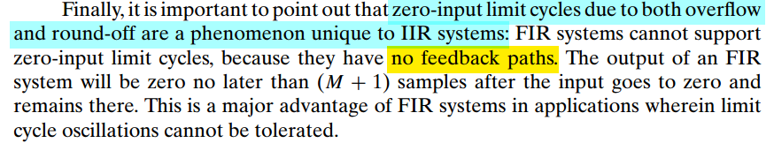


### Saturation Arithmetic & Scaling of Signals

***<span style="color:blue">Saturation arithmetic</span> prevents <span style="color:blue">overflow</span> by clipping the results to a maximum value***

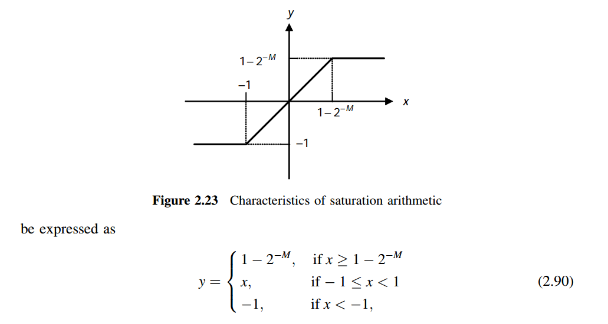


---

---

***The most effective technique in preventing <span style="color:blue">overflow</span> is by <span style="color:blue">scaling down</span> the signal***

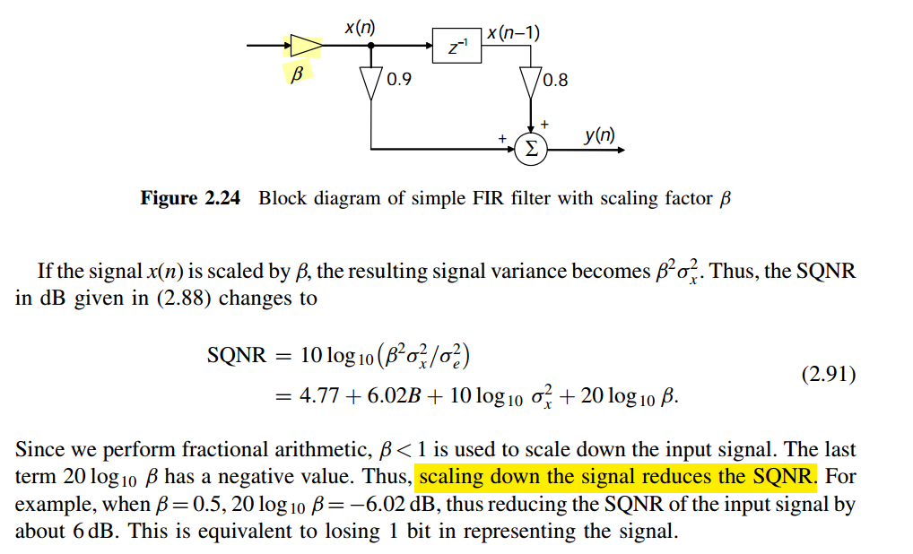

### Saturation Bias Effects

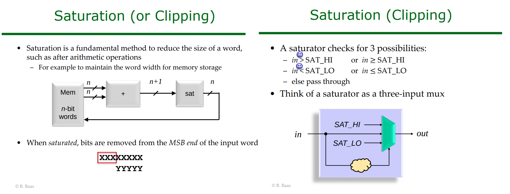

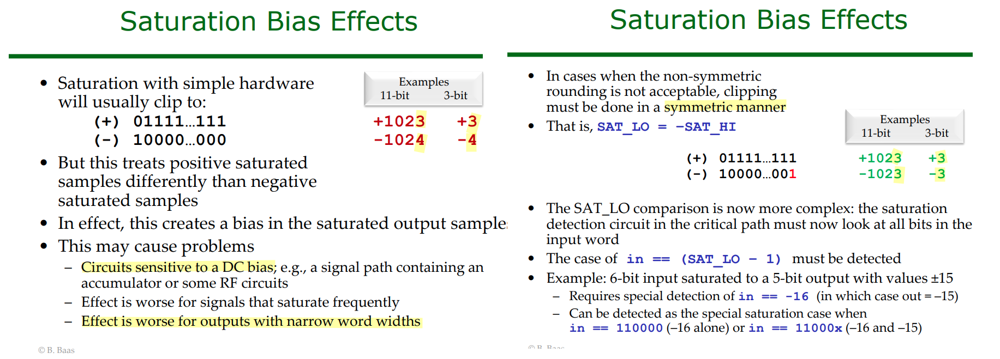


## One-Hot and Thermometer (Unary) codes

**An N-bit binary input represents $2^{N}$ unique values** (from 0 to $2^N - 1$)

Converting this input requires a **$2^{N}$-bit width for One-Hot** encoding, but only a **$(2^N - 1)$-bit width for Thermometer Code**, as the value zero is represented by all zeros


| Decimal | Binary ($N=3$) | One-Hot ($2^3 = 8$) bits) | Thermometer ($2^3 - 1 = 7$) bits) |
| ------- | -------------- | ------------------------- | --------------------------------- |
| **0**   | `000`          | `00000001`                | `0000000`                         |
| **1**   | `001`          | `00000010`                | `0000001`                         |
| **2**   | `010`          | `00000100`                | `0000011`                         |
| **3**   | `011`          | `00001000`                | `0000111`                         |
| **4**   | `100`          | `00010000`                | `0001111`                         |
| **5**   | `101`          | `00100000`                | `0011111`                         |
| **6**   | `110`          | `01000000`                | `0111111`                         |
| **7**   | `111`          | `10000000`                | `1111111`                         |


## reference

Padgett, Wayne T. and David V. Anderson. "Fixed-Point Signal Processing." *Synthesis Lectures on Signal Processing* (2009).

Alan V Oppenheim, Ronald W. Schafer. Discrete-Time Signal Processing, 3rd edition

Jabbour, Chadi, etc.. "Digitally enhanced mixed signal systems." *IEEE International Symposium on Circuits and Systems (ISCAS)*. 2019.

Sen M. Kuo. Real-Time Digital Signal Processing: Fundamentals, Implementations and Applications, 3rd Edition. John Wiley & Sons 2013 [[pdf](http://dl.icdst.org/pdfs/files/e51100ce301ad56951e4511a9a1c66aa.pdf)]

Taylor, Fred. *Digital filters: principles and applications with MATLAB*. John Wiley & Sons, 2011

D. Markovic and R. W. Brodersen, DSP Architecture Design Essentials, Springer, 2012.

X. Yang, Integrated Circuit Design: IC Design Flow and Project-Based Learning, 1st edition. Boca Raton: CRC Press, 2024 [[repo](https://github.com/IC-Design-Lab/IC-Design)]

---

Bevan Baas, EEC281 VLSI Digital Signal Processing,  [[https://www.ece.ucdavis.edu/~bbaas/281/](https://www.ece.ucdavis.edu/~bbaas/281/)]

Mark Horowitz. EE371: Advanced VLSI Circuit Design Spring 2006-2007 [[https://web.stanford.edu/class/archive/ee/ee371/ee371.1066/](https://web.stanford.edu/class/archive/ee/ee371/ee371.1066/)]

Tinoosh Mohsenin. CMPE 691: Digital Signal Processing Hardware Implementation [[https://userpages.cs.umbc.edu/tinoosh/cmpe691/](https://userpages.cs.umbc.edu/tinoosh/cmpe691/)]

Keshab K. Parhi [[http://www.ece.umn.edu/users/parhi/](http://www.ece.umn.edu/users/parhi/)]

謝秉璇. 2019 積體電路設計導論 [[link](https://nthuee.org/archive//%E7%A9%8D%E9%AB%94%E9%9B%BB%E8%B7%AF%E8%A8%AD%E8%A8%88%E5%B0%8E%E8%AB%96/2019%E8%AC%9D%E7%A7%89%E7%92%87/)]

---

Jason Sachs. Understanding and Preventing Overflow (I Had Too Much to Add Last Night) [[https://www.embeddedrelated.com/showarticle/532.php](https://www.embeddedrelated.com/showarticle/532.php)]

—. Round Round Get Around: Why Fixed-Point Right-Shifts Are Just Fine [[https://www.embeddedrelated.com/showarticle/1015.php](https://www.embeddedrelated.com/showarticle/1015.php)]

—. How to Build a Fixed-Point PI Controller That Just Works: Part I [[https://www.embeddedrelated.com/showarticle/121.php](https://www.embeddedrelated.com/showarticle/121.php)]

—. How to Build a Fixed-Point PI Controller That Just Works: Part II [[https://www.embeddedrelated.com/showarticle/123.php](https://www.embeddedrelated.com/showarticle/123.php)]

---

AHMED SHAHEIN, Fixed-Point Simulation in GNU Octave—Without MATLAB [[https://www.dsprelated.com/showarticle/1786.php](https://www.dsprelated.com/showarticle/1786.php)]

A. Antoniou, "On the roots of digital signal processing. Part I," in *IEEE Circuits and Systems Magazine*, vol. 7, no. 1, pp. 8-18, First Quarter 2007

—, "Feature - On the roots of digital signal processing - Part II," in *IEEE Circuits and Systems Magazine*, vol. 7, no. 4, pp. 8-19, Fourth Quarter 2007

Hideo Okawara's Mixed Signal Lecture Series [[https://tomverbeure.github.io/2024/01/06/Hideo-Okawara-Mixed-Signal-Lecture-Series.html](https://tomverbeure.github.io/2024/01/06/Hideo-Okawara-Mixed-Signal-Lecture-Series.html)]

Jeffrey Walling, DSP to ASIC Block [[https://youtube.com/playlist?list=PLP4ZmM6GPueNEdnLhgkdr8_X8dSizUwMs](https://youtube.com/playlist?list=PLP4ZmM6GPueNEdnLhgkdr8_X8dSizUwMs)]

Abdur Rafae Haqqani, Embedded Systems / FPGA Blogs On Request Rounding, dither and saturation when you cut word width in FPGA DSP. [[https://rafae1130.github.io/posts/on-request/fractions-in-fpga.html](https://rafae1130.github.io/posts/on-request/fractions-in-fpga.html)]
