**Jitter separation** lets you learn if the components of jitter are random or deterministic. That is, if they are caused by crosstalk, channel loss, or some other phenomenon. The identification of jitter and noise sources is critical when debugging failure sources in the transmission of high-speed serial signals

- Tail Fit Method
- Spectral method

| RJ Extraction Methods | Rationale                                                    |
| --------------------- | ------------------------------------------------------------ |
| Spectral              | Speed/Consistency to Past Measurements;<br />Accuracy in low Crosstalk or Aperiodic  Bounded Uncorrelated Jitter (ABUJ) conditions |
| Tail Fit              | General Purpose;<br />Accuracy in high Crosstalk or ABUJ conditions |

## Jitter Components

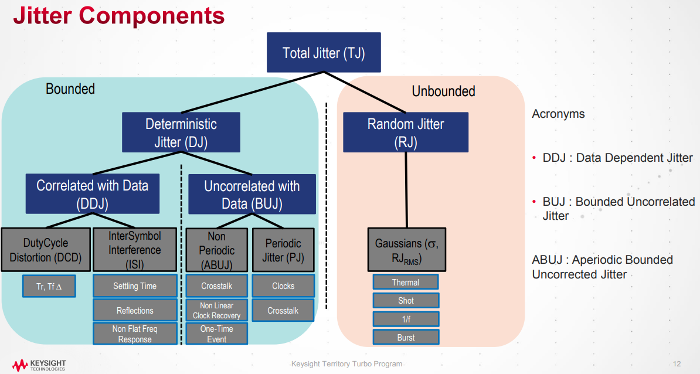

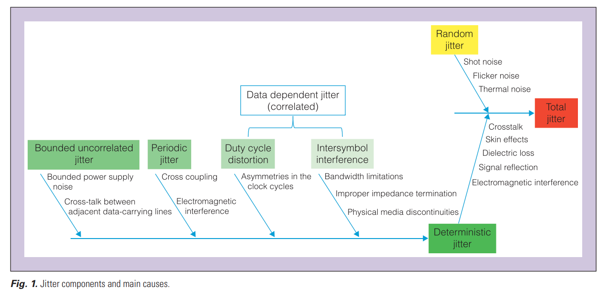


## Spectral method

>  power spectral density (PSD) represents jitter spectrum and peaks in the spectrum can be interpreted as PJ or DDJ, while the average noise floor is the power of RJ

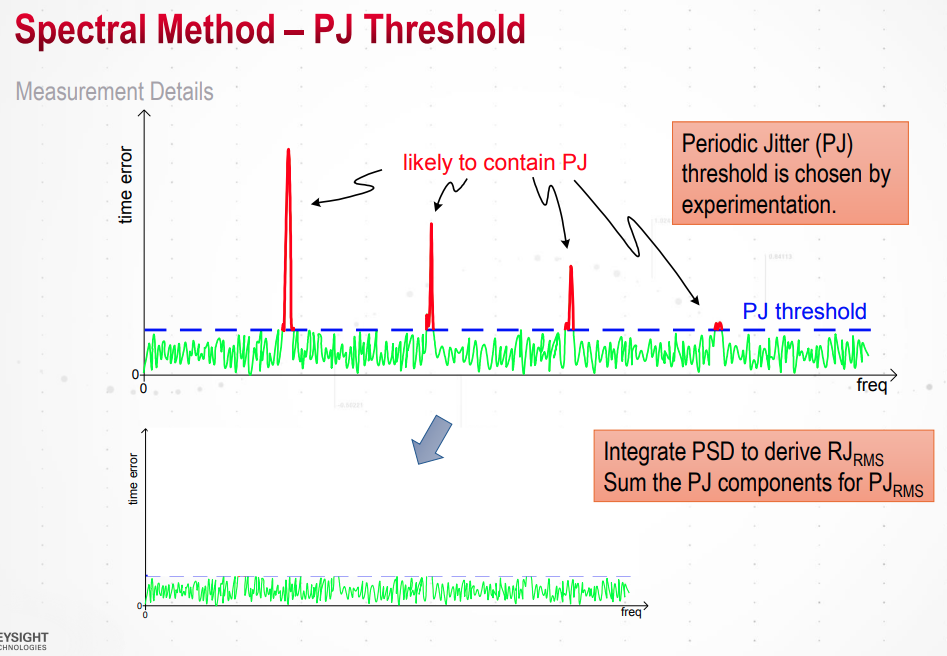

```matlab
S1 = sum(win);
S2 = sum(win.^2);
N = length(win);
spec_nospur2 = (spec_nospur*S1).^2/N/S2;    % To obtain linear spectrum for rj
rj_utj = sqrt(sum(spec_nospur2))*1e12;

spec = 1*ones(length(spec_nospur), 1)*1e-21;
spec(index) = specx(index);
% insert fft nyquist frequency component between positive frequency and
% negative frequency component
% DC;posFreq;nyqFreq;negFreq
spec_ifft = [spec;specnyq;conj(spec(end:-1:2))]';
sfactor = sum(win)/sqrt(2);
spec_ifft = spec_ifft*sfactor;
sig_rec = real(ifft(spec_ifft));
sig_rec = sig_rec(:);
sig_rec_utj = sig_rec./win(1:end);
```


## Dual-Dirac Model

> Jitter Analysis: The Dual-Dirac Model, RJ/DJ, and Q-scale [[https://people.engr.tamu.edu/spalermo/ecen689/jitter_dual_dirac_agilent.pdf](https://people.engr.tamu.edu/spalermo/ecen689/jitter_dual_dirac_agilent.pdf)]
>
> E. Balestrieri, L. De Vito, F. Lamonaca, F. Picariello, S. Rapuano and I. Tudosa, "The jitter measurement ways: The jitter decomposition," in IEEE Instrumentation & Measurement Magazine, vol. 23, no. 7, pp. 3-12, Oct. 2020, [[https://sci-hub.ru/10.1109/MIM.2020.9234759](https://sci-hub.ru/10.1109/MIM.2020.9234759)]

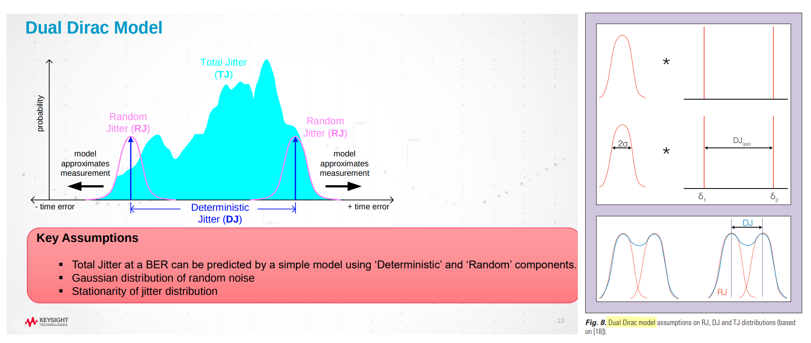

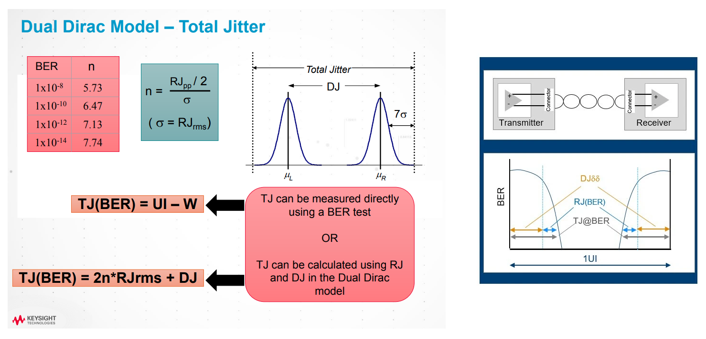

$$
\boxed{\text{TJ(BER)} \approx 2Q_{\mathrm{BER}} \cdot \text{RJ}_{\mathrm{rms}} + \text{DJ}(\delta\delta)}
$$

The slide above and the Q-scale slide below use different probability normalizations. Define $Q(z)=\frac{1}{2}\operatorname{erfc}(z/\sqrt{2})$, the standard Gaussian upper-tail probability. The table above uses $n=Q^{-1}(\mathrm{BER}/2)$, assigning half of a two-sided probability to each tail; at $\mathrm{BER}=10^{-12}$ this gives $n\approx7.1305$.

The boxed formula here follows the transition-density normalization in [the Agilent paper, Section 3.1](https://people.engr.tamu.edu/spalermo/ecen689/jitter_dual_dirac_agilent.pdf), also used by the Q-scale slide below:

$$
Q_{\mathrm{BER}}=\sqrt{2}\operatorname{erf}^{-1}\left(1-\frac{\mathrm{BER}}{\rho_T}\right)
=Q^{-1}\left(\frac{\mathrm{BER}}{2\rho_T}\right).
$$

Here $\rho_T$ is the transition density. With $\rho_T=0.5$ and $\mathrm{BER}=10^{-12}$, $Q_{\mathrm{BER}}\approx7.0345$, giving an RJ multiplier of $2Q_{\mathrm{BER}}\approx14.0690$. The table's value of $7.13$ belongs to its two-sided probability convention rather than this transition-density convention.


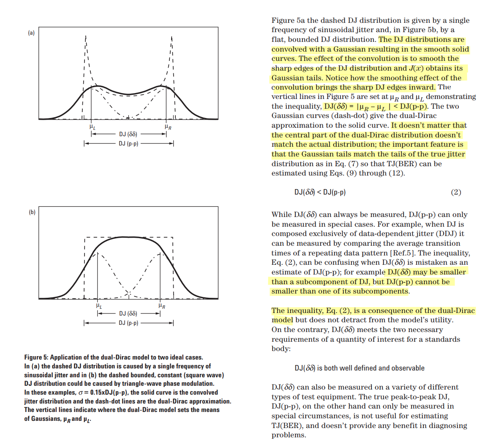

$\text{DJ}(\delta\delta)$ is a **model parameter**, not a measured peak-to-peak value.  In general
$$
\boxed{\text{DJ}(\delta\delta)\leq \text{DJ(p-p)}}
$$

The **dual-Dirac model** can be fitted to measured data through **PDF tail fitting** or **CDF/Q-scale tail fitting**. Both fit Gaussian tails: the first works directly on the jitter histogram, while the second works on integrated tail probabilities or the corresponding BER bathtub curves. Q-scale is a transformation that makes Gaussian cumulative tails linear.


### PDF tail fitting

Fit Gaussian expressions to the left and right outer tails of the measured jitter PDF:

$$
p_i(t)\approx\frac{\rho_i}{\sqrt{2\pi}\sigma_i}
\exp\left[-\frac{(t-\mu_i)^2}{2\sigma_i^2}\right],\qquad i\in\{L,R\}.
$$

The fitted parameters describe the Gaussian position $\mu_i$, width $\sigma_i$, and weight $\rho_i$. Conventional dual-Dirac implementations constrain the widths to a common $\sigma$ and use equal weights of $1/2$; more flexible fits can allow different widths and weights. These weights $\rho_i$ are distinct from the transition density $\rho_T$ used to normalize BER.

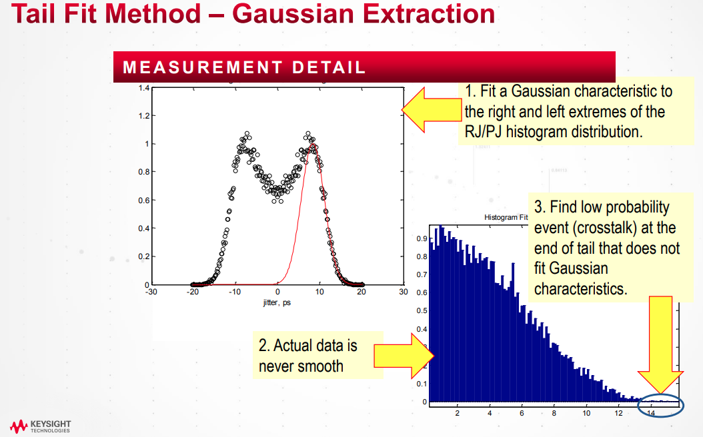


### CDF/Q-scale tail fitting

Integrate the PDF tail and fit its cumulative probability. For the right tail,

$$
P_R(t)=\int_t^{\infty}p_R(u)\,du
\approx\rho_R Q\left(\frac{t-\mu_R}{\sigma_R}\right).
$$

After normalizing by the fitted or assumed weight $\rho_R$, the inverse Gaussian tail transform gives

$$
q_R(t)=Q^{-1}\left(\frac{P_R(t)}{\rho_R}\right)
\approx\frac{t-\mu_R}{\sigma_R}.
$$

The slope is $1/\sigma_R$, and the extrapolated zero crossing is $\mu_R$. Apply the corresponding lower-tail transform to the left tail to obtain $\sigma_L$ and $\mu_L$; their fitted separation gives $\text{DJ}(\delta\delta)=\mu_R-\mu_L$.

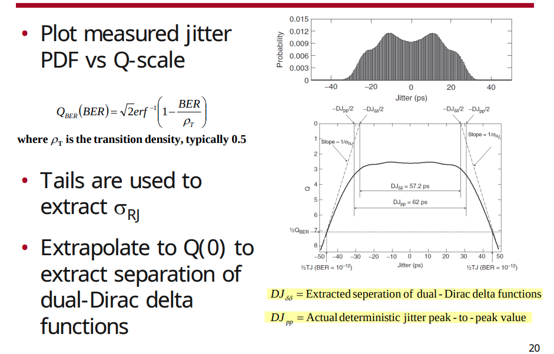

The MATLAB example below performs a **right-tail Q-scale fit**. It assumes that the inputs contain only the selected Gaussian tail samples, with $0<P_R/\rho_R<1$. Here `tail_prob` is the normalized, decreasing survival probability $P_R/\rho_R$, transformed using [qfuncinv](https://www.mathworks.com/help/comm/ref/qfuncinv.html). An ordinary increasing Gaussian CDF would instead use [norminv](https://www.mathworks.com/help/stats/norminv.html).

```matlab
% tail_prob = P_R(t)/rho_R for the selected Gaussian right-tail samples.
t_ps = bin_sig*1e12;

q = qfuncinv(tail_prob);

% q = (t_ps - mu)/sigma = coef(1)*t_ps + coef(2)
coef = polyfit(t_ps, q, 1);
sigma = 1/coef(1);
mu = -coef(2)/coef(1);

fprintf('sigma=%.3fps, mu=%.3fps\n', sigma, mu);
```


## Least Squares (LS) method

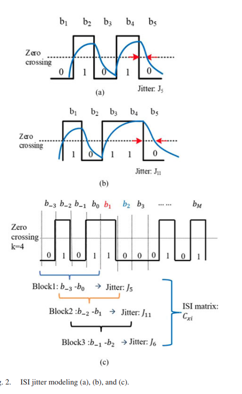

 It is known that TIE jitter is a linear equation, shown in below formula
$$
x[n] = d_n \times \left[ \Delta t_{pj}[n]+\Delta t_{DCD}[n] +\Delta t_{ISI}[n]+\Delta t_{RJ}[n]\right]
$$
LS can be used to estimate the PJ, DCD, RJ , and ISI parameters $[a,b,J_{DCD},J_0, J_1...J_{(2^k-1)}]$

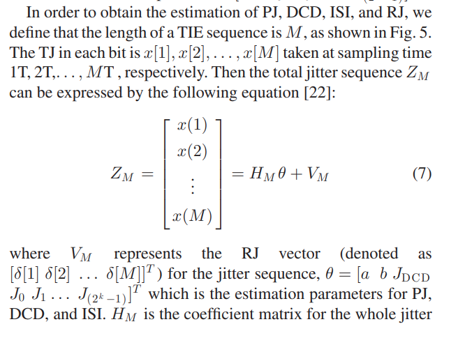

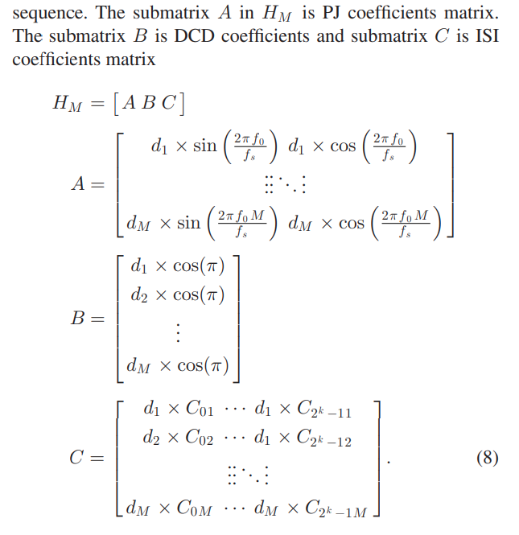

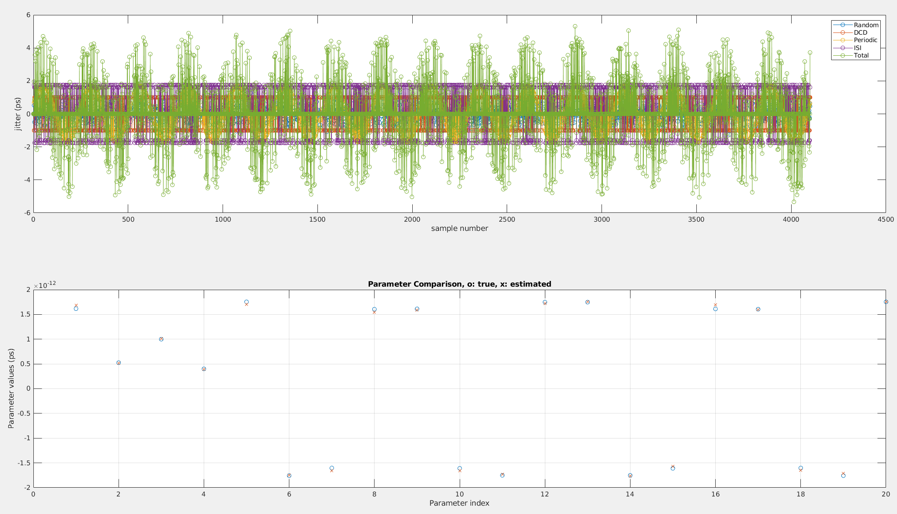


## Jitter modeling

### Periodic Jitter (PJ)

PJ is a repeating jitter
$$
\Delta t_{PJ}[n]=A\sin(2\pi f_0\cdot nT_s + \theta)=a \sin(2\pi f_0 \cdot nT_s)+b\cos(2\pi f_0 \cdot nT_s)
$$
where $f_0$ represents the fundamental frequency of PJ; $A$ is the amplitude of PJ; $T_s$ is the data stream period, and $\theta$ is the initial phase of PJ

> In the spectrum, the frequency of maximum amount of the jitter is PJ frequency $f_0$.

### Duty Cycle Distortion (DCD)

DCD is viewed as a series of **adjacent positive and negative impulses**
$$
\Delta t_{DCD}[n] = J_{DCD}\times (-1)^n = [-J_{DCD},J_{DCD},-J_{DCD},J_{DCD},...]
$$
Where $J_{DCD}$ is the DCD amplitude.

###  Random Jitter (RJ)

RJ is created by unbounded jitter sources, such as Gaussian white noise. The statistical PDF for RJ is enerally treated as a Gaussian distribution
$$
f_{RJ}(\Delta t) = \frac{1}{\sqrt{2\pi\sigma}}\exp(-\frac{(\Delta t)^2}{2\sigma^2})
$$


## DJ/RJ

> K. Bidaj, J. -B. Begueret, N. Houdali, J. Deroo and S. Rieubon, "Time-domain PLL modeling and RJ/DJ jitter decomposition," 2016 IEEE International Symposium on Circuits and Systems (ISCAS), Montreal, QC, Canada, 2016 [[https://sci-hub.se/10.1109/ISCAS.2016.7527201](https://sci-hub.se/10.1109/ISCAS.2016.7527201)]

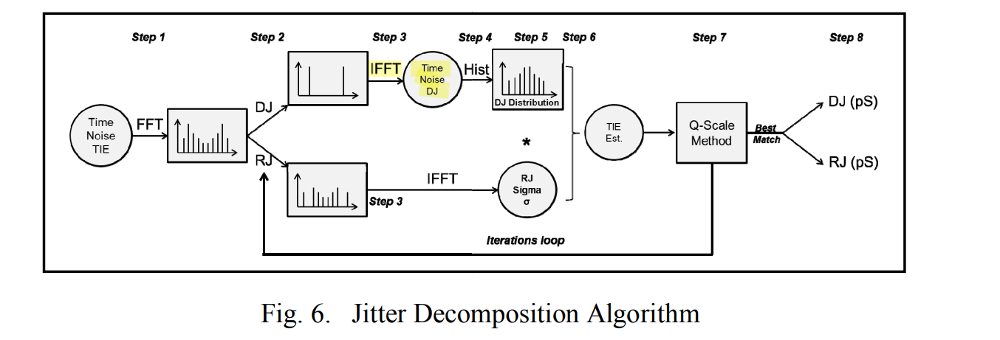


## Periodic Jitter Generator & Insertion

*Analysis and Estimation of Jitter Sub-Components: Classification and Segregation of Jitter Components*

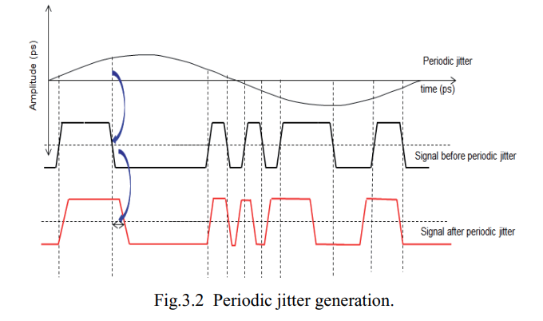

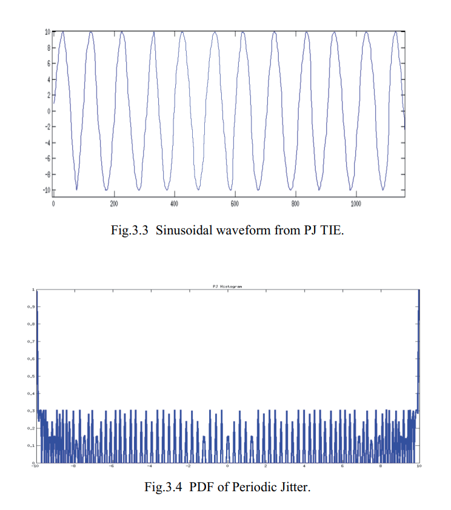


## Reference

Li, Mike Peng. *Jitter, Noise, and Signal Integrity at High- Speed*. Prentice Hall, 2008.

—,DesignCon 2007, *Simultaneous Jitter Analysis in Time, Frequency, and Statistical Domains and Their Interrelationships* [[pdf](https://www.magazines007.com/pdf/DesignCon_Mike_Li.pdf)]

—,DesignCon 2023, *Accuracy and Challenges of PAM4 jitter and noise measurements for >100Gbps Serial Links* [[pdf](https://mys.mapyourshow.com/mys_shared/dcon23/handouts/PAPER_8_AccuracyChallengesPAM4JitterNoiseMeasurements_Nourzad.pdf)]

—, "A new method for jitter decomposition through its distribution tail fitting," International Test Conference 1999. Proceedings (IEEE Cat. No.99CH37034), 1999, pp. 788-794, [[https://sci-hub.jp/10.1109/TEST.1999.805809](https://sci-hub.jp/10.1109/TEST.1999.805809)]

---

余宥浚 Jacky Yu, Keysight Taiwan AEO, Advanced Jitter and Eye-Diagram Analysis [余宥浚 Jacky Yu, Keysight Taiwan AEO, Advanced Jitter and Eye-Diagram Analysis](https://keysightevent.com/191023/handout/d)

Y. Duan and D. Chen, "Accurate jitter decomposition in high-speed links," 2017 IEEE 35th VLSI Test Symposium (VTS), 2017, pp. 1-6 [[https://sci-hub.ru/10.1109/VTS.2017.7928918](https://sci-hub.ru/10.1109/VTS.2017.7928918)]

—, phd thesis URL: [https://dr.lib.iastate.edu/handle/20.500.12876/30459](https://dr.lib.iastate.edu/handle/20.500.12876/30459)

—, "Fast and Accurate Decomposition of Deterministic Jitter Components in High-Speed Links," in IEEE Transactions on Electromagnetic Compatibility, vol. 61, no. 1, pp. 217-225, Feb. 2019, [[https://sci-hub.ru/10.1109/TEMC.2018.2797122](https://sci-hub.ru/10.1109/TEMC.2018.2797122)]

Whitepaper: Keysight Technologies, U.S.A., Dec. 2017, *"Jitter Analysis: The Dual-Dirac Model, RJ/DJ, and Q-Scale"*

Sharma, Vijender Kumar and Sujay Deb. "Analysis and Estimation of Jitter Sub-Components." (2014).

Qingqi Dou and J. A. Abraham, "Jitter decomposition in ring oscillators," Asia and South Pacific Conference on Design Automation, 2006

McClure, Mark Scott. "Digital jitter measurement and separation." PhD diss., 2005.

Ren, Nan, Zaiming Fu, Shengcu Lei, Hanglin Liu, and Shulin Tian. "Jitter generation model based on timing modulation and cross point calibration for jitter decomposition." Metrology and Measurement Systems 28, no. 1 (2021).

K. Bidaj, J. -B. Begueret and J. Deroo, "RJ/DJ jitter decomposition technique for high speed links," *2016 IEEE International Conference on Electronics, Circuits and Systems (ICECS)*  [[https://sci-hub.se/10.1109/ICECS.2016.7841269](https://sci-hub.se/10.1109/ICECS.2016.7841269)]
