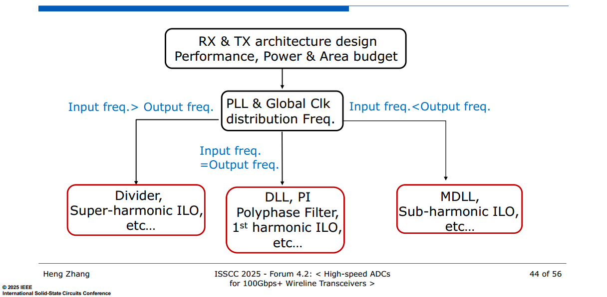

## MPG using DLL

> Z. Wang,.*Efficient and High-Performance Clocking Circuits for High-Speed Data Links*. 2022. Columbia University, PhD dissertation. *Academic Commons*,[[https://academiccommons.columbia.edu/doi/10.7916/g3f1-4e71](https://academiccommons.columbia.edu/doi/10.7916/g3f1-4e71)]

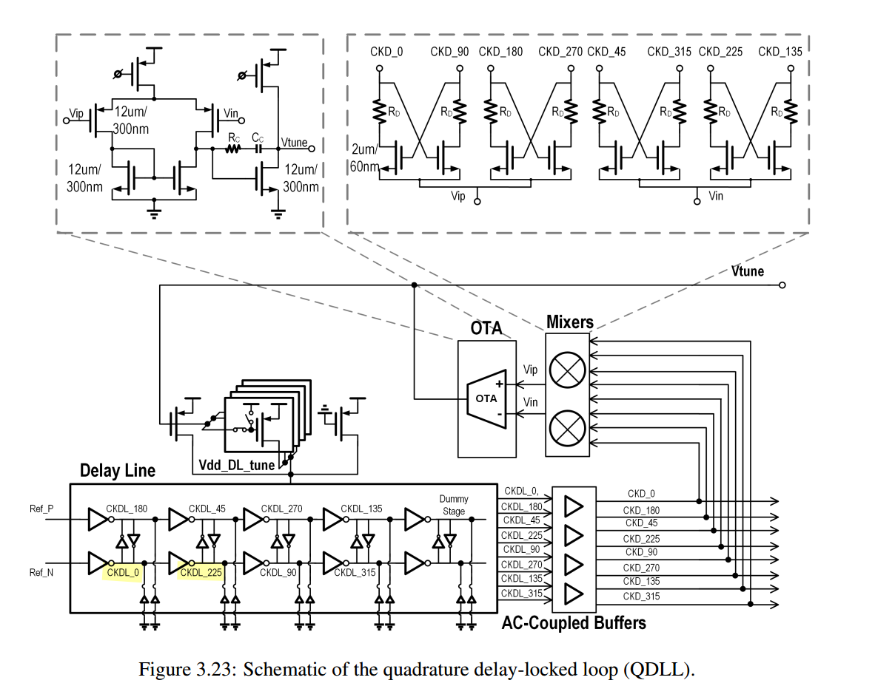

Each delay stage is an inverter, so it shifts phase by $180^\circ$ (inversion) plus its delay $\tau$. The QDLL locks $\tau = T/8$ ($45^\circ$), so each stage shifts by $225^\circ$: $CKDL_0 \to CKDL_{225} \to CKDL_{90} \to CKDL_{315}$. 

$T/8$ is the shortest stage delay that keeps all 8 outputs on the $45^\circ$ grid (the others are $3T/8$, $5T/8$, $7T/8$), so the minimum inverter delay $\tau_{min}$ sets the maximum frequency: $\tau_{min} \le T/8$, i.e. $f \le 1/(8\tau_{min})$.

## MPG using Divider

> J. Q. Wang *et al*., "7.1 A 2.69pJ/b 212Gb/s DSP-Based PAM-4 Transceiver for Optical Direct-Detect Application in 5nm FinFET," *2024 IEEE International Solid-State Circuits Conference (ISSCC)*, San Francisco, CA, USA, 2024, pp. 123-125, doi: 10.1109/ISSCC49657.2024.10454275.

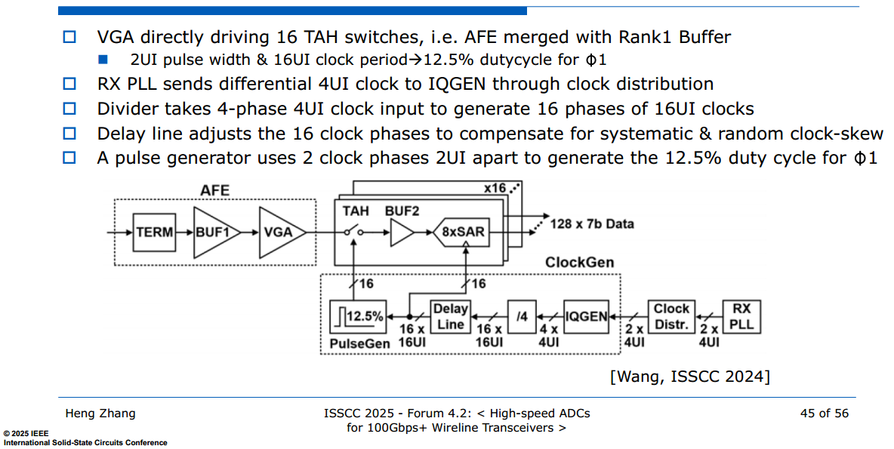

---

---

ph\<0:3\> 4UI clock to oph\<0:15> 16UI clock

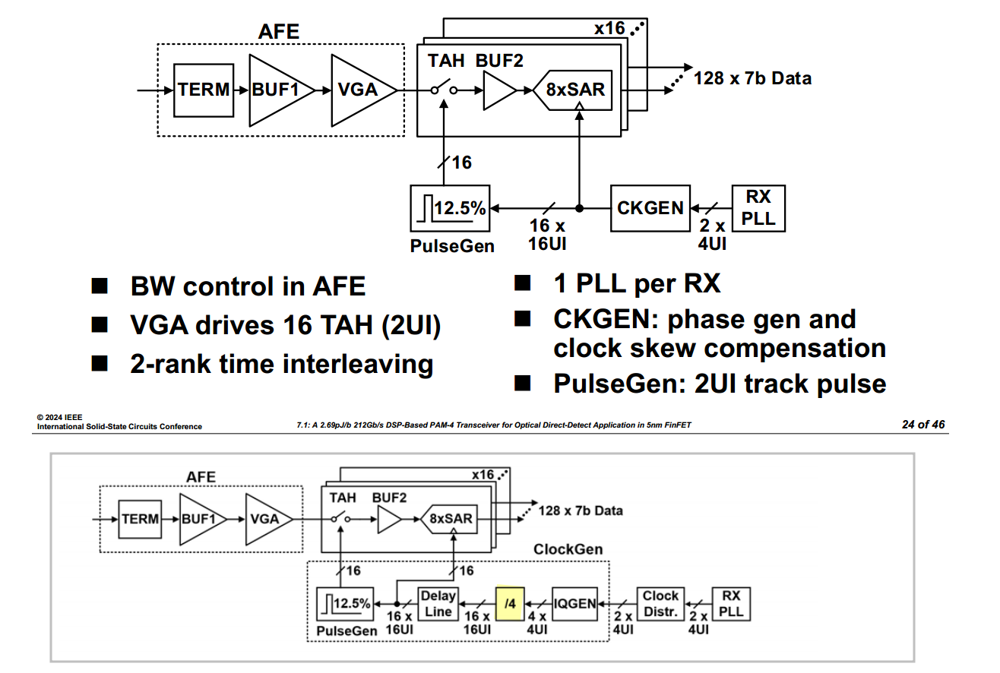

| D / Db | Retiming clock (rising edge) | Q | Qb |
|---|---|---|---|
| QP1 / QN1 | ph<0> | oph<4> | oph<12> |
| VOP1 / VON1 | ph<0> | oph<8> | oph<0> |
| QP2 / QN2 | ph<2> | oph<6> | oph<14> |
| VOP2 / VON2 | ph<2> | oph<10> | oph<2> |
| QP1 / QN1 | ph<3> | oph<3> | oph<11> |
| VOP1 / VON1 | ph<3> | oph<7> | oph<15> |
| QP2 / QN2 | ph<1> | oph<5> | oph<13> |
| VOP2 / VON2 | ph<1> | oph<9> | oph<1> |

---

---

ph\<0:3\> 4UI clock to oph\<0:7\> 8UI clock

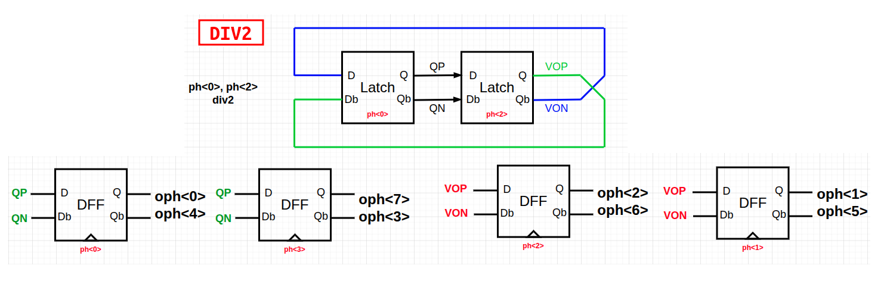

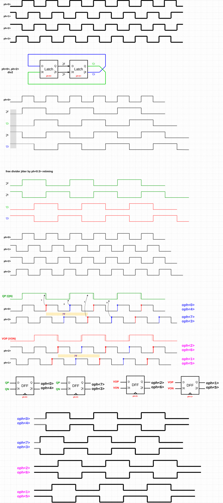

---

ph\<0:1\> 2UI clock to oph\<0:3\> 4UI clock

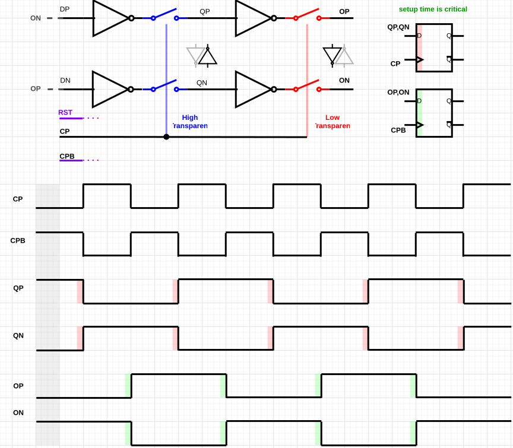

---

clock divide  by 2 only

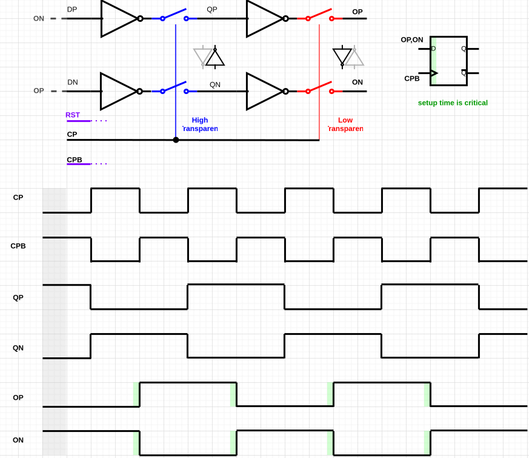

**Retiming functionality**

- **Jitter removal**: the DFF re-samples the divider output with the input clock, so output edges are timed by the clock, not by the divider. The jitter and delay variation accumulated in the divider latches and logic are removed; only the DFF's clock-to-Q jitter is added. This works only while the divider output meets the DFF setup time, the critical constraint here.
- **Glitch masking**: the divider latches are level-sensitive, so glitches during reset and at reset release show up on their outputs. The DFF is edge-triggered: its output changes only on a clock edge, so glitches between edges never reach the output.

Note: the divider latches must be reset. They form a feedback loop that powers up in a random state, which leaves the output polarity (and the phase order across parallel dividers) undefined. The retiming DFF needs no reset: it has no feedback, so it picks up the divider's state on the first clock edge. Leaving reset out also keeps the DFF fast.

---

PH\<0:7\> 8UI clock to OC\<0:15> 16UI clock

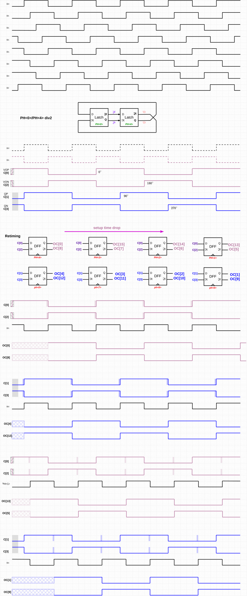

## MPG using ILO

> D. Pfaff *et al*., "7.3 A 224Gb/s 3pJ/b 40dB Insertion Loss Transceiver in 3nm FinFET CMOS," *2024 IEEE International Solid-State Circuits Conference (ISSCC)*, San Francisco, CA, USA, 2024, pp. 128-130, doi: 10.1109/ISSCC49657.2024.10454537
>
> Y. Tian *et al*., "A 28-nm 8–28-GHz Eight-Phase Clock Generator Using an Injection-Locked Dual-Feedback Ring Oscillator," in *IEEE Journal of Solid-State Circuits*, vol. 61, no. 1, pp. 47-62, Jan. 2026, doi: 10.1109/JSSC.2025.3613940

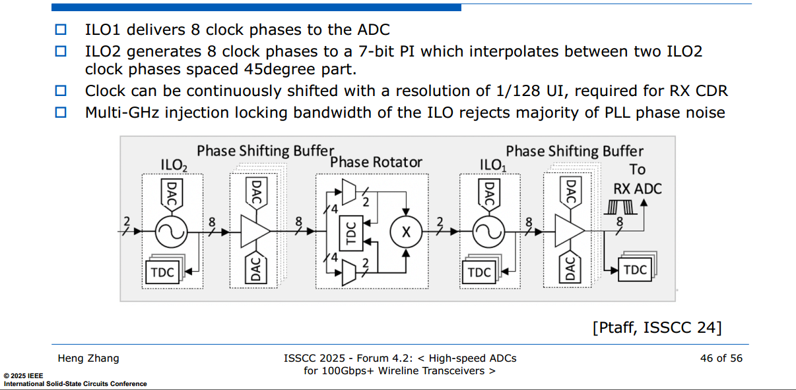

## Polyphase Filter (PPF)

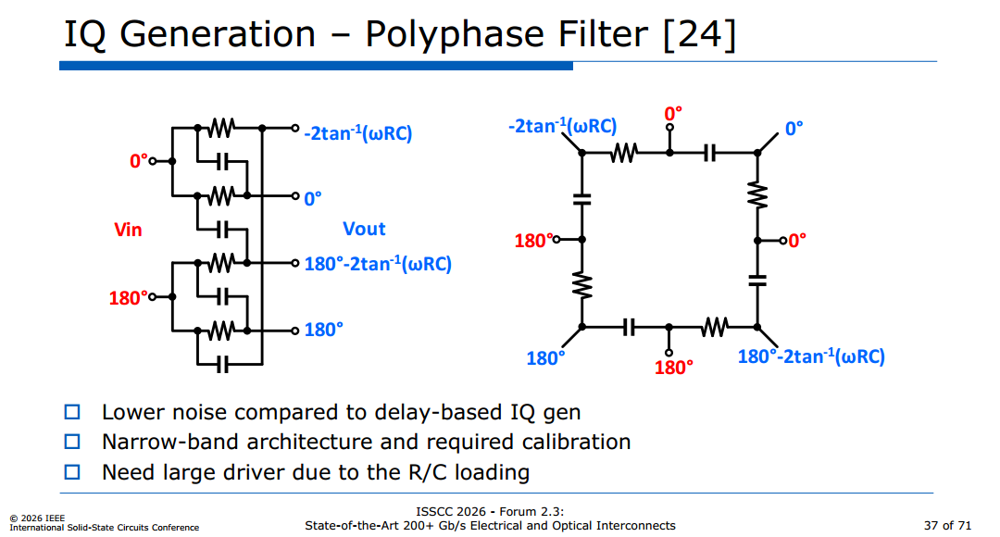

## Multiplying Delay-Locked-Loop (MDLL)

*TODO* &#128197;

## delay line based Skew Correction 

> D. Pfaff *et al*., "7.3 A 224Gb/s 3pJ/b 40dB Insertion Loss Transceiver in 3nm FinFET CMOS," *2024 IEEE International Solid-State Circuits Conference (ISSCC)*, San Francisco, CA, USA, 2024, pp. 128-130, doi: 10.1109/ISSCC49657.2024.10454537

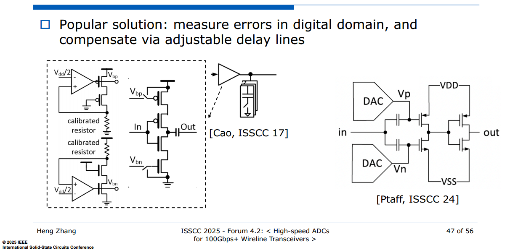

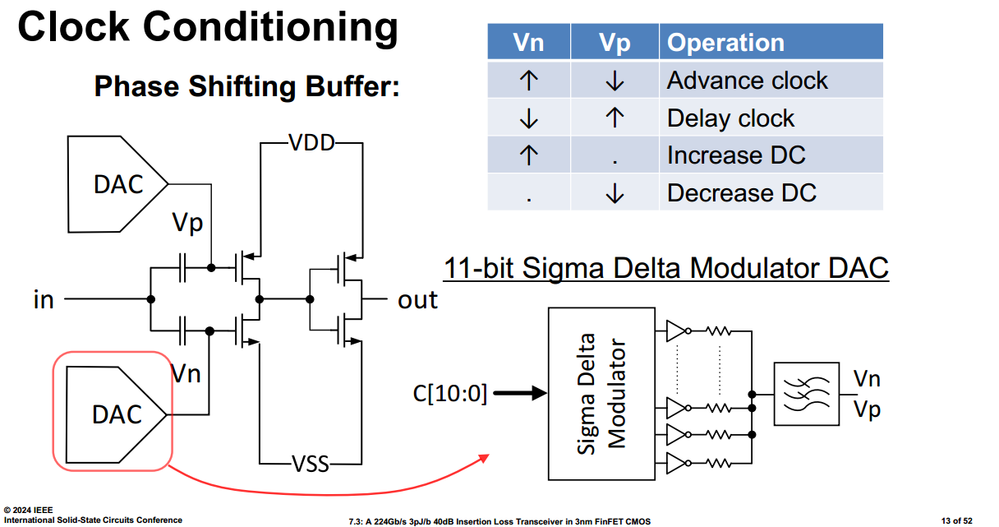

## phase interpolator based Skew Correction

> J. Q. Wang *et al*., "7.1 A 2.69pJ/b 212Gb/s DSP-Based PAM-4 Transceiver for Optical Direct-Detect Application in 5nm FinFET," *2024 IEEE International Solid-State Circuits Conference (ISSCC)*, San Francisco, CA, USA, 2024, pp. 123-125, doi: 10.1109/ISSCC49657.2024.10454275

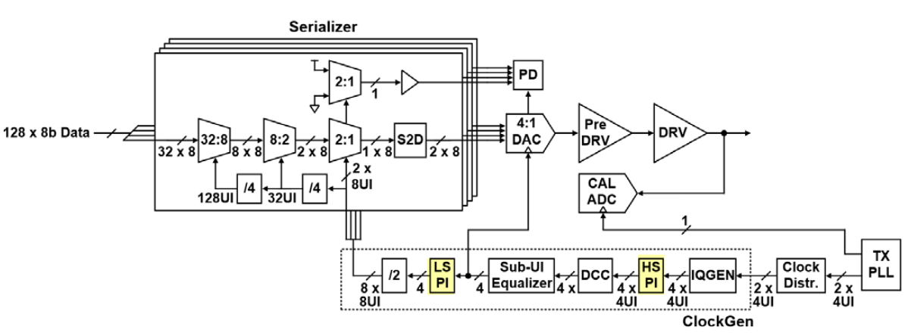

## mixer based Quadrature Phase Detector

> S. Chen et al., "A 4-to-16GHz inverter-based injection-locked quadrature clock generator with phase interpolators for multi-standard I/Os in 7nm FinFET," 2018 IEEE International Solid-State Circuits Conference - (ISSCC), San Francisco, CA, USA, 2018, pp. 390-39 [[https://sci-hub.red/storage/twin/6715/2bc891863e9eac1eb1670deb776ff04d/chen2018.pdf](https://sci-hub.red/storage/twin/6715/2bc891863e9eac1eb1670deb776ff04d/chen2018.pdf)]
>
> Z. Wang, Y. Zhang, Y. Onizuka and P. R. Kinget, "11.4 A High-Accuracy Multi-Phase Injection-Locked 8-Phase 7GHz Clock Generator in 65nm with 7b Phase Interpolators for High-Speed Data Links," *2021 IEEE International Solid-State Circuits Conference (ISSCC)*, San Francisco, CA, USA, 2021, pp. 186-188, [[https://sci-hub.ru/10.1109/ISSCC42613.2021.9365800](https://sci-hub.ru/10.1109/ISSCC42613.2021.9365800)]
>
> —, "Multi-Phase Clock Generation for Phase Interpolation With a Multi-Phase, Injection-Locked Ring Oscillator and a Quadrature DLL," in IEEE Journal of Solid-State Circuits, vol. 57, no. 6, pp. 1776-1787, June 2022, doi: 10.1109/JSSC.2021.3124486.
>
> —, "A Very High Linearity Twin Phase Interpolator With a Low-Noise and Wideband Delta Quadrature DLL for High-Speed Data Link Clocking," in IEEE Journal of Solid-State Circuits, vol. 58, no. 4, pp. 1172-1184, April 2023, doi: 10.1109/JSSC.2022.3197061
>
> —. *Efficient and High-Performance Clocking Circuits for High-Speed Data Links*. 2022. Columbia University, PhD dissertation. *Academic Commons*,[[https://academiccommons.columbia.edu/doi/10.7916/g3f1-4e71](https://academiccommons.columbia.edu/doi/10.7916/g3f1-4e71)]
>
> Shaokang ZHAO, 2025, "Multi-Phase Clock Generator for High-Speed Wireline Systems," [[paper](https://yuegroup.hkust.edu.hk/sites/default/files/Thesis/1.Thesis/2.Mphil/Shaokang%20Thesis.pdf), [slides](https://yuegroup.hkust.edu.hk/sites/default/files/Thesis/2.Slides/2.Mphil/Shaokang_Zhao%20Slides.pdf)]
>

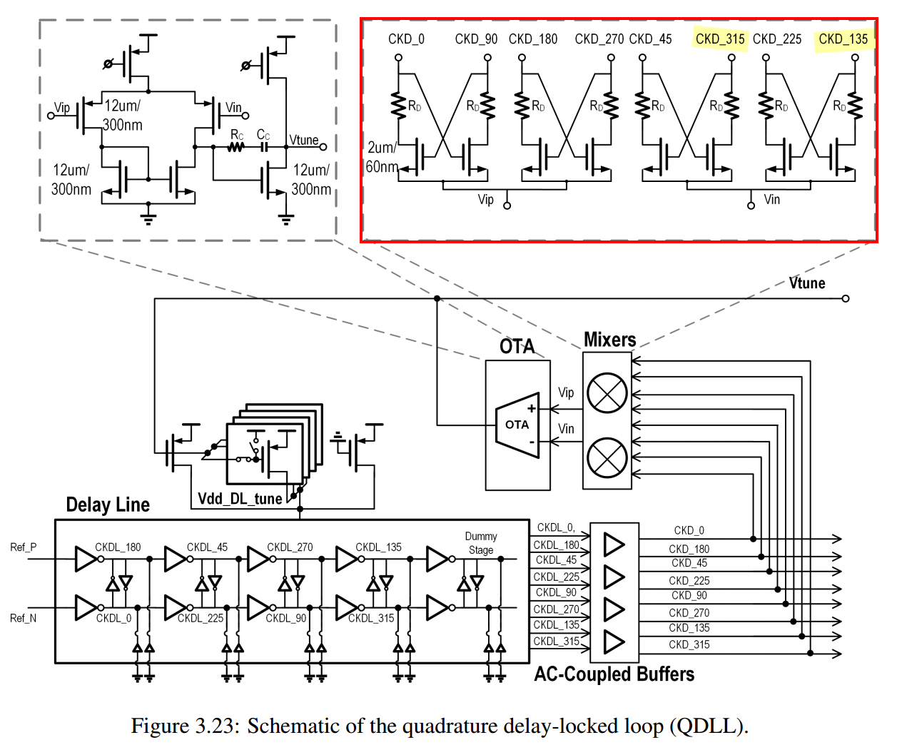
$$
V_{ip}=\mathrm{XNOR}(CKD_0,CKD_{90})\qquad \qquad V_{in}=\mathrm{XNOR}(CKD_{45},\textcolor{red}{CKD_{315}})
$$

> The loop settles where $V_{ip} = V_{in}$ on average, i.e. at a stage delay $\tau = T/8$ ($45^\circ$). Each inverter stage adds $180^\circ$ of inversion, so it shifts phase by $225^\circ$.  (see [MPG using DLL](#mpg-using-dll)).

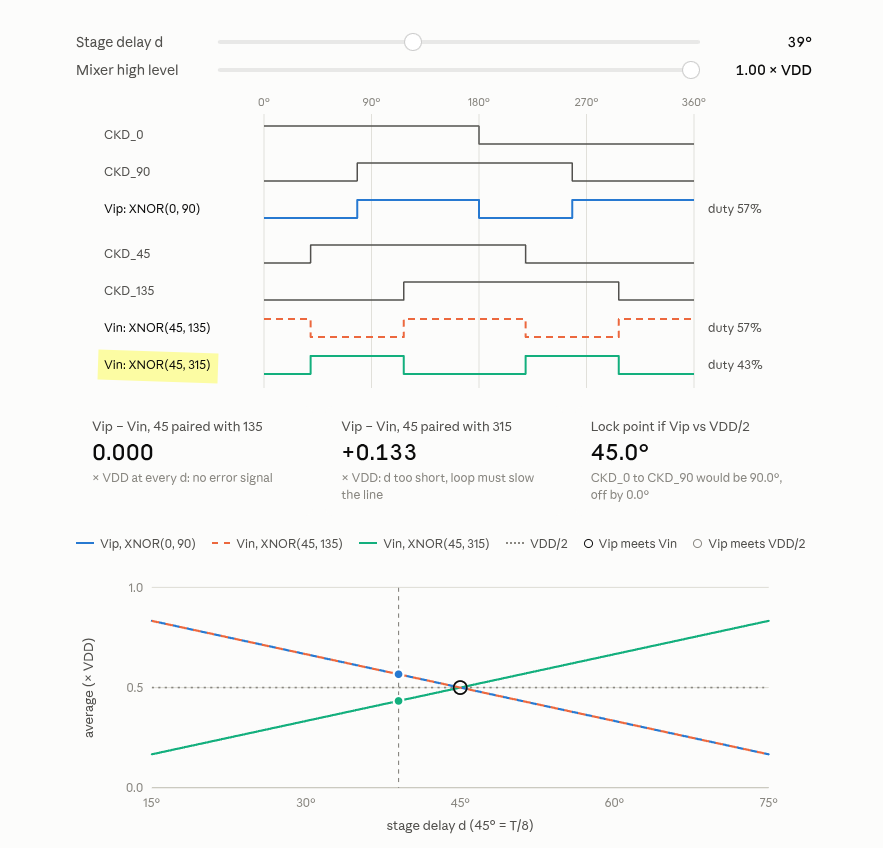

complementary of mixers-based QPD

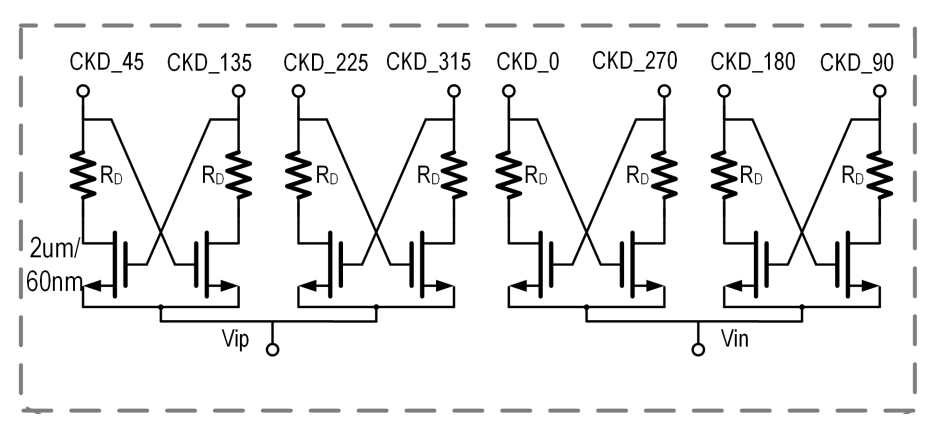

---

A natural approach is to compare

$$
\mathrm{XOR}(CKD_0,CKD_{90})+\mathrm{XOR}(CKD_{45},CKD_{135})
$$

against

$$
\mathrm{XNOR}(CKD_0,CKD_{90})+\mathrm{XNOR}(CKD_{45},CKD_{135})
$$

Its main limitation is that accurate phase detection relies on the input clocks having a 50% duty cycle.

---

> J. Im et al., "6.1 A 112Gb/s PAM-4 Long-Reach Wireline Transceiver Using a 36-Way Time-Interleaved SAR-ADC and Inverter-Based RX Analog Front-End in 7nm FinFET," 2020 IEEE International Solid-State Circuits Conference - (ISSCC), San Francisco, CA, USA, 2020, pp. 116-11 [[https://sci-hub.ru/10.1109/ISSCC19947.2020.9063081](https://sci-hub.ru/10.1109/ISSCC19947.2020.9063081)]
>
> —, "A 112-Gb/s PAM-4 Long-Reach Wireline Transceiver Using a 36-Way Time-Interleaved SAR ADC and Inverter-Based RX Analog Front-End in 7-nm FinFET," in IEEE Journal of Solid-State Circuits, vol. 56, no. 1, pp. 7-18, Jan. 2021 [[https://sci-hub.ru/10.1109/JSSC.2020.3024261](https://sci-hub.ru/10.1109/JSSC.2020.3024261)]

 It is important to note that any DCD in the output of the PI will translate into the IQ error at the output of the divide-by-6 block.

IQ correction of the 2.333-GHz clocks is carried out by adjusting the **duty cycle** after the PI

An **analog-style XOR detection** is used to generate an error voltage which after processing with a dynamic comparator is used as an input to a digital control algorithm

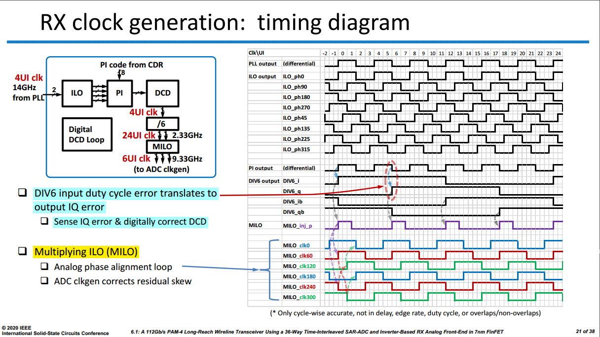

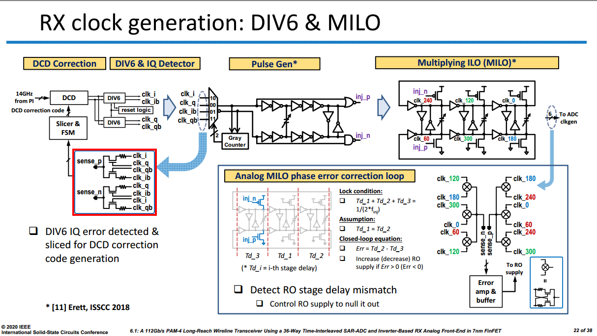

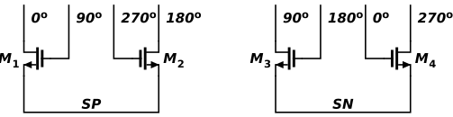

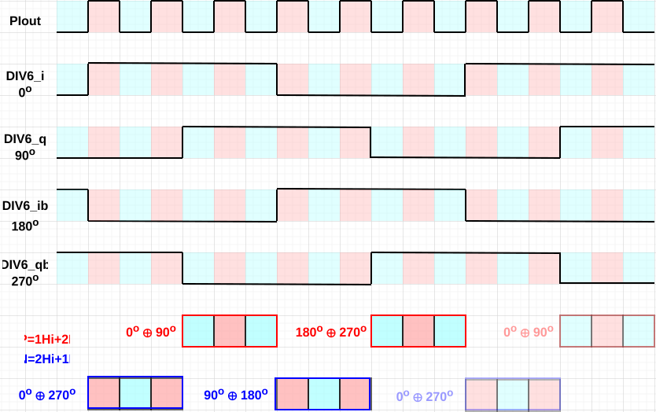

$$
\boxed{\text{SP} - \text{SN} = \text{1Lo} - \text{1Hi}}
$$

## calibration ADC based skew detection

> J. Q. Wang *et al*., "7.1 A 2.69pJ/b 212Gb/s DSP-Based PAM-4 Transceiver for Optical Direct-Detect Application in 5nm FinFET," *2024 IEEE International Solid-State Circuits Conference (ISSCC)*, San Francisco, CA, USA, 2024, pp. 123-125, doi: 10.1109/ISSCC49657.2024.10454275.

*TODO* &#128197;

## DCC & AC-coupled buffer

The amount of correction can be set by intentional injection of an *offset current* into the summing input node of INV, ***threshold-adjustable inverter***

> Note that the change to the threshold is ***opposite in direction*** to the change to INV
>
> increasing DC of input signal is equivalent to lower down the threshold of INV

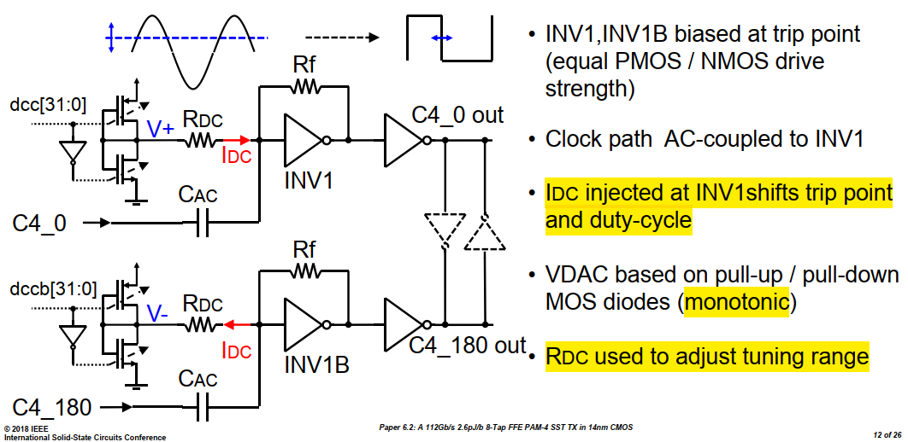

---

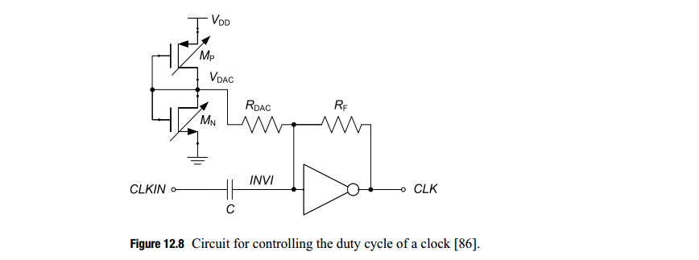

voltage at *INV1* will increased by:
$$
\frac{\Delta V_{DAC} - \Delta {INV1}}{R_{DAC}} = \frac{\Delta {INV1} +A_0 \Delta {INV1}}{R_{F}}
$$
therefore
$$
\Delta {INV1} = \Delta V_{DAC} \cdot \frac{R_F}{R_F+(A_0+1)R_{DAC}} \approx  \Delta V_{DAC} \cdot \frac{R_F}{A_0R_{DAC}}
$$

> variable $R_{DAC}$ can be used to tweak tuning resolution & range

If $R_{DAC} = R_F$
$$
\Delta {INV1}\approx \frac{\Delta V_{DAC}}{A_0}
$$

---

> C. Menolfi *et al*., "A 112Gb/S 2.6pJ/b 8-Tap FFE PAM-4 SST TX in 14nm CMOS," *2018 IEEE International Solid-State Circuits Conference - (ISSCC)* [[https://sci-hub.se/https://doi.org/10.1109/ISSCC.2018.8310205](https://sci-hub.se/https://doi.org/10.1109/ISSCC.2018.8310205)],[[visual](https://picture.iczhiku.com/resource/eetop/shiGDYTDYikLlnXv.pdf)]
>
> M. A. Kossel *et al*., "8.3 An 8b DAC-Based SST TX Using Metal Gate Resistors with 1.4pJ/b Efficiency at 112Gb/s PAM-4 and 8-Tap FFE in 7nm CMOS," *2021 IEEE International Solid-State Circuits Conference (ISSCC)*, San Francisco, CA, USA, 2021[[https://sci-hub.se/10.1109/ISSCC42613.2021.9365784](https://sci-hub.se/10.1109/ISSCC42613.2021.9365784)]
>
> C. Menolfi *et al*., "A 28Gb/s source-series terminated TX in 32nm CMOS SOI," *2012 IEEE International Solid-State Circuits Conference*, San Francisco, CA, USA, 2012
>
> Bob Lefferts, Navraj Nandra. SNUG Israel 2007

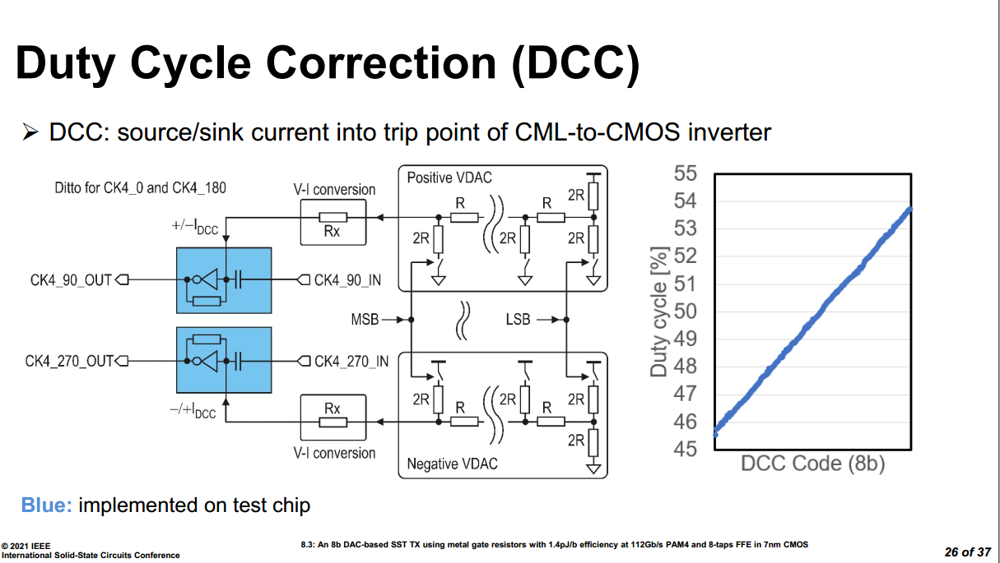

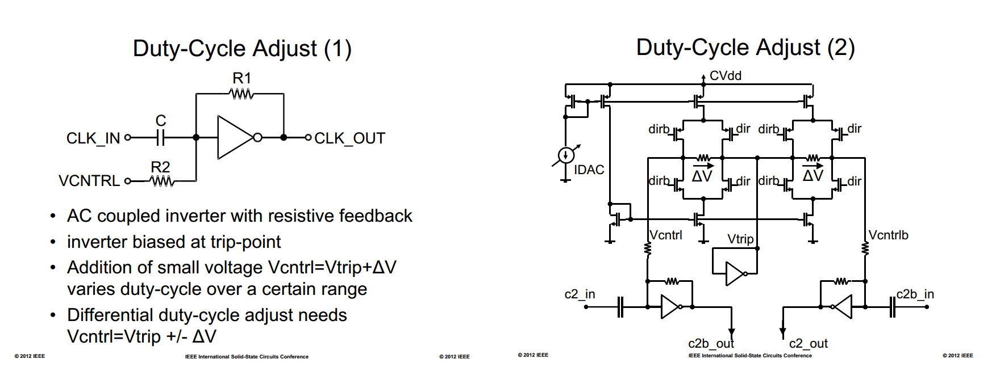

---

> Casper B, O'Mahony F. Clocking analysis, implementation and measurement techniques for high-speed data links: A tutorial. IEEE Transactions on Circuits and Systems I: Regular Papers. 2009;56(1):17-39 [[https://people.engr.tamu.edu/spalermo/ecen689/clocking_analysis_hs_links_casper_tcas1_2009.pdf](https://people.engr.tamu.edu/spalermo/ecen689/clocking_analysis_hs_links_casper_tcas1_2009.pdf)]

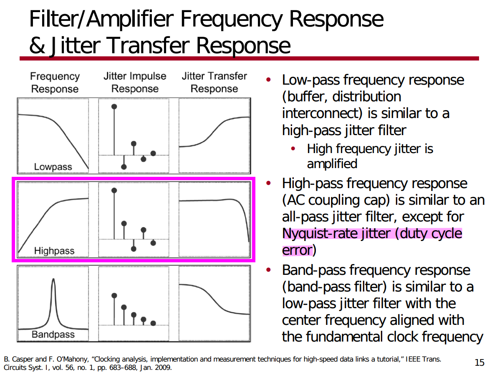

> Since duty-cycle error is *high frequency* component, the high-pass filter suppresses the duty-cycle error propagating to the output

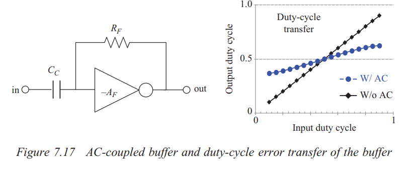

- The AC-coupling capacitor blocks the low-frequency component of the input
- The feedback resistor sets common mode voltage to the crossover voltage

## MUX Structure

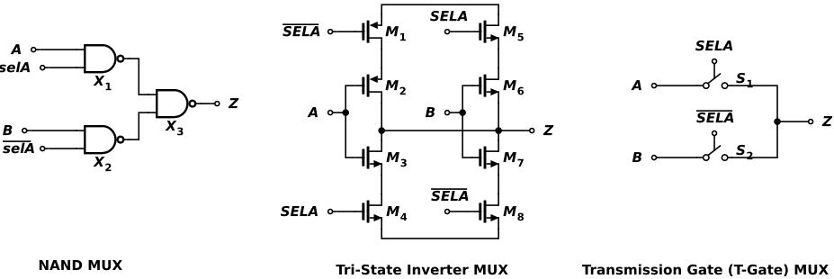

## Pulse Width Jitter (PWJ)

> [[Spectre Tech Tips: Measuring Noise in Digital Circuits](https://community.cadence.com/cadence_blogs_8/b/cic/posts/spectre-tech-tips-measuring-noise-in-digital-circuits)]

**Pnoise sampled: Edge Delay mode** measures the noise defined by two edges. Both edges are defined by a threshold voltage and rising or falling edges, which measures the noise of the pulse itself and direct plot calculate the variation of the **pulse width**

*TODO* &#128197;

## reference

Nicola Da Dalt, Intel. ISSCC 2017 Forum: High-Performance Clock Generation and Distribution in Very-High-Speed Wireline Transceivers

Jri Lee, NTU. ISSCC 2017 Forum: Fully-Integrated Millimeter-Wave Clock Generation — From DC to 300GHz

Jihwan Kim,Intel, ISSCC 2023 Forum *F1.5: Circuit Designs for 200+Gb/s Electrical Transceivers*

Heng Zhang, Broadcom, ISSCC 2025 - Forum *F4.2: High-speed ADCs for 100Gbps+ Wireline Transceivers*

**H. Zhang**, D. Cui, J. Cao, and A.Momtaz, *"Phase Adjustment Scheme for Time-interleaved ADCs"*, United States Patent. US 9065464 B2. Issued Jun.23, 2015. [[https://patentimages.storage.googleapis.com/c1/11/1f/6fb830d08b710b/US9065464.pdf](https://patentimages.storage.googleapis.com/c1/11/1f/6fb830d08b710b/US9065464.pdf)]

**H. Zhang**, D. Cui,  and J. Cao, *"Clock Generator for Use in A Time-interleaved ADC and Methods for Use therewith"*, United States Patent. US 8902094 B1. Issued Dec.2, 2014. [[https://patentimages.storage.googleapis.com/c7/0b/73/74e61515ddffa2/US8902094.pdf](https://patentimages.storage.googleapis.com/c7/0b/73/74e61515ddffa2/US8902094.pdf)]

E-Hung Chen, MTK, ISSCC 2026 Forum *F2.3: State-of-the-Art 200+ Gb/s Electrical and Optical Interconnects*

---

Rhee, W. (2020). Phase-locked frequency generation and clocking : architectures and circuits for modern wireless and wireline systems. The Institution of Engineering and Technology

Bae, Woorham; Jeong, Deog-Kyoon: 'Analysis and Design of CMOS Clocking Circuits for Low Phase Noise' (Materials, Circuits and Devices, 2020)

rfinsights, Quadrature Phase Detector: passive mixer vs XOR gate [[https://www.rfinsights.com/concepts/quadrature-phase-detector-passive-mixer-vs-xor/](https://www.rfinsights.com/concepts/quadrature-phase-detector-passive-mixer-vs-xor/)]

—, multiphase clock generation technique: a brief look into the history and the latest [[https://www.rfinsights.com/synthesizer/multiphase-clock-generation-techniques/](https://www.rfinsights.com/synthesizer/multiphase-clock-generation-techniques/)]

—, phase rotator in serdes - every major topology, explained [[https://www.rfinsights.com/synthesizer/phase-rotator/](https://www.rfinsights.com/synthesizer/phase-rotator/)]

