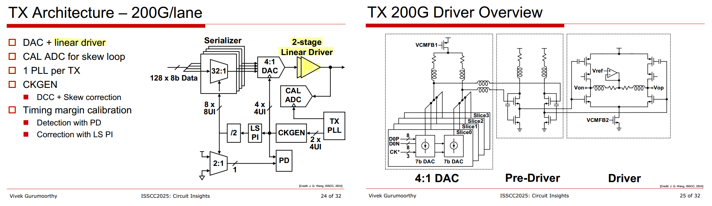
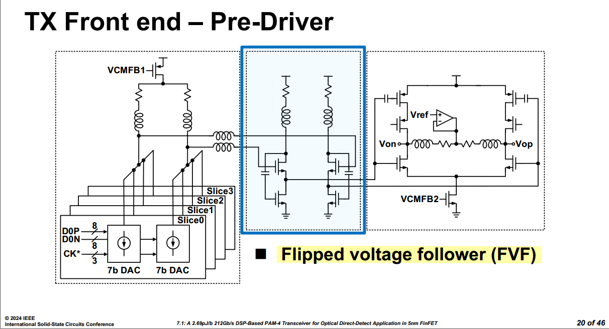

ODSP: Optical DSP

## Wavelength-Division Multiplexing (WDM)

Different wavelengths can travel simultaneously through the same fiber. This technique is called WDM (Wavelength-Division Multiplexing)

Think of a fiber as a highway, and different wavelengths as different lanes

## Linear Driver

> J. Q. Wang et al., "7.1 A 2.69pJ/b 212Gb/s DSP-Based PAM-4 Transceiver for Optical Direct-Detect Application in 5nm FinFET," 2024 IEEE International Solid-State Circuits Conference (ISSCC), San Francisco, CA, USA, 2024, pp. 123-125, doi: 10.1109/ISSCC49657.2024.10454275.

> Assuming the capacitor symbol in FVF is one voltage follower

## reference

Vladimir Stojanović, VLSI 2016 SC6: Integrated Electronic-Photonic Communication Circuits

Sudip Shekhar, ISSCC 2021 Tutorial, *Silicon Photonics: From Basics to ASICs*

Mayank Raj, CICC 2024, ES3-3: *Design of Silicon photonics based high throughput optical transceivers*

Vivek Gurumoorthy, Marvell, ISSCC 2025 Circuit Insights: *Circuits for Optical Communication*
