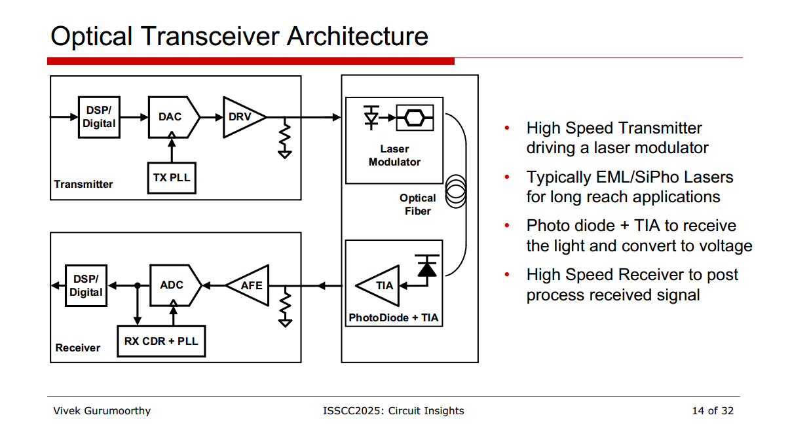
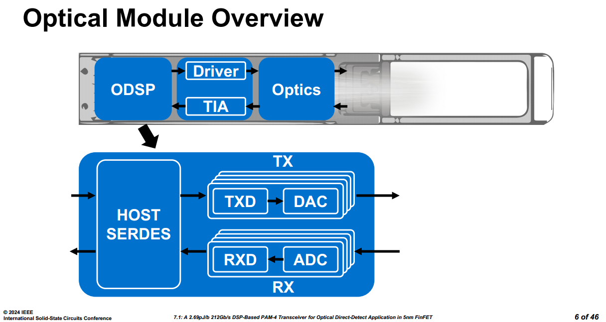
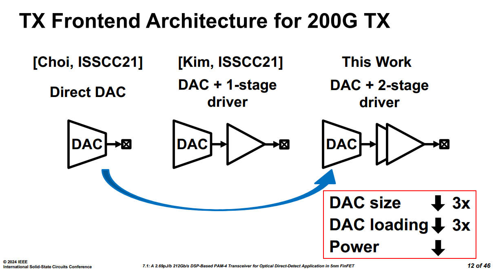
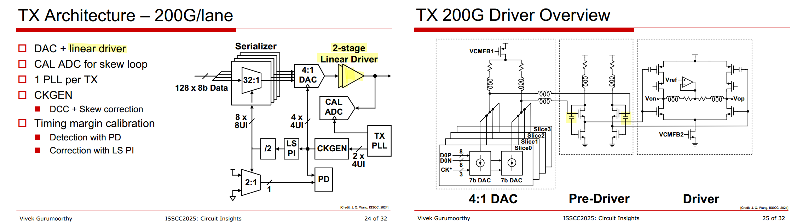
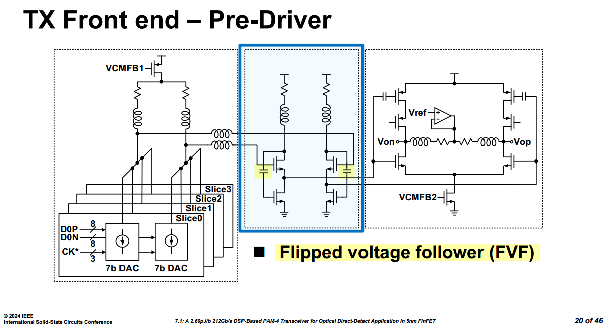
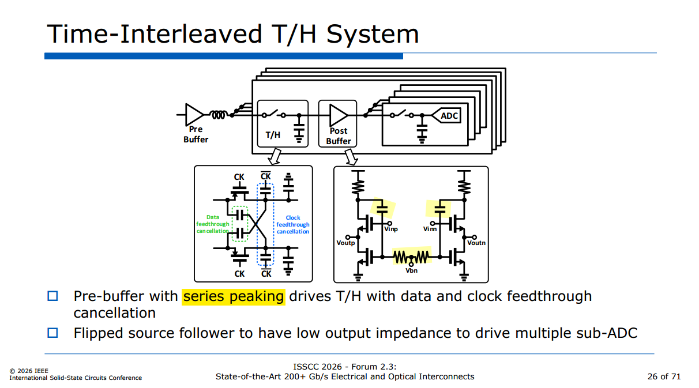
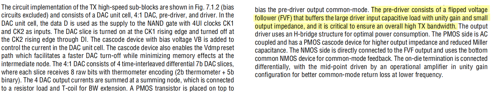
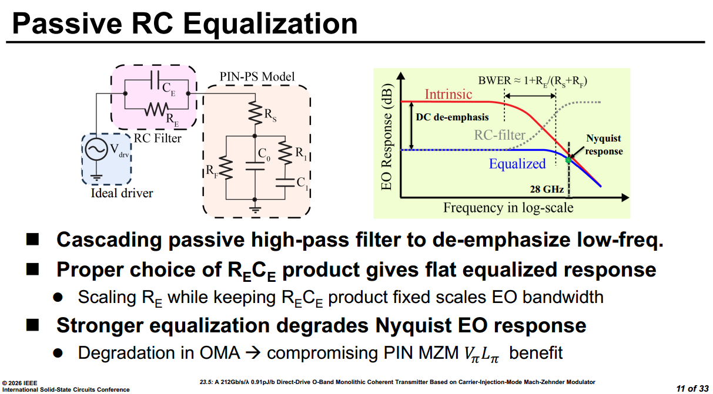

ODSP: Optical DSP

## Wavelength-Division Multiplexing (WDM)

Different wavelengths can travel simultaneously through the same fiber. This technique is called WDM (Wavelength-Division Multiplexing)

Think of a fiber as a highway, and different wavelengths as different lanes

## Linear Driver

> J. Q. Wang et al., "7.1 A 2.69pJ/b 212Gb/s DSP-Based PAM-4 Transceiver for Optical Direct-Detect Application in 5nm FinFET," 2024 IEEE International Solid-State Circuits Conference (ISSCC), San Francisco, CA, USA, 2024, pp. 123-125 [[https://sci-net.xyz/10.1109/ISSCC49657.2024.10454275](https://sci-net.xyz/10.1109/ISSCC49657.2024.10454275)]

> AC capacitor maintain AC feedback path of FVF, and provide appropriate DC bias for tail NMOS
>
> 

## Passive RC Equalization

> A. R. Chowdhury, W. Rahman, A. ElShater, T. Ali and V. Stojanovic, "A 212Gb/s/λ 0.91pJ/b Direct-Drive O-Band Monolithic Coherent Transmitter Based on Carrier-Injection-Mode Mach-Zehnder Modulator," *2026 IEEE International Solid-State Circuits Conference (ISSCC)*, San Francisco, CA, USA, 2026, pp. 1-3, doi: 10.1109/ISSCC49663.2026.11409273.

## reference

Vladimir Stojanović, VLSI 2016 SC6: *Integrated Electronic-Photonic Communication Circuits*

Azita Emami, CICC 2019 ES3-2: *High-Speed Optical Links*

Sudip Shekhar, ISSCC 2021 Tutorial, *Silicon Photonics: From Basics to ASICs*

Mayank Raj, CICC 2024, ES3-3: *Design of Silicon photonics based high throughput optical transceivers*

Peter Ossieur, ISSCC 2025 tutorial T6: *Front-End Circuit Design for High-Speed Optical Transceivers*

Vivek Gurumoorthy, Marvell, ISSCC 2025 Circuit Insights: *Circuits for Optical Communication*

E-Hung Chen, MTK, ISSCC 2026 Forum *F2.3: State-of-the-Art 200+ Gb/s Electrical and Optical Interconnects*
