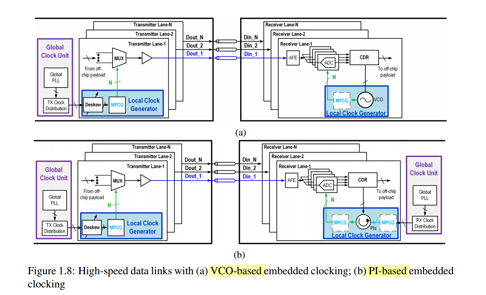

> Wang, Zhaowen. *Efficient and High-Performance Clocking Circuits for High-Speed Data Links*. 2022. Columbia University, PhD dissertation. *Academic Commons*,[[https://academiccommons.columbia.edu/doi/10.7916/g3f1-4e71](https://academiccommons.columbia.edu/doi/10.7916/g3f1-4e71)]

The PI-based architecture decouples the high-frequency clock synthesis and local clock deskew, allowing to optimize the power consumption and circuit area at a system level


## Current-Mode Phase Interpolator (CMPI)

> A. K. Mishra, Y. Li, P. Agarwal and S. Shekhar, "17.7 A 9b-Linear 14GHz Integrating-Mode Phase Interpolator in 5nm FinFET Process," *2022 IEEE International Solid-State Circuits Conference (ISSCC)*, San Francisco, CA, USA, 2022, pp. 1-3 [[https://sci-hub.jp/10.1109/ISSCC42614.2022.9731703](https://sci-hub.jp/10.1109/ISSCC42614.2022.9731703)]
>
> —, "Improving Linearity in CMOS Phase Interpolators," in *IEEE Journal of Solid-State Circuits*, vol. 58, no. 6, pp. 1623-1635, June 2023 [[https://sci-net.xyz/10.1109/JSSC.2023.3243305](https://sci-net.xyz/10.1109/JSSC.2023.3243305)]
>
> D. Xu *et al*., "8.5 A Scalable Adaptive ADC/DSP-Based 1.25-to-56Gbps/112Gbps High-Speed Transceiver Architecture Using Decision-Directed MMSE CDR in 16nm and 7nm," *2021 IEEE International Solid-State Circuits Conference (ISSCC)*, San Francisco, CA, USA, 2021, pp. 134-136 [[https://sci-hub.ru/10.1109/ISSCC42613.2021.9366063](https://sci-hub.ru/10.1109/ISSCC42613.2021.9366063)]

Current-mode PIs (CMPIs) can achieve high linearity but at the cost of digital overhead to generate **sinusoidal weights**

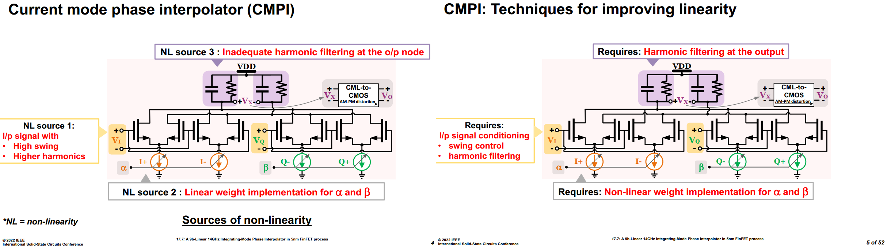

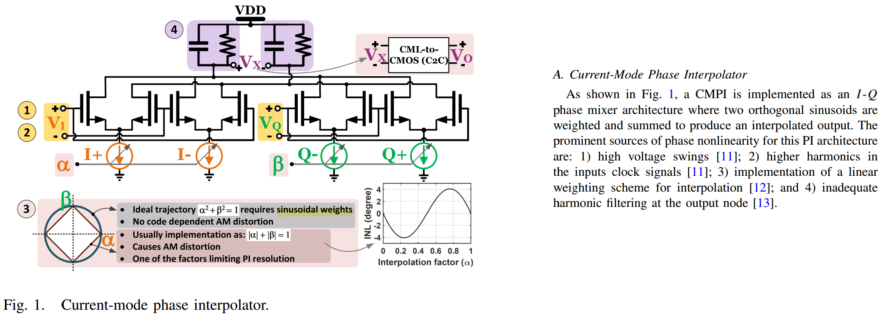

> $\alpha^2 + \beta^2=1$ ensure constant amplitude, however $\alpha$ still needed be selected with $\tan\phi = \frac{1-\alpha^2}{\alpha^2}$ for constant phase step

A **constant Output amplitude** is desired because the *swing-dependent delay characteristic* of the **CML-to-CMOS (C2C)** circuit results in *AM–PM distortion* which eventually manifests as phase nonlinearity

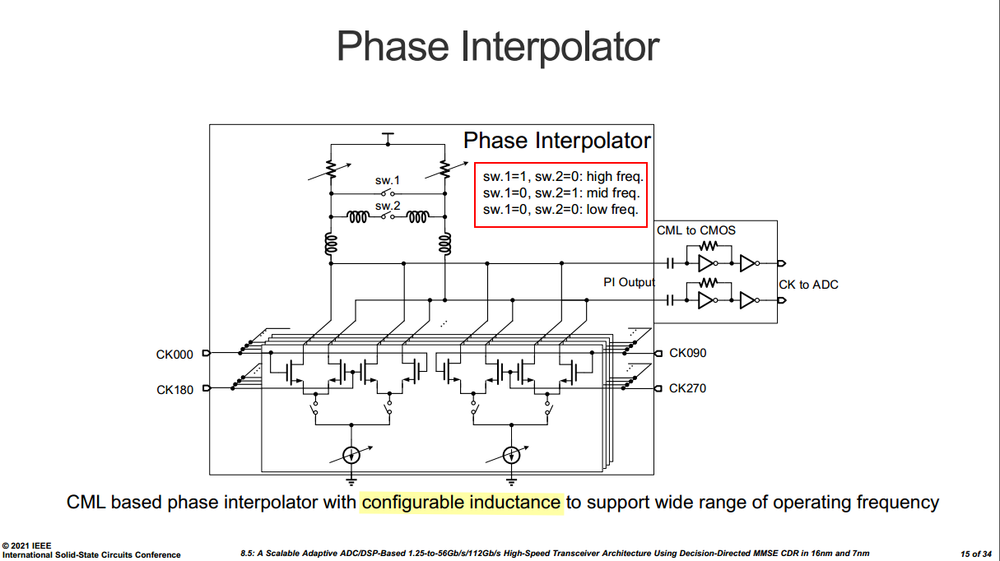

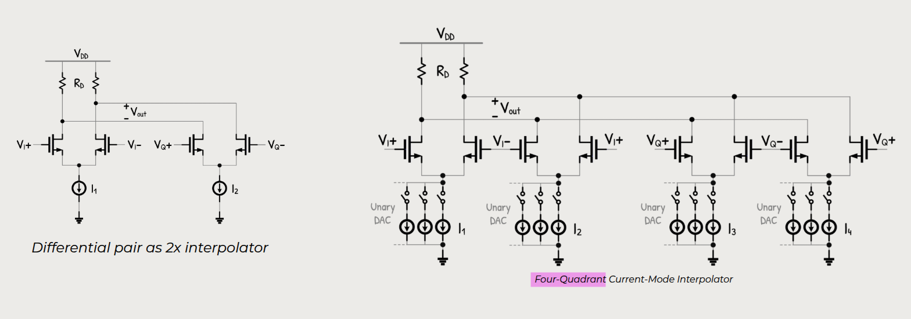


## Voltage-Mode Phase Interpolator (VMPI)

> A. K. Mishra, Y. Li, P. Agarwal and S. Shekhar, "17.7 A 9b-Linear 14GHz Integrating-Mode Phase Interpolator in 5nm FinFET Process," *2022 IEEE International Solid-State Circuits Conference (ISSCC)*, San Francisco, CA, USA, 2022, pp. 1-3 [[https://sci-hub.jp/10.1109/ISSCC42614.2022.9731703](https://sci-hub.jp/10.1109/ISSCC42614.2022.9731703)]

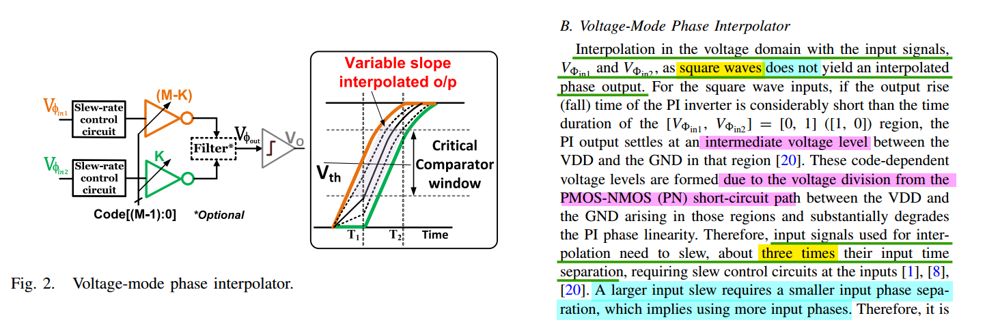

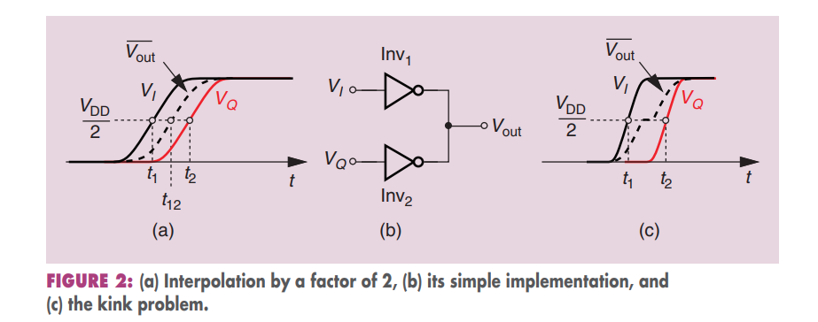

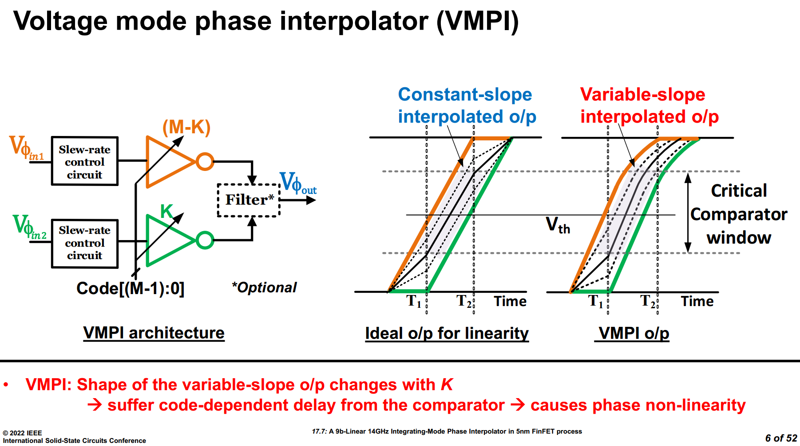


---

> B. Razavi, "The Design of a Phase Interpolator [The Analog Mind]," in *IEEE Solid-State Circuits Magazine*, vol. 15, no. 4, pp. 6-10, Fall 2023 [[https://www.seas.ucla.edu/brweb/papers/Journals/BR_SSCM_4_2023.pdf](https://www.seas.ucla.edu/brweb/papers/Journals/BR_SSCM_4_2023.pdf)]


<span style="background-color:yellow">Use of **resistors** in the interpolation network</span>

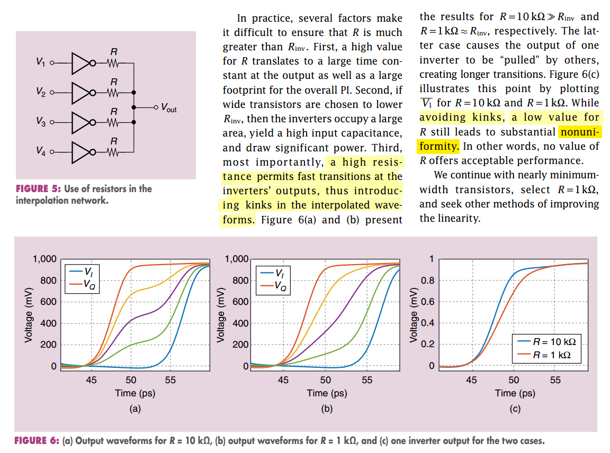

| R               | High Value | Low Value |
| --------------- | ---------- | --------- |
| *kink*          | &#10062;   | &#9989;   |
| *nonconformity* | &#9989;    | &#10062;  |

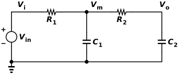

With $\tau_1 = R_1C_1$, $\tau_2 = R_2C_2$ and $\tau_{12} = R_1C_2$
$$
\frac{V_o}{V_{in}} = \frac{1}{D(s)}, \quad \frac{V_m}{V_{in}} = \frac{1+s\tau_2}{D(s)}
$$
where
$$
D(s) = 1 + s(\tau_1+\tau_2+\tau_{12}) + s^2\tau_1\tau_2 = (1+s\tau_a)(1+s\tau_b)
$$

$$
\tau_{a,b} = \frac{1}{2}\left[(\tau_1+\tau_2+\tau_{12}) \pm \sqrt{(\tau_1+\tau_2+\tau_{12})^2 - 4\tau_1\tau_2}\right], \quad \tau_a > \tau_2 > \tau_b
$$

The step responses are
$$\begin{align}
V_o(t) &= 1 - \frac{\tau_a e^{-t/\tau_a} - \tau_b e^{-t/\tau_b}}{\tau_a - \tau_b} \\
V_m(t) &= 1 - \frac{(\tau_a-\tau_2) e^{-t/\tau_a} + (\tau_2-\tau_b) e^{-t/\tau_b}}{\tau_a - \tau_b}
\end{align}$$

- initial slope: $V_m'(0^+) = \frac{1}{R_1C_1}$ for any $R_2$ ($V_m = V_o = 0$ at $t=0^+$, no current flows into $R_2$), while $V_o'(0^+) = 0$
- Elmore time constant of $V_m$: $\int_0^\infty (1-V_m)\,dt = \tau_a + \tau_b - \tau_2 = R_1(C_1+C_2)$, ***independent of $R_2$***, all of $C_2$'s charge still flows through $R_1$
- Elmore time constant of $V_o$: $\int_0^\infty (1-V_o)\,dt = \tau_a + \tau_b = R_1C_1 + (R_1+R_2)C_2$, grows with $R_2$

For $R_2 \gg R_1$ (well-separated poles)
$$
\boxed{V_m(t) \approx 1 - \frac{R_2}{R_1+R_2}e^{-\frac{t}{(R_1\parallel R_2)C_1}} - \frac{R_1}{R_1+R_2}e^{-\frac{t}{(R_1+R_2)C_2}}}
$$

<span style="background-color:yellow">For the internal node (the inverter output), increasing $R_2$ does not change its Elmore time constant $R_1(C_1+C_2)$, but it reshapes the response</span>: 

- most of the swing completes with a **fast pole** $\approx (R_1\parallel R_2)C_1 \to R_1C_1$, leaving a small tail of amplitude $\approx \frac{R_1}{R_1+R_2}$ with $\tau \approx (R_1+R_2)C_2$. 

So the inverter edge gets sharper (an earlier mid-rail crossing) even though the output-node time constant $R_1C_1+(R_1+R_2)C_2$ grows

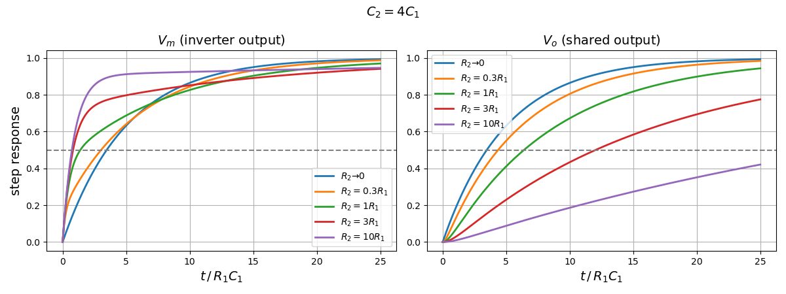

```python
import numpy as np
import matplotlib.pyplot as plt

R1, C1, C2 = 1, 1, 4    # normalized, t in units of R1*C1
t = np.linspace(0, 25, 25001)

def step(R2):
    tau1, tau2, tau12 = R1*C1, R2*C2, R1*C2
    b1, b2 = tau1 + tau2 + tau12, tau1*tau2
    ta = (b1 + np.sqrt(b1**2 - 4*b2))/2
    tb = (b1 - np.sqrt(b1**2 - 4*b2))/2
    vo = 1 - (ta*np.exp(-t/ta) - tb*np.exp(-t/tb))/(ta - tb)
    vm = 1 - ((ta - tau2)*np.exp(-t/ta) + (tau2 - tb)*np.exp(-t/tb))/(ta - tb)
    return vm, vo

plt.figure(figsize=(12, 4.5))
for R2 in [1e-3, 0.3, 1, 3, 10]:
    vm, vo = step(R2)
    label = r'$R_2 \to 0$' if R2 < 0.01 else rf'$R_2={R2:g}R_1$'
    plt.subplot(1, 2, 1); plt.plot(t, vm, linewidth=2, label=label)
    plt.subplot(1, 2, 2); plt.plot(t, vo, linewidth=2, label=label)

for i, title in enumerate([r'$V_m$ (inverter output)', r'$V_o$ (shared output)']):
    plt.subplot(1, 2, i+1)
    plt.axhline(0.5, linestyle='--', color='gray'); plt.grid(); plt.legend(fontsize=10)
    plt.title(title, fontsize=14); plt.xlabel(r'$t\,/\,R_1C_1$', fontsize=14)
plt.subplot(1, 2, 1); plt.ylabel('step response', fontsize=14)
plt.suptitle(r'$C_2 = 4C_1$', fontsize=14); plt.tight_layout()

plt.show()
```


## Integrating-Mode Phase Interpolator (IMPI)

> A. K. Mishra, Y. Li, P. Agarwal and S. Shekhar, "17.7 A 9b-Linear 14GHz Integrating-Mode Phase Interpolator in 5nm FinFET Process," *2022 IEEE International Solid-State Circuits Conference (ISSCC)*, San Francisco, CA, USA, 2022, pp. 1-3, doi: 10.1109/ISSCC42614.2022.9731703.
>
> Shaokang ZHAO, 2025, "Multi-Phase Clock Generator for High-Speed Wireline Systems," [[paper](https://yuegroup.hkust.edu.hk/sites/default/files/Thesis/1.Thesis/2.Mphil/Shaokang%20Thesis.pdf), [slides](https://yuegroup.hkust.edu.hk/sites/default/files/Thesis/2.Slides/2.Mphil/Shaokang_Zhao%20Slides.pdf)]

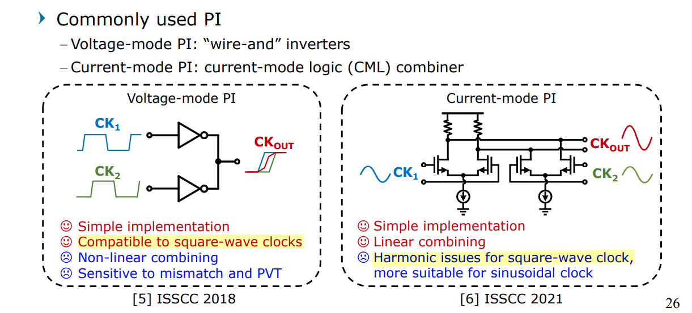


## CMPI using LC-resonant load

> C. -f. Liang, S. -c. Hwu and S. -i. Liu, "A 10Gbps Burst-Mode CDR Circuit in 0.18μm CMOS," *IEEE Custom Integrated Circuits Conference 2006*, San Jose, CA, USA, 2006, pp. 599-602 [[https://sci-hub.ru/10.1109/CICC.2006.320828](https://sci-hub.ru/10.1109/CICC.2006.320828)]
>
> L. -m. Lee and C. -K. K. Yang, "Phase correction of a resonant clocking system using resonant interpolators," *2008 IEEE Symposium on VLSI Circuits*, Honolulu, HI, USA, 2008, pp. 170-171 [[https://sci-hub.jp/10.1109/VLSIC.2008.4585994](https://sci-hub.jp/10.1109/VLSIC.2008.4585994)] 
>
> M. Erett *et al*., "A 0.5–16.3 Gbps Multi-Standard Serial Transceiver With 219 mW/Channel in 16-nm FinFET," in *IEEE Journal of Solid-State Circuits*, vol. 52, no. 7, pp. 1783-1797, July 2017 [[https://sci-hub.jp/10.1109/JSSC.2017.2702711](https://sci-hub.jp/10.1109/JSSC.2017.2702711)]

<span style="background-color:yellow">**harmonic filtering for less jitter, better INL & DNL**</span>

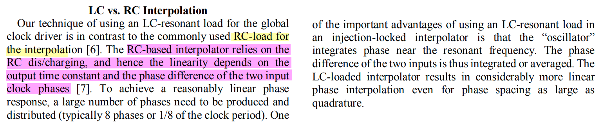

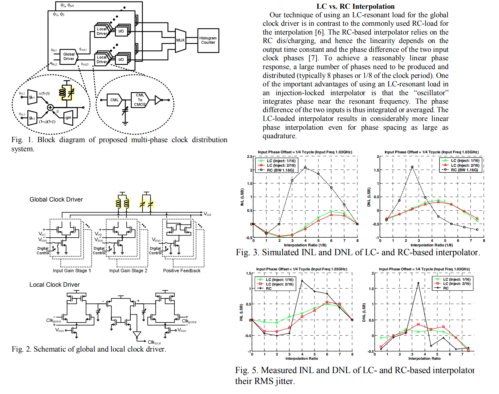


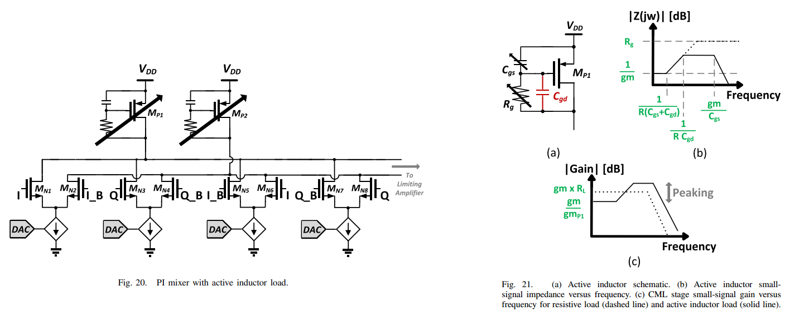


## reference clock edges

> **B. Razavi, **"The Design of a Phase Interpolator [The Analog Mind]," IEEE Solid-State Circuits Magazine, Volume. 15, Issue. 4, pp. 6-10, Fall 2023.([https://www.seas.ucla.edu/brweb/papers/Journals/BR_SSCM_4_2023.pdf](https://www.seas.ucla.edu/brweb/papers/Journals/BR_SSCM_4_2023.pdf))

<span style="background-color:yellow">***kink problem***</span>

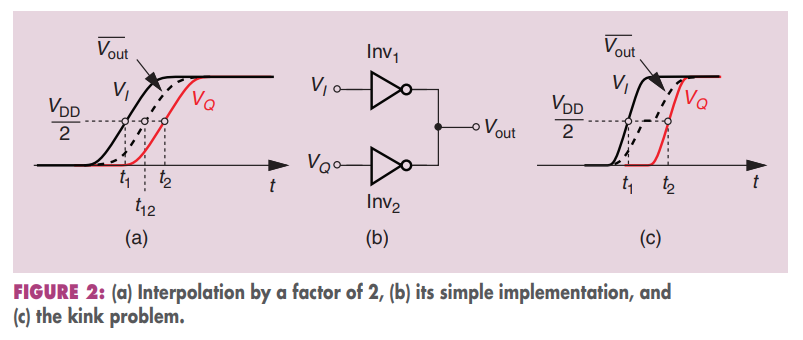


!!! Clock Edges

And for a phase interpolator, you need those reference clocks to be completely the opposite. Ideally they would be **triangular** shaped

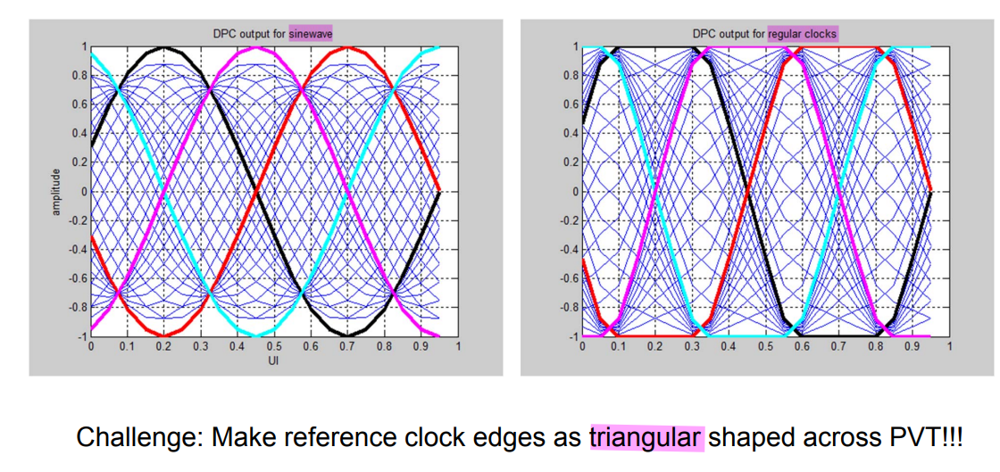

> *four input clocks given by the cyan, black, magenta, red*


## Predistortion


### Predistortion for sinusoidal

the interpolating inverters near the midscale can be made weaker so as to obtain more uniform phase increments. Alternatively, those at the top and bottom of the array can be made stronger

<span style="color:white; background-color:black">**Single-Quadrant PI**</span>

$$
V_o(t) = m \cdot \sin(\omega t + \frac{\pi}{2}) + p\cdot \sin(\omega t) = m\cdot \cos(\omega t) + p\cdot \sin(\omega t) = \sqrt{m^2+p^2} \sin(\omega t + \phi)
$$

where $\tan \phi = \frac{m}{p} = \frac{1-p}{p}$ and $p = \frac{1}{1+\tan \phi}$


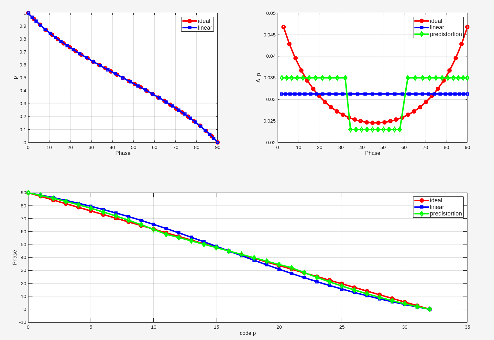

```matlab
phi = (32:-1:0)./32*pi/2;
p_ideal = 1./(1+tan(phi));
delta_p_ideal = abs(p_ideal(1:end-1) - p_ideal(2:end));
phi_ideal = atan((1-p_ideal)./p_ideal);


p_lin = (0:1:32)/32;
phi_lin = atan((1-p_lin)./p_lin);
delta_p_lin = abs(p_lin(1:end-1) - p_lin(2:end));


delta_plr_predist = ones(1,11)*0.035;
delta_pm_predist = ones(1,10) * (1-2*sum(delta_plr_predist))/10;
delta_p_predist = [delta_plr_predist delta_pm_predist delta_plr_predist];
p_predist = [0 cumsum(delta_p_predist)];
phi_predist = atan((1-p_predist)./p_predist);


subplot(2,2,1)
plot(phi/pi*180, p_ideal, 'ro-', LineWidth=3)
hold on
plot(phi_lin/pi*180, p_lin, 'bs-', LineWidth=3)
grid on; legend('ideal', 'linear', fontsize=12)
xlabel('Phase'); ylabel('p')

subplot(2,2,2)
plot(phi(1:end-1)/pi*180, delta_p_ideal, 'ro-', LineWidth=3)
hold on
plot(phi_lin(1:end-1)/pi*180, delta_p_lin, 'bs-', LineWidth=3)
plot(phi_predist(1:end-1)/pi*180, delta_p_predist, 'gd-', LineWidth=3)
grid on; legend('ideal', 'linear', 'predistortion', fontsize=12)
xlabel('Phase'); ylabel('\Delta p')

subplot(2,2, [3,4])

plot(0:1:32, phi/pi*180, 'ro-', LineWidth=3)
hold on
plot(0:1:32, phi_lin/pi*180, 'bs-', LineWidth=3)
plot(0:1:32, phi_predist/pi*180, 'gd-', LineWidth=3)
grid on; legend('ideal', 'linear', 'predistortion', fontsize=12)
xlabel('code p'); ylabel('Phase')
```


<span style="color:white; background-color:black">**Eight-Quadrant PI**</span>

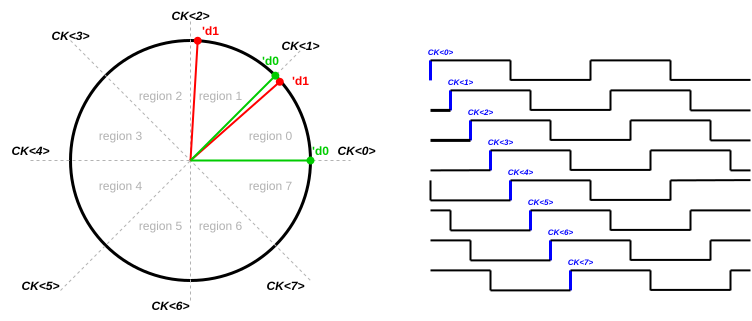
$$\begin{align}
V_o(t) &= m \cdot \sin(\omega t + \frac{\pi}{4}) + p\cdot \sin(\omega t) = \frac{\sqrt{2}}{2}m\cdot \cos(\omega t) + \left( \frac{\sqrt{2}}{2}m + p\right)\cdot \sin(\omega t) \\
&= \sqrt{m^2 + p^2 +\sqrt{2}pm}\cdot \sin(\omega t + \phi)
\end{align}$$

where $\tan\phi = \frac{\sqrt{2}m}{\sqrt{2}m+2p} = \frac{\sqrt{2}-\sqrt{2}p}{\sqrt{2}+(2-\sqrt{2})p}$

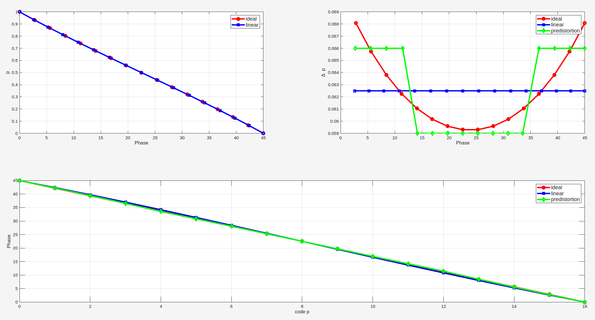

```matlab
phi = (16:-1:0)./16*pi/4;
p_ideal = 2^0.5*(1-tan(phi))./(2*tan(phi)+2^0.5*(1-tan(phi)));
delta_p_ideal = abs(p_ideal(1:end-1) - p_ideal(2:end));
phi_ideal = atan((2^0.5 - 2^0.5*p_ideal)./(2^0.5 + (2-2^0.5)*p_ideal));


p_lin = (0:1:16)/16;
phi_lin = atan((2^0.5 - 2^0.5*p_lin)./(2^0.5 + (2-2^0.5)*p_lin));
delta_p_lin = abs(p_lin(1:end-1) - p_lin(2:end));


delta_plr_predist = ones(1,4)*0.066;
delta_pm_predist = ones(1,8) * (1-2*sum(delta_plr_predist))/8;
delta_p_predist = [delta_plr_predist delta_pm_predist delta_plr_predist];
p_predist = [0 cumsum(delta_p_predist)];
phi_predist = atan((2^0.5 - 2^0.5*p_predist)./(2^0.5 + (2-2^0.5)*p_predist));


subplot(2,2,1)
plot(phi/pi*180, p_ideal, 'ro-', LineWidth=3)
hold on
plot(phi_lin/pi*180, p_lin, 'bs-', LineWidth=3)
grid on; legend('ideal', 'linear', fontsize=12)
xlabel('Phase'); ylabel('p')

subplot(2,2,2)
plot(phi(1:end-1)/pi*180, delta_p_ideal, 'ro-', LineWidth=3)
hold on
plot(phi_lin(1:end-1)/pi*180, delta_p_lin, 'bs-', LineWidth=3)
plot(phi_predist(1:end-1)/pi*180, delta_p_predist, 'gd-', LineWidth=3)
grid on; legend('ideal', 'linear', 'predistortion', fontsize=12)
xlabel('Phase'); ylabel('\Delta p')

subplot(2,2, [3,4])

plot(0:1:16, phi/pi*180, 'ro-', LineWidth=3)
hold on
plot(0:1:16, phi_lin/pi*180, 'bs-', LineWidth=3)
plot(0:1:16, phi_predist/pi*180, 'gd-', LineWidth=3)
grid on; legend('ideal', 'linear', 'predistortion', fontsize=12)
xlabel('code p'); ylabel('Phase')
```


### Predistortion for square wave

> Weinlader, Daniel, Thomas H. Lee and James A. Gasbarro. "Precision CMOS receivers for VLSI testing applications." (2001). [[https://www-vlsi.stanford.edu/people/alum/pdf/0111_Weinlader_Precision_CMOS_Receivers_.pdf](https://www-vlsi.stanford.edu/people/alum/pdf/0111_Weinlader_Precision_CMOS_Receivers_.pdf)]

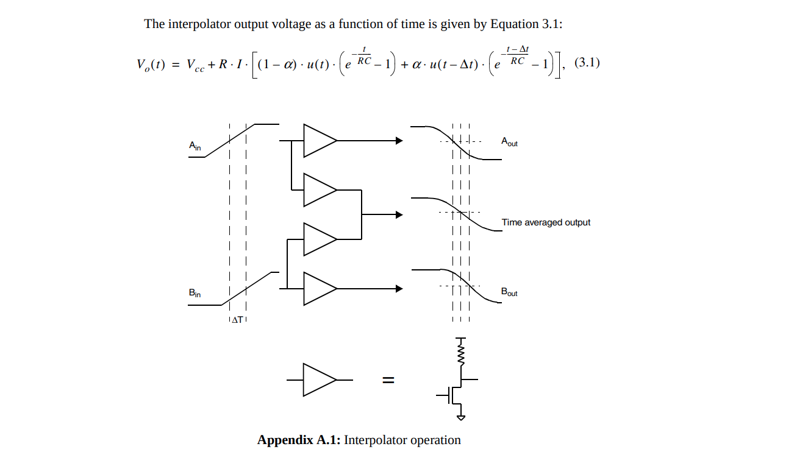

Normalize Eq. (3.1) with $\tau = RC$ and threshold at mid-swing, suppose $V_i(t) = 1- e^{-\frac{t}{\tau}}$ and $V_q(t) = 1-e^{-\frac{t-\Delta t}{\tau}}$ with $t\ge \Delta t$
$$
\frac{1}{2} = (1-\alpha)\cdot V_i(t) + \alpha \cdot V_q(t)
$$
yields the trigger time
$$
t = \tau \ln\left[ 1 + \alpha \left(e^{\frac{\Delta t}{\tau}}-1\right)\right] + \tau \ln 2
$$
which holds for all $\alpha$ only if $\Delta t \le \tau \ln 2$, i.e. the crossing always happens after $V_q$ starts rising; otherwise, at small $\alpha$ the output crosses before $V_q$ arrives → ***kink problem***

Then
$$\begin{align}
\frac{\partial t}{\partial \alpha} &= \tau \frac{e^{\frac{\Delta t}{\tau }}-1}{1+\alpha(e^{\frac{\Delta t}{\tau}}-1)} \gt 0 \\
\frac{\partial^2 t}{\partial \alpha^2} &= -\tau \frac{\left(e^{\frac{\Delta t}{\tau }}-1\right)^2}{\left(1+\alpha(e^{\frac{\Delta t}{\tau}}-1)\right)^2} \lt 0
\end{align}$$

- full span: $t(1) - t(0) = \Delta t$
- step ratio: $\left.\frac{\partial t}{\partial \alpha}\right|_{\alpha=0} \Big/ \left.\frac{\partial t}{\partial \alpha}\right|_{\alpha=1} = e^{\frac{\Delta t}{\tau}}$
- peak INL $\approx \frac{\Delta t^2}{8\tau}$ at $\alpha \approx \frac{1}{2}$

Hence, ***larger weight step $\Delta \alpha$ as $\alpha$ approaches 1*** in order to improve linearity. Unlike the sinusoidal case (symmetric, S-shaped), the correction is one-sided

For $N$ uniform delay steps $t_k - t_0 = \frac{k}{N}\Delta t$, the predistorted weight is
$$
\alpha_k = \frac{e^{\frac{k}{N}\frac{\Delta t}{\tau}}-1}{e^{\frac{\Delta t}{\tau}}-1}, \quad k = 0, 1, \dots, N
$$

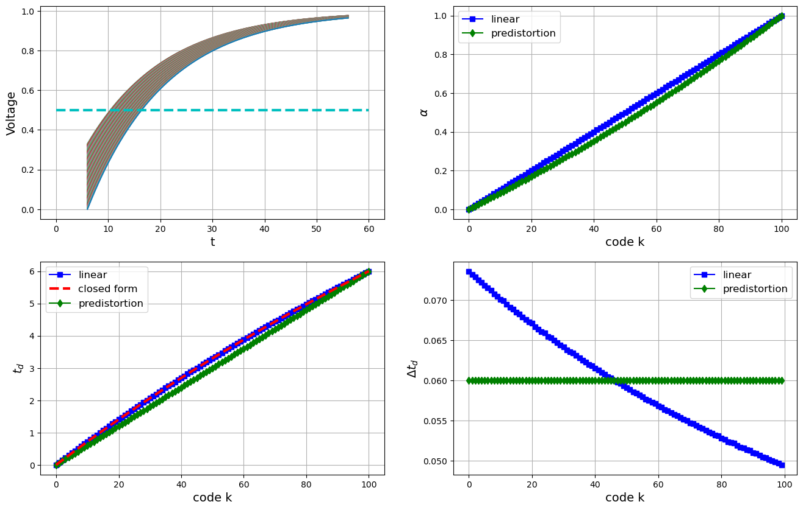

```python
import numpy as np
import matplotlib.pyplot as plt

tau = 15    # ps
dt = 6      # ps, \Delta t
N = 100     # number of codes
t = np.linspace(dt, 56, 500001)

vi = 1 - np.exp(-t/tau)
vq = 1 - np.exp(-(t-dt)/tau)

def t_cross(alpha):
    viq = (1-alpha)*vi + alpha*vq
    return t[np.argmin(np.abs(viq - 0.5))]

k = np.arange(N+1)
alpha_lin = k/N
alpha_predist = (np.exp(k/N*dt/tau) - 1)/(np.exp(dt/tau) - 1)

td_lin = np.array([t_cross(a) for a in alpha_lin])
td_lin = td_lin - td_lin[0]
td_predist = np.array([t_cross(a) for a in alpha_predist])
td_predist = td_predist - td_predist[0]
td_closed = tau*np.log(1 + alpha_lin*(np.exp(dt/tau) - 1))

plt.figure(figsize=(16,10))
plt.subplot(2, 2, 1)
for alpha in alpha_lin:
    plt.plot(t[::1000], ((1-alpha)*vi + alpha*vq)[::1000])
plt.plot([0, 60], [0.5,0.5], '--c', linewidth=3); plt.grid()
plt.xlabel('t', fontsize=14); plt.ylabel('Voltage', fontsize=14)

plt.subplot(2, 2, 2)
plt.plot(k, alpha_lin, 'bs-', label='linear')
plt.plot(k, alpha_predist, 'gd-', label='predistortion')
plt.grid(); plt.legend(fontsize=12)
plt.xlabel('code k', fontsize=14); plt.ylabel(r'$\alpha$', fontsize=14)

plt.subplot(2, 2, 3)
plt.plot(k, td_lin, 'bs-', label='linear')
plt.plot(k, td_closed, 'r--', linewidth=3, label='closed form', zorder=3)
plt.plot(k, td_predist, 'gd-', label='predistortion')
plt.grid(); plt.legend(fontsize=12)
plt.xlabel('code k', fontsize=14); plt.ylabel(r'$t_d$', fontsize=14)

plt.subplot(2, 2, 4)
plt.plot(k[:-1], np.diff(td_lin), 'bs-', label='linear')
plt.plot(k[:-1], np.diff(td_predist), 'gd-', label='predistortion')
plt.grid(); plt.legend(fontsize=12)
plt.xlabel('code k', fontsize=14); plt.ylabel(r'$\Delta t_d$', fontsize=14)

plt.show()
```


## PI static & dynamic linearity

> A. K. Mishra, Y. Li, P. Agarwal and S. Shekhar, "17.7 A 9b-Linear 14GHz Integrating-Mode Phase Interpolator in 5nm FinFET Process," *2022 IEEE International Solid-State Circuits Conference (ISSCC)*, San Francisco, CA, USA, 2022, pp. 1-3, [[https://sci-hub.jp/10.1109/ISSCC42614.2022.9731703](https://sci-hub.jp/10.1109/ISSCC42614.2022.9731703)]
>
> —, "Improving Linearity in CMOS Phase Interpolators," in *IEEE Journal of Solid-State Circuits*, vol. 58, no. 6, pp. 1623-1635, June 2023, [[https://sci-net.xyz/10.1109/JSSC.2023.3243305](https://sci-net.xyz/10.1109/JSSC.2023.3243305)]
>
> Wang, Zhaowen. *Efficient and High-Performance Clocking Circuits for High-Speed Data Links*. 2022. Columbia University, PhD dissertation. *Academic Commons*,[[https://academiccommons.columbia.edu/doi/10.7916/g3f1-4e71](https://academiccommons.columbia.edu/doi/10.7916/g3f1-4e71)]


### PI rotation (dynamic operation)

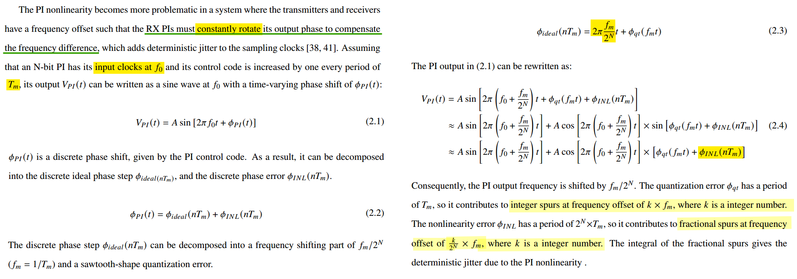

$$
K_{f,PI} = \frac{1/2^N}{T_m/T_o}\cdot \frac{1}{T_o} = \frac{f_m}{2^N}
$$
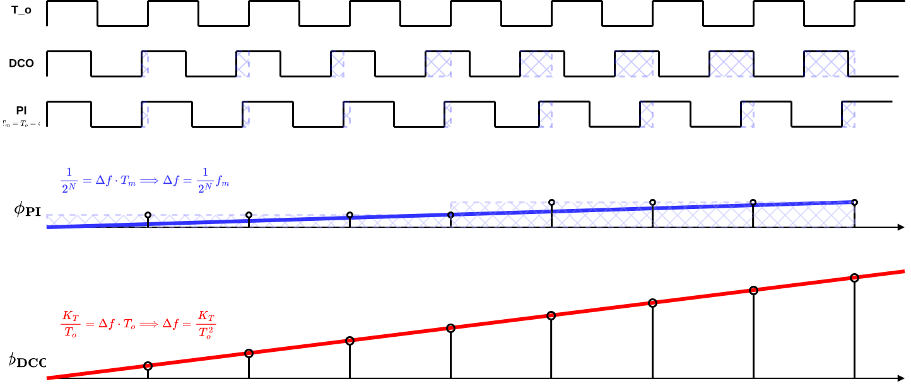

---

<span style="color:white; background-color:black">**For DCO**</span>
$$
K_{f,DCO} = \frac{K_T}{T_o}\cdot \frac{1}{T_o} = \frac{K_T}{T_o^2}
$$


---

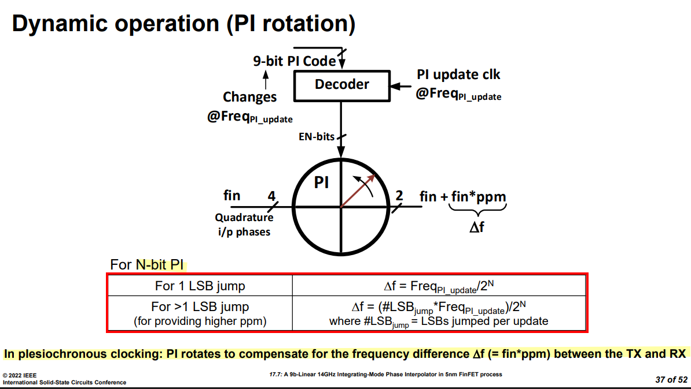


### Deterministic Jitter & rotation spur

> E. Monaco, G. Anzalone, G. Albasini, S. Erba, M. Bassi and A. Mazzanti, "A 2–11 GHz 7-Bit High-Linearity Phase Rotator Based on Wideband Injection-Locking Multi-Phase Generation for High-Speed Serial Links in 28-nm CMOS FDSOI," in *IEEE Journal of Solid-State Circuits*, vol. 52, no. 7, pp. 1739-1752, July 2017 [[https://sci-hub.jp/10.1109/JSSC.2017.2702742](https://sci-hub.jp/10.1109/JSSC.2017.2702742)]


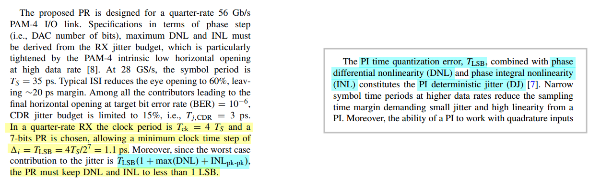
$$
\boxed{\color{red}|\text{DJ}| \leq T_{LSB} (1+\max(\text{DNL}) + \text{INL}_\text{pk-pk})}
$$


---


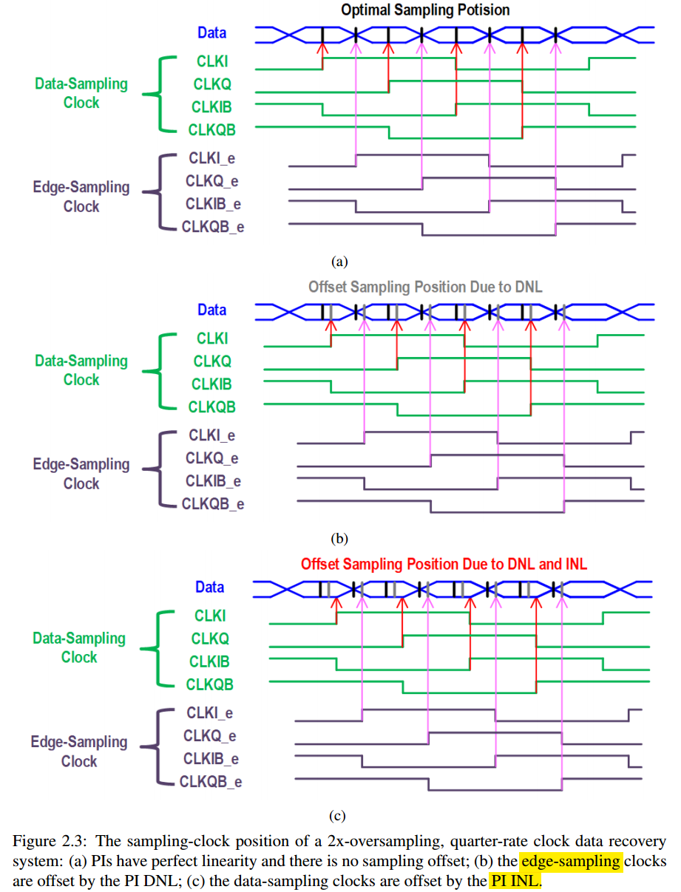


Let $T=T_{\mathrm{LSB}}$, and write a PI’s output time as

$$
t(k)=t_{\mathrm{ref}}+[k+I(k)]T
$$

where $I(k)=\mathrm{INL}(k)$, expressed in LSBs. Then

$$
\mathrm{DNL}(k)=\frac{t(k+1)-t(k)}{T}-1 =I(k+1)-I(k)
$$

Thus INL describes the error at a code, while DNL describes the error in one code-to-code step.

<span style="color:white; background-color:black">**1. Why $(0.5+|\mathrm{DNL}_p|)T$?**</span>

For an ideal PI, available phases are spaced by $T$. If the desired transition lies halfway between two available phases, selecting the nearest phase leaves an error of

$$
|E_e|\le \frac{T}{2}
$$

That explains the **$0.5$**

With DNL, a particular step has width

$$
t(k+1)-t(k)=[1+\mathrm{DNL}(k)]T
$$

A larger step means a larger gap in which the desired phase might lie.

The excerpt can be read as budgeting

$$
\underbrace{0.5T}_{\text{nominal quantization}} + \underbrace{|\mathrm{DNL}_p|T}_{\text{nonlinearity allowance}}
$$

But for a monotonic PI that actually selects the nearest available phase, the tighter bound is **half the largest actual step**:

$$
\boxed{|E_e| \le \frac{1+\max_k\mathrm{DNL}(k)}{2}T \le \left(0.5+\frac{|\mathrm{DNL}_p|}{2}\right)T}
$$

So the paper's $0.5+|\mathrm{DNL}_p|$ is a looser bound under this model


<span style="color:white; background-color:black">**2. Why does the data-clock bound become $(1+|\mathrm{DNL}_p|+|\mathrm{INL}_{pp}|)T$?**</span>

$E_e$ and $E_d$ are **timing errors**, measured in seconds—not the clock times themselves

- **$E_e$: edge-sampling clock error** relative to the ideal data-transition time:
  $$
  E_e=t_e-t_{\text{transition}}.
  $$

- **$E_d$: data-sampling clock error** relative to the ideal data-sampling time, assumed here to be half a UI after that transition:
  $$
  E_d=t_d-\left(t_{\text{transition}}+\frac{\mathrm{UI}}{2}\right).
  $$

Here $t_e$ and $t_d$ are the **actual sampling times**. A positive error means the clock samples **late**; a negative error means it samples **early**.

Writing $H=\mathrm{UI}/2$, these definitions give

$$
\boxed{E_d=E_e+\underbrace{(t_d-t_e-H)}_{\text{error in edge-to-data spacing}}.}
$$

Let the desired edge-to-data spacing be

$$
H=\frac{\mathrm{UI}}{2}
$$

and let the data-clock code be $k+m$ when the edge-clock code is $k$. Then

$$
t_d-t_e=mT+[I(k+m)-I(k)]T
$$

Consequently, the data-clock error relative to its ideal sampling position is

$$
\boxed{ E_d = E_e +\underbrace{(mT-H)}_{\text{spacing quantization}} +\underbrace{[I(k+m)-I(k)]T}_{\text{relative INL error}} }
$$

If $m$ is chosen by rounding $H/T$, then

$$
|mT-H|\le 0.5T.
$$

Combining this with the paper’s edge-clock allowance gives

$$
|E_d| \le \underbrace{(0.5+|\mathrm{DNL}_p|)T}_{\text{edge-clock error}} +\underbrace{0.5T}_{\text{spacing quantization}} +\underbrace{\mathrm{INL}_{pp}T}_{\text{relative INL error}}
$$

which produces the quoted expression.

Using tighter edge-clock bound

$$
|E_d| \le \underbrace{\left(0.5+\frac{|\mathrm{DNL}_p|}{2}\right)T_{\mathrm{LSB}}}_{\text{edge-clock error}} +\underbrace{0.5T_{\mathrm{LSB}}}_{\text{spacing quantization}} +\underbrace{\mathrm{INL}_{pp}T_{\mathrm{LSB}}}_{\text{relative INL error}}
$$

so

$$
\boxed{|E_d|\le \left(1+\frac{|\mathrm{DNL}_p|}{2}+\mathrm{INL}_{pp}\right)T_{\mathrm{LSB}}}
$$


If $H/T$ is an integer—for example, a full-period PI with a number of steps divisible by eight can represent $45^\circ$ exactly—then $mT-H=0$. That extra $0.5T$ is unnecessary. (If the desired edge-to-data spacing is exactly representable by an integer number of PI steps, the spacing-quantization term vanishes, and the constant $1$ becomes $0.5$)


---

The CDR finds an edge-clock code, and the data-clock code is obtained by adding a fixed code offset

With $T=T_{\mathrm{LSB}}$ and $H=\mathrm{UI}/2$:

$$
k_e=k,\qquad m=\operatorname{round}\left(\frac{H}{T}\right),\qquad k_d=k_e+m
$$

Here, $m$ is **a number of PI steps**, not a time. Thus, for an **ideal PI**, the timing relationship is

$$
\boxed{ t_d=t_e+\operatorname{round}\left(\frac{\mathrm{UI}}{2T}\right)T}
$$

The circuit operates continuously: the CDR adjusts $k_e$, and the data-clock code follows as $k_d=k_e+m$. It does not need to measure a numerical value of $t_e$ before generating the data clock.

For **nonlinear PIs**, adding $m$ codes does not necessarily add exactly $mT$ in time. Assuming a common timing reference,

$$
\boxed{ t_d=t_e+mT+ \left[I_d(k_e+m)-I_e(k_e)\right]T}
$$

That last term is precisely the relative INL error we discussed. The subscripts allow the edge and data clocks to come from different PIs.


## PI vs. PLL based CDR

> PCI Express Jitter Modeling Revision 1.0RD July 14, 2004

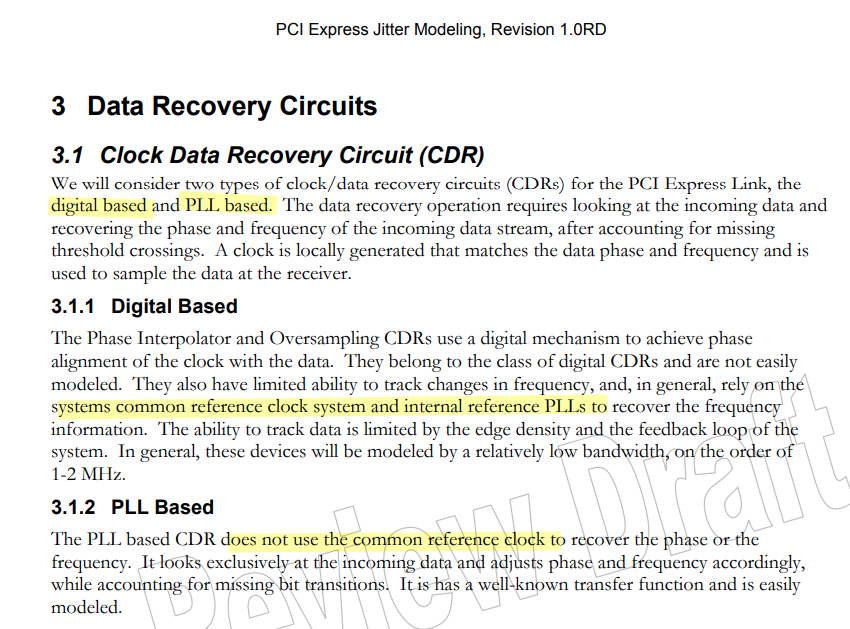

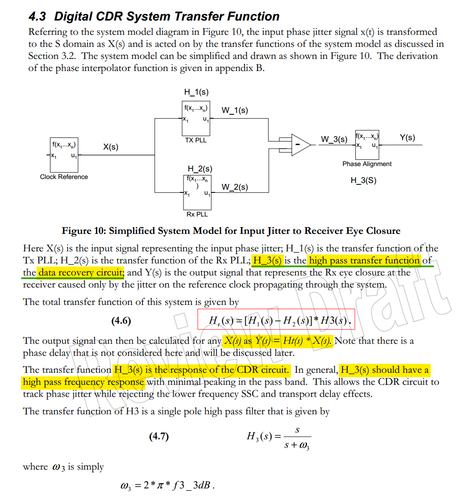
$$
H_1 - \left[H_1(1-H_3) + H_2H_3\right] = (H_1-H_2)H_3
$$


## reference

Cortiula A, Menin D, Bandiziol A, Driussi F, Palestri P. Modeling of Phase-Interpolator-Based Clock and Data Recovery for High-Speed PAM-4 Serial Interfaces. *Electronics*. 2025; [[https://www.mdpi.com/2079-9292/14/10/1979](https://www.mdpi.com/2079-9292/14/10/1979)]

G. Souliotis, A. Tsimpos and S. Vlassis, "Phase Interpolator-Based Clock and Data Recovery With Jitter Optimization," in *IEEE Open Journal of Circuits and Systems*, vol. 4, pp. 203-217, 2023 [[https://ieeexplore.ieee.org/document/10184121](https://ieeexplore.ieee.org/document/10184121)]

T. Chan Carusone, T. O. Dickson, S. Palermo, S. Shekhar and M. Mansuri, "Modern Wireline Transceivers," in IEEE Journal of Solid-State Circuits, vol. 61, no. 2, pp. 395-422, Feb. 2026 [[https://ieeexplore.ieee.org/stamp/stamp.jsp?arnumber=11311714](https://ieeexplore.ieee.org/stamp/stamp.jsp?arnumber=11311714)]

CHUNG-CHUN (CC) CHEN, *Why Phase Interpolator Based CDR?* [[https://youtu.be/FkoJwnAYbMs](https://youtu.be/FkoJwnAYbMs)]

—, *Why High Linearity Phase Interpolator with Low Power?* [[https://youtu.be/II9vQPH8MNM](https://youtu.be/II9vQPH8MNM)]

—, *Why Not A Voltage Mode or A Current Mode Phase Interpolator?* [[https://youtu.be/1vrBgDNTOMA](https://youtu.be/1vrBgDNTOMA)]

—, *Why An Integrating Mode Phase Interpolator?* [[https://youtu.be/VEkM8ZEcYnc](https://youtu.be/VEkM8ZEcYnc)]

—, *Why High-Speed Integrating Mode Phase Interpolator, IMPI?* [[https://youtu.be/6197voGpOek](https://youtu.be/6197voGpOek)]

rfinsights, phase rotator in serdes - every major topology, explained [[https://www.rfinsights.com/synthesizer/phase-rotator/](https://www.rfinsights.com/synthesizer/phase-rotator/)]