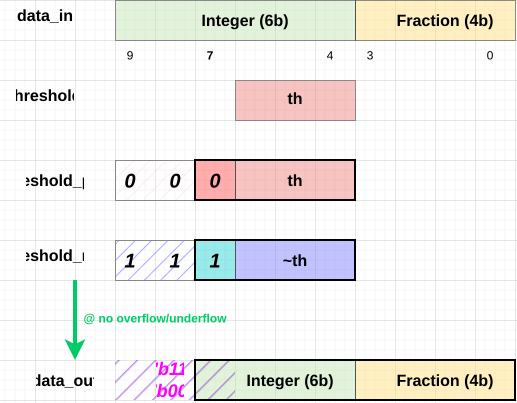
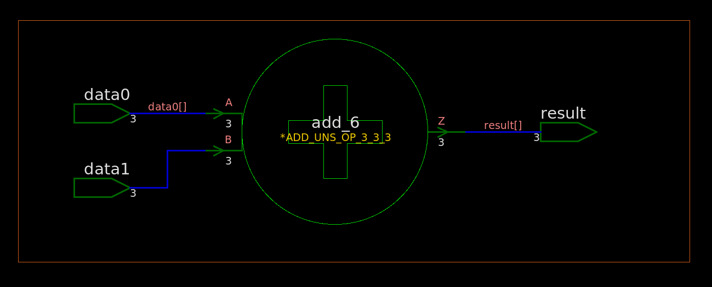
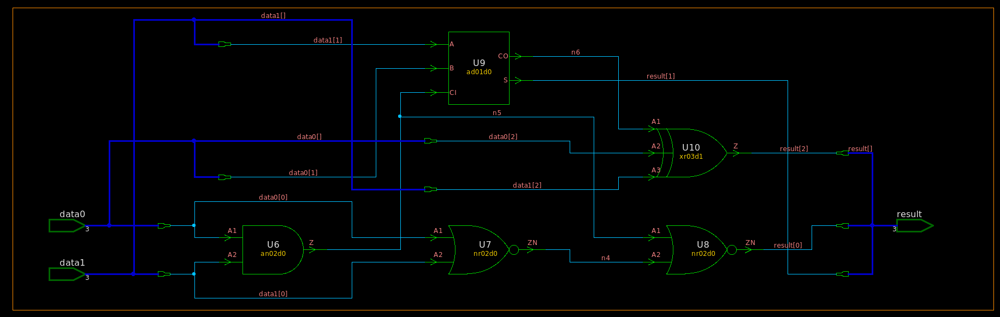
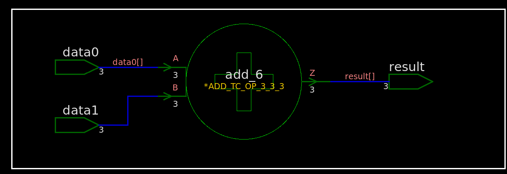
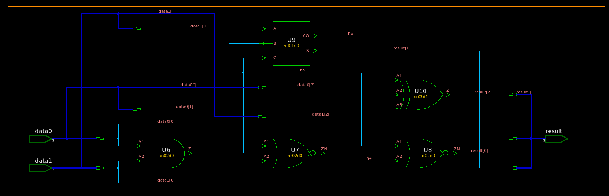
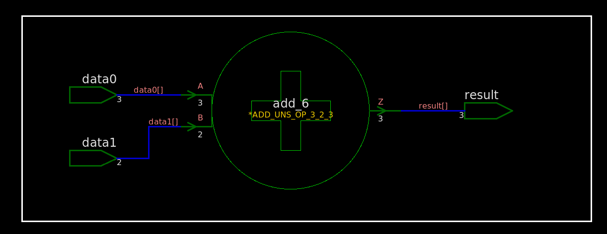
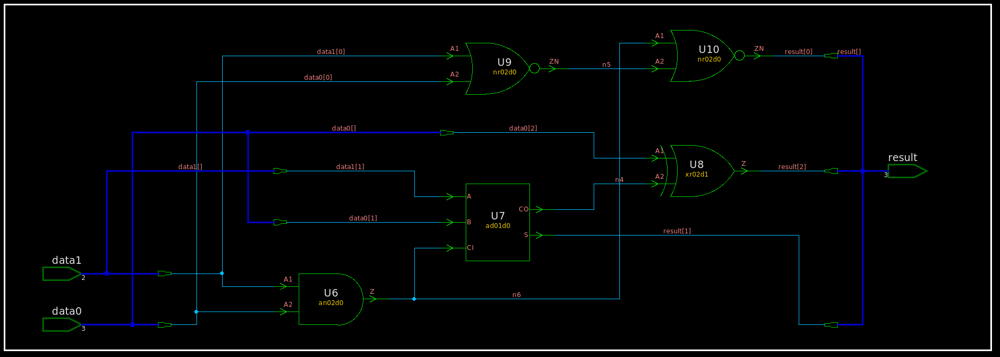
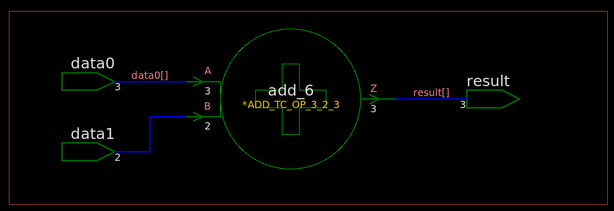
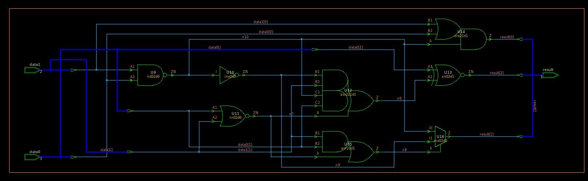
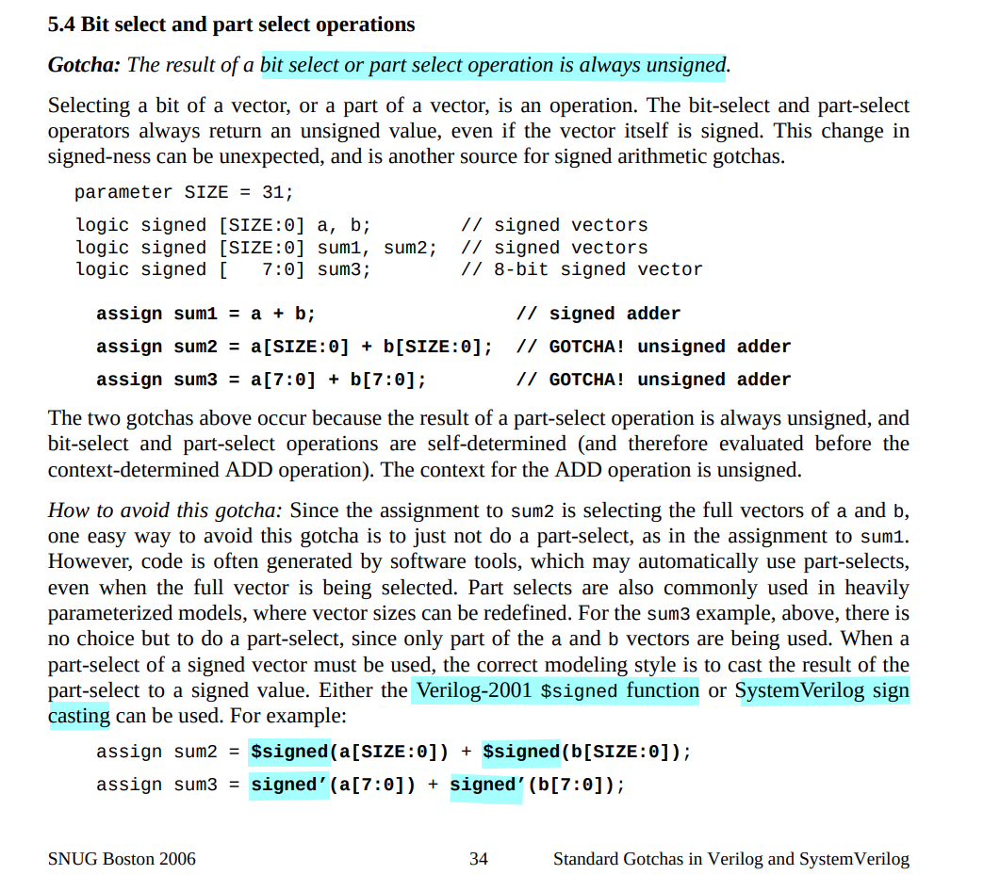

## Bit patterns, signedness, and literals

An $N$-bit vector has the following ranges:

| Type | Minimum | Maximum |
| --- | ---: | ---: |
| Unsigned | $0$ | $2^N-1$ |
| Signed two's complement | $-2^{N-1}$ | $2^{N-1}-1$ |

The same bits can represent different values:

```systemverilog
logic        [7:0] u;
logic signed [7:0] s;

initial begin
    u = 8'b1111_1111;  // 255
    s = 8'b1111_1111;  // -1
end
```

Signedness does not change the stored bits. It changes how operations such as widening, comparison, division, and arithmetic right shift use those bits.

### Sized literals

A sized integer literal has the form `<width>'[s]<base><digits>`. The optional `s` makes the literal signed; it does not add a sign bit.

| Literal | Width | Bits | Value |
| --- | ---: | --- | ---: |
| `6'b100000` | 6 | `100000` | 32 |
| `6'sb100000` | 6 | `100000` | -32 |
| `6'sb10000` | 6 | `010000` | 16 |
| `8'd1` | 8 | `00000001` | 1, unsigned |
| `8'sd1` | 8 | `00000001` | 1, signed |
| `1'sb1` | 1 | `1` | -1 |

For the ordinary binary digits shown here, missing digits are padded with zeros **within the declared literal width**, even when `s` is present. Subsequent widening of the completed signed literal uses its sign bit.

An unsized decimal integer such as `1` is signed and at least 32 bits wide. Sized literals make width and signedness explicit in RTL.


---

**`'sb` is used for signed binary constants.** —  `<width>'sb<binary_digits>`

```verilog
3'sb011   // 3-bit signed constant: +3
3'sb101   // 3-bit signed constant: -3
4'sb0101  // 4-bit signed constant: +5
```


| Syntax       | Purpose                                                  |
| ------------ | -------------------------------------------------------- |
| `3'sb101`    | Write a signed binary constant                           |
| `signed'(x)` | Make an existing expression signed, preserving its width |
| `$signed(x)` | Same conversion as `signed'(x)`                          |


### Widening and narrowing

When a standalone integral value is assigned to a wider vector, its signedness determines the extension. The destination's signedness does not select the extension rule.

```systemverilog
logic signed [7:0] a, b;
logic        [7:0] c;

assign a = 6'sb100000;  // 11100000: signed -32
assign b = 6'b100000;   // 00100000: signed +32
assign c = 6'sb100000;  // 11100000: unsigned 224
```

Assigning either `6'b100000` or `6'sb100000` directly to a **6-bit signed** destination produces -32: no widening occurs, so the same six bits are copied.

Assigning a wider vector to a narrower vector discards the upper bits. It does **not** clamp the numeric value.

### What `$signed` and `$unsigned` do

`$signed(expr)` returns the bits of `expr` with a signed type. `$unsigned(expr)` returns them with an unsigned type. Neither conversion changes the bit width or bit pattern of its argument's result.

```systemverilog
logic        [5:0] x;
logic signed [7:0] a, b;

assign x = 6'b100000;
assign a = x;           // Zero extension: 00100000 = +32
assign b = $signed(x);  // Sign extension: 11100000 = -32
```

Here, `$signed(x)` is still six bits wide; the assignment then extends it to eight bits.

Casting an unsigned vector to signed does not preserve its full unsigned numeric range. For example, `$signed(8'hff)` is -1. To represent unsigned 255 as a positive signed value, add a leading zero first:

```systemverilog
logic        [7:0] u;
logic signed [8:0] u_signed;

assign u_signed = $signed({1'b0, u});  // Range: 0 to 255
```


---

**For integral expressions, `$signed(expr)` and `signed'(expr)` produce the same result:** they make the result signed while preserving its width and bit pattern

|                       | `$signed(expr)`                  | `signed'(expr)` |
| --------------------- | -------------------------------- | --------------- |
| Syntax                | System function                  | Signing cast    |
| Language support      | Verilog-2001 and *SystemVerilog* | *SystemVerilog* |
| Result signedness     | Signed                           | Signed          |
| Bit width and pattern | Preserved                        | Preserved       |

For example:

```verilog
logic        [5:0] x;
logic signed [7:0] a, b;

assign x = 6'b100000;

assign a = $signed(x);  // 11100000 = -32
assign b = signed'(x);  // 11100000 = -32
```

Both casts produce a **6-bit signed** value of −32. The assignment subsequently sign-extends it to eight bits


## Expression width and mixed signedness

For a simple integral `a + b` or `a - b` expression:

- If both operands are signed, the arithmetic expression is signed.
- If either operand is unsigned, the arithmetic expression is unsigned; operands that need widening are zero-extended.
- The assignment destination can increase the **evaluation width** of the expression.
- Declaring the destination signed does not make an unsigned right-hand-side expression signed.

These are rules for these integral operators, not a rule that every operand of every operator controls signedness. For example, a shift amount does not determine the signedness of the value being shifted.

### The left-hand side can affect evaluation width

```systemverilog
logic [7:0] a, b;
logic [8:0] wide_sum, narrow_sum, explicit_sum;

assign wide_sum     = a + b;                  // Addition evaluated at 9 bits
assign narrow_sum   = {a + b};                // Addition inside {} is 8 bits
assign explicit_sum = {1'b0, a} + {1'b0, b};  // Explicit 9-bit operands
```

With `a = 8'd255` and `b = 8'd1`, `wide_sum` and `explicit_sum` are 256, while `narrow_sum` is 0.

The concatenation's element `a + b` is **self-determined**: its width is set by its operands, so the outer assignment cannot preserve its carry. Parentheses alone do not create this boundary: `wide_sum = (a + b)` still preserves the carry.

The same issue applies to `$signed(a + b)`: the cast changes signedness after its argument is evaluated at its own width. A cast around a result cannot recover bits already lost. Widen the operands or use an appropriately sized intermediate **before** an operation that needs more bits.

See Sutherland and Mills, *Standard Gotchas*, Section 5, for a detailed discussion of expression sizing and signedness.

### Addition and subtraction examples

The following table assumes four-bit inputs and a five-bit destination. “Signed output” and “unsigned output” are two interpretations of the same five result bits.

| Operation | Input types | Operands at evaluation width | Result bits | Signed output | Unsigned output |
| --- | --- | --- | --- | ---: | ---: |
| `0101 + 1111` | Signed + signed | `00101 + 11111` | `00100` | 4 | 4 |
| `0101 + 1111` | Signed + unsigned | `00101 + 01111` | `10100` | -12 | 20 |
| `0101 + 1111` | Unsigned + signed | `00101 + 01111` | `10100` | -12 | 20 |
| `1111 - 0010` | Signed - signed | `11111 - 00010` | `11101` | -3 | 29 |
| `1111 - 0010` | Signed - unsigned | `01111 - 00010` | `01101` | 13 | 13 |

A compact testbench reproduces the distinction:

```systemverilog
module arithmetic_tb;
    logic signed [3:0] a, b;
    logic        [3:0] u;
    logic signed [4:0] result_s;
    logic        [4:0] result_u;

    initial begin
        a = 4'sb0101;
        b = 4'sb1111;
        u = 4'b1111;

        result_s = a + b;
        result_u = a + b;
        $display("signed add: s=%0d u=%0d bits=%b",
                 result_s, result_u, result_s);  // 4, 4, 00100

        result_s = a + u;
        result_u = a + u;
        $display("mixed add:  s=%0d u=%0d bits=%b",
                 result_s, result_u, result_s);  // -12, 20, 10100

        a = -4'sd1;
        b = 4'sd2;
        u = 4'd2;

        result_s = a - b;
        result_u = a - b;
        $display("signed sub: s=%0d u=%0d bits=%b",
                 result_s, result_u, result_s);  // -3, 29, 11101

        result_s = a - u;
        result_u = a - u;
        $display("mixed sub:  s=%0d u=%0d bits=%b",
                 result_s, result_u, result_s);  // 13, 13, 01101
    end
endmodule
```

For subtraction at a chosen width, the hardware can compute $a + \overline b + 1$ and retain the required low bits. Apply the correct operand extension before taking the complement.

### A mixed-width example: unsigned position plus signed offset

```systemverilog
logic        [7:0] x;
logic signed [7:0] y;
logic signed [3:0] move;
logic signed [7:0] x1, y1;
logic signed [9:0] x_full;

assign x1     = x + move;
assign y1     = y + move;
assign x_full = $signed({1'b0, x}) + move;
```

For `x = 7`, `y = 7`, and `move = -4`:

| Expression | Extended offset | Result |
| --- | --- | ---: |
| `x + move` | `00001100`, or +12 | 19 |
| `y + move` | `11111100`, or -4 | 3 |
| `$signed({1'b0, x}) + move` | Signed -4 at the evaluation width | 3 |

The last expression preserves `x` as a nonnegative signed operand. Its ten-bit result also covers the full mathematical range, $-8$ through $262$.

## When signedness changes the result

For `logic [7:0] x = 8'hff`:

| Operation | Unsigned form | Signed form |
| --- | --- | --- |
| Compare with +1 | `x < 8'd1` is false | `$signed(x) < 8'sd1` is true |
| Widen to 16 bits | `x` becomes `00000000_11111111` | `$signed(x)` becomes `11111111_11111111` |
| Right shift, retaining 8 bits | `x >>> 1` gives `01111111` | `$signed(x) >>> 1` gives `11111111` |
| Divide by 2, retaining 8 bits | `x / 8'd2` gives 127 | `$signed(x) / 8'sd2` gives 0 |

Signed integer division truncates toward zero, so $-1/2$ gives 0.

### Comparisons require compatible operand types

For integral relational comparisons, if either operand is unsigned, the comparison is unsigned.

```systemverilog
// x = 8'hff
$signed(x) < 8'sd1   // -1 < 1: true
$signed(x) < 8'd1    // 255 < 1: false
```

Although `8'd1` and `8'sd1` have identical bits, their types change the comparison. Casting just one operand is insufficient when the other remains unsigned.

### Arithmetic right shift

`>>` always shifts in zeros. `>>>` shifts in copies of the sign bit only when its left operand, as evaluated in context, is signed.

```systemverilog
logic signed [7:0] s;
logic signed [7:0] logical_shift, arithmetic_shift;

assign s = -8'sd4;
assign logical_shift    = s >> 1;   // 01111110 = +126
assign arithmetic_shift = s >>> 1;  // 11111110 = -2
```

For the examples above, the destination has the same width as the shifted value. A wider assignment or a surrounding mixed-signedness expression can affect evaluation; use a signed intermediate when the intended shift behavior needs to be explicit.

### Addition and subtraction at a fixed width

When the operand bit patterns and evaluation width are fixed, the low $N$ result bits of addition and subtraction are identical for signed and unsigned arithmetic:

$$
r_{\text{add}}=(a+b)\bmod 2^N,\qquad
r_{\text{sub}}=(a-b)\bmod 2^N.
$$

For example, eight-bit `11111111 + 00000001` produces `00000000` whether described as unsigned $255+1$ or signed $-1+1$.

This does **not** imply that all signed and unsigned operations synthesize identically. Extension, comparison, division, and arithmetic right shift can change the required logic.

## Overflow detection

Overflow means the exact mathematical result lies outside the destination's representable range. A carry bit and a signed-overflow flag answer different questions.

### Unsigned addition and subtraction

For two $N$-bit unsigned operands, use an $N+1$-bit sum. Its top bit indicates unsigned addition overflow.

```systemverilog
logic [7:0] a, b;
logic [8:0] sum;
logic carry, borrow;

assign sum    = {1'b0, a} + {1'b0, b};
assign carry  = sum[8];
assign borrow = (a < b);  // Underflow when unsigned a - b would be negative
```

### Signed addition and subtraction

Let `r` be the truncated $N$-bit result of an operation on two $N$-bit signed operands:

```systemverilog
// Signed addition overflow:
overflow_add = (a[N-1] == b[N-1]) && (r[N-1] != a[N-1]);

// Signed subtraction overflow:
overflow_sub = (a[N-1] != b[N-1]) && (r[N-1] != a[N-1]);
```

For addition, operands with opposite signs cannot overflow. With equal signs, overflow occurs when the retained result has the opposite sign.

| 3-bit signed A | 3-bit signed B | Exact sum as 4-bit signed | Retained 3-bit result | Status |
| --- | --- | --- | --- | --- |
| `011` (+3) | `011` (+3) | `0110` (+6) | `110` (-2) | Positive overflow |
| `100` (-4) | `100` (-4) | `1000` (-8) | `000` (0) | Negative overflow |
| `111` (-1) | `110` (-2) | `1101` (-3) | `101` (-3) | In range |

The four-bit exact sums above come from **sign-extended operands**. They are not the raw carry concatenated with the result of an unextended three-bit adder.

### overflow detection from a widened signed result

When `t` is an exact $(N+1)$-bit signed result, examine `t[N:N-1]` before narrowing to $N$ bits:

| Top two bits | Meaning |
| --- | --- |
| `00` or `11` | Fits in $N$ signed bits |
| `01` | Above the signed maximum; clamp upward |
| `10` | Below the signed minimum; clamp downward |

For example, a ten-bit accumulator plus a signed two-bit increment can use an eleven-bit intermediate:

```systemverilog
logic signed [1:0] acc_inc;
logic signed [9:0] acc;
logic signed [10:0] acc_w;
logic signed [9:0] acc_sat;

assign acc_w = acc + acc_inc;

assign acc_sat = (acc_w[10:9] == 2'b01) ? 10'sb0111111111 :
                 (acc_w[10:9] == 2'b10) ? 10'sb1000000000 :
                                         acc_w[9:0];
```

Both overflow directions are often called ***signed overflow***. “**Negative overflow**” here means a result below the minimum; it is unrelated to floating-point underflow


### underflow detection

signed to unsigned assignemnt

```verilog
logic signed [7:0]  nxt;
wire underflow = nxt[7] | (~(|nxt));

logic [4:0] tgt;
```

There are two different uses of `|` here:

- `nxt[7]` is 1 when `nxt` is **negative**.
- `|nxt` is **reduction OR**: it ORs together every bit. Thus, `~(|nxt)` is 1 exactly when **all bits are zero**.
- The outer `|` combines these two conditions.

For known binary inputs:

$$
\text{underflow} =(a_{\text{next}}<0)\lor(a_{\text{next}}=0) =\boxed{a_{\text{next}}\le0}
$$


## Saturating arithmetic

Saturation returns the nearest endpoint when a result is outside the output range:

$$
\operatorname{sat}_{[L,U]}(x)=
\begin{cases}
L, & x<L,\\
x, & L\le x\le U,\\
U, & x>U.
\end{cases}
$$

First compute an exact intermediate; then clamp and narrow it. In the function names below, `u` means unsigned and `s` means signed, in the order **input A, input B, output**. These suffixes describe the intended numeric operation, not an implicit language conversion.

### Unsigned + unsigned to unsigned

The sum lies in $[0,510]$, so nine unsigned bits are sufficient.

```systemverilog
function automatic logic [7:0] satadd_uuu8b(
    input logic [7:0] a,
    input logic [7:0] b
);
    logic [8:0] t;
    begin
        t = {1'b0, a} + {1'b0, b};
        satadd_uuu8b = t[8] ? 8'hff : t[7:0];
    end
endfunction
```

### Signed + signed to signed

The sum lies in $[-256,254]$, so nine signed bits are sufficient. The function's return type must also be signed if callers are to use its result as a signed operand.

```systemverilog
function automatic logic signed [7:0] satadd_sss8b(
    input logic signed [7:0] a,
    input logic signed [7:0] b
);
    logic signed [8:0] t;
    begin
        t = a + b;
        satadd_sss8b = (t[8:7] == 2'b01) ? 8'sh7f :
                      (t[8:7] == 2'b10) ? 8'sh80 :
                                          t[7:0];
    end
endfunction
```

The last ternary branch is an unsigned part-select. All branches already have the final eight-bit width, so they select the intended bits; the declared function return type makes the returned value signed.

### Signed + unsigned to unsigned

The mathematical sum lies in $[-128,382]$. A **signed nine-bit** intermediate only covers $[-256,255]$, so use **ten signed bits**.

```systemverilog
function automatic logic [7:0] satadd_suu8b(
    input logic signed [7:0] a,
    input logic        [7:0] b
);
    logic signed [9:0] a_ext, b_ext, t;
    begin
        a_ext = {{2{a[7]}}, a};
        b_ext = {2'b00, b};
        t = a_ext + b_ext;

        if (t > 10'sd255)
            satadd_suu8b = 8'hff;
        else if (t < 10'sd0)
            satadd_suu8b = 8'h00;
        else
            satadd_suu8b = t[7:0];
    end
endfunction
```

For example, $127+255=382$ must clamp to 255. Computing that sum as a nine-bit signed value would wrap to -130 before the saturation decision.

### Signed +/- unsigned to signed

For eight-bit operands, addition spans $[-128,382]$ and subtraction spans $[-383,127]$. Ten signed bits cover both.

```systemverilog
function automatic logic signed [7:0] satop_sus8b(
    input logic signed [7:0] a,
    input logic        [7:0] b,
    input logic             plus
);
    logic signed [9:0] a_ext, b_ext, t;
    begin
        a_ext = {{2{a[7]}}, a};
        b_ext = {2'b00, b};
        t = plus ? (a_ext + b_ext) : (a_ext - b_ext);

        if (t > 10'sd127)
            satop_sus8b = 8'sh7f;
        else if (t < -10'sd128)
            satop_sus8b = 8'sh80;
        else
            satop_sus8b = t[7:0];
    end
endfunction
```

Examples:

| Operation | Exact result | Saturated signed output |
| --- | ---: | ---: |
| $127+255$ | 382 | 127 |
| $-128+255$ | 127 | 127 |
| $-128-255$ | -383 | -128 |
| $127-255$ | -128 | -128 |


### Clamp 8-bit signed input to 6 bits

A six-bit signed value ranges from -32 to +31.

```systemverilog
module clamp_8_to_6 (
    input  logic signed [7:0] din,
    output logic signed [5:0] dout
);
    always_comb begin
        if (din > 8'sd31)
            dout = 6'sd31;
        else if (din < -8'sd32)
            dout = 6'sb100000;
        else
            dout = din[5:0];
    end
endmodule
```

The range check can also use the upper bits. The discarded bits `din[7:6]` must equal the retained sign bit `din[5]`.

| `din[7:5]` | Input range | Action |
| --- | --- | --- |
| `000` | 0 to 31 | Keep `din[5:0]` |
| `111` | -32 to -1 | Keep `din[5:0]` |
| `001`, `010`, `011` | 32 to 127 | Clamp to +31 |
| `100`, `101`, `110` | -128 to -33 | Clamp to -32 |

The following block is an **alternative** to the block above, not an additional driver:

```systemverilog
always_comb begin
    if (din[7:5] == {3{din[5]}})
        dout = din[5:0];
    else
        dout = din[7] ? 6'sb100000 : 6'sb011111;
end
```

More generally, narrowing a signed $M$-bit value to $N$ bits, with $M>N$, preserves its value exactly when all bits `din[M-1:N-1]` equal `din[N-1]`


### Clamp signed input by threshold


```verilog
module signed_threshold_clamp (
    input  logic              clk,
    input  logic              rst_n,
    input  logic signed [9:0] data_in,    // S10.4
    input  logic        [2:0] threshold,  // U3.0: 0 to 7
    output logic signed [7:0] data_out    // S8.4
);

    logic signed [3:0] threshold_pos;    // S4.0
    logic signed [3:0] threshold_neg;    // S4.0
    logic overflow, underflow;

    assign threshold_pos = {1'b0, threshold};
    assign threshold_neg = ~threshold_pos; // -T - 1

    // Compare the signed integer part against integer thresholds.
    assign overflow  = (signed'(data_in[9:4]) >= threshold_pos);
    assign underflow = (signed'(data_in[9:4]) <  threshold_neg);

    always_ff @(posedge clk or negedge rst_n) begin
        if (!rst_n)
            data_out <= '0;
        else if (overflow)
            data_out <= {threshold_pos, 4'd0};
        else if (underflow)
            data_out <= {threshold_neg, 4'd0};
        else
            data_out <= data_in[7:0];
    end

endmodule
```

If you want **symmetric limits \([-T,+T]\)**, replace:

```verilog
assign threshold_neg = -threshold_pos;
```




## What the synthesized adders show

The following examples retain the original Design Compiler screenshots and mapped netlists. They illustrate how operand extension changes the Boolean function. Exact cell mapping depends on the synthesis tool, cell library, constraints, and optimization settings.

### Equal operand and result widths

These unsigned and signed three-bit adders compute the same three output bits. Neither preserves an extra overflow bit.

```systemverilog
module add3_unsigned (
    input  wire [2:0] data0,
    input  wire [2:0] data1,
    output wire [2:0] result
);
    assign result = data0 + data1;
endmodule

module add3_signed (
    input  wire signed [2:0] data0,
    input  wire signed [2:0] data1,
    output wire signed [2:0] result
);
    assign result = data0 + data1;
endmodule
```

Unsigned RTL and mapped circuit:





Signed RTL and mapped circuit:





Both original runs produced the same gate-level connectivity:

```verilog
/////////////////////////////////////////////////////////////
// Created by: Synopsys DC Ultra(TM) in wire load mode
// Version   : S-2021.06-SP5
// Date      : Sat May  7 11:43:27 2022
/////////////////////////////////////////////////////////////


module TOP ( data0, data1, result );
  input [2:0] data0;
  input [2:0] data1;
  output [2:0] result;
  wire   n4, n5, n6;

  an02d0 U6 ( .A1(data0[0]), .A2(data1[0]), .Z(n5) );
  nr02d0 U7 ( .A1(data0[0]), .A2(data1[0]), .ZN(n4) );
  nr02d0 U8 ( .A1(n5), .A2(n4), .ZN(result[0]) );
  ad01d0 U9 ( .A(data1[1]), .B(data0[1]), .CI(n5), .CO(n6), .S(result[1]) );
  xr03d1 U10 ( .A1(n6), .A2(data0[2]), .A3(data1[2]), .Z(result[2]) );
endmodule
```

### Unequal operand widths: zero extension

Here the two-bit unsigned input is extended as `{1'b0, data1}`.

```systemverilog
module add3_2_unsigned (
    input  wire [2:0] data0,
    input  wire [1:0] data1,
    output wire [2:0] result
);
    assign result = data0 + data1;
endmodule
```





Original mapped netlist:

```verilog
/////////////////////////////////////////////////////////////
// Created by: Synopsys DC Ultra(TM) in wire load mode
// Version   : S-2021.06-SP5
// Date      : Sat May  7 12:15:58 2022
/////////////////////////////////////////////////////////////


module TOP ( data0, data1, result );
  input [2:0] data0;
  input [1:0] data1;
  output [2:0] result;
  wire   n4, n5, n6;

  an02d0 U6 ( .A1(data1[0]), .A2(data0[0]), .Z(n6) );
  ad01d0 U7 ( .A(data1[1]), .B(data0[1]), .CI(n6), .CO(n4), .S(result[1]) );
  xr02d1 U8 ( .A1(data0[2]), .A2(n4), .Z(result[2]) );
  nr02d0 U9 ( .A1(data1[0]), .A2(data0[0]), .ZN(n5) );
  nr02d0 U10 ( .A1(n6), .A2(n5), .ZN(result[0]) );
endmodule
```

### Unequal operand widths: sign extension

Here the two-bit signed input is extended as `{data1[1], data1}`. The extra dependence on `data1[1]` can change the mapped logic.

```systemverilog
module add3_2_signed (
    input  wire signed [2:0] data0,
    input  wire signed [1:0] data1,
    output wire signed [2:0] result
);
    assign result = data0 + data1;
endmodule
```





Original mapped netlist:

```verilog
/////////////////////////////////////////////////////////////
// Created by: Synopsys DC Ultra(TM) in wire load mode
// Version   : S-2021.06-SP5
// Date      : Sat May  7 12:21:51 2022
/////////////////////////////////////////////////////////////


module TOP ( data0, data1, result );
  input [2:0] data0;
  input [1:0] data1;
  output [2:0] result;
  wire   n6, n7, n8, n9, n10;

  nd02d0 U9 ( .A1(data1[0]), .A2(data0[0]), .ZN(n10) );
  inv0d0 U10 ( .I(n10), .ZN(n9) );
  nr02d0 U11 ( .A1(data0[1]), .A2(data1[1]), .ZN(n7) );
  aor221d1 U12 ( .B1(n9), .B2(data1[1]), .C1(n10), .C2(data0[1]), .A(n7), .Z(
        n6) );
  xn02d1 U13 ( .A1(data0[2]), .A2(n6), .ZN(result[2]) );
  ora21d1 U14 ( .B1(data1[0]), .B2(data0[0]), .A(n10), .Z(result[0]) );
  aor21d1 U15 ( .B1(data1[1]), .B2(data0[1]), .A(n7), .Z(n8) );
  mx02d0 U16 ( .I0(n10), .I1(n9), .S(n8), .Z(result[1]) );
endmodule
```

The three-bit outputs still wrap on overflow. A full-precision sum of these operands needs four output bits.

The archived netlists use library-specific cells such as `ad01d0`. Gate-level simulation requires the matching cell models; for example, VCS can load them with `-v /path/to/lib.v`. Each archived `TOP` module is a separate example.

## Bit selection and masking

> Stuart Sutherland, Standard Gotchas Subtleties in the Verilog and SystemVerilog Standards That Every Engineer Should Know [[https://sutherland-hdl.com/papers/2006-SNUG-Boston_standard_gotchas_paper.pdf](https://sutherland-hdl.com/papers/2006-SNUG-Boston_standard_gotchas_paper.pdf)]


### Constant and indexed part-selects

A part-select extracts contiguous bits. A constant part-select fixes both endpoints:

```systemverilog
logic [31:0] addr;
// Inside a procedural block:
addr[23:16] = 8'h23;
```

An indexed part-select has a variable base but a constant width:

| Form | Selected indices |
| --- | --- |
| `vector[base +: width]` | From `base` through `base + width - 1` |
| `vector[base -: width]` | From `base` through `base - width + 1` |

The vector's declared direction determines the ordering of the returned bits:

```systemverilog
logic [31:0] a_vect;
logic [0:31] b_vect;
logic [63:0] dword;
int sel;

// Equivalent selections:
a_vect[0  +: 8]  // a_vect[7:0]
a_vect[15 -: 8]  // a_vect[15:8]
b_vect[0  +: 8]  // b_vect[0:7]
b_vect[15 -: 8]  // b_vect[8:15]

dword[8*sel +: 8]  // Select byte sel; valid byte indices are 0 through 7
```

For a packed integral vector, every part-select above is **unsigned**, regardless of the vector's declaration. Use `$signed(...)` when the extracted field represents a signed number


### Concatenations and part-selects are unsigned

A concatenation is unsigned, even when all its elements come from signed vectors. A bit-select or part-select is also unsigned, even if the part-select covers the entire signed vector.

```systemverilog
logic signed [5:0] x;
logic signed [7:0] auto_ext, manual_ext, slice_ext, cast_ext;

assign auto_ext   = x;                  // Automatic sign extension
assign manual_ext = {{2{x[5]}}, x};     // Explicit sign-extension bits
assign slice_ext  = x[5:0];             // Unsigned slice: zero extension
assign cast_ext   = $signed(x[5:0]);    // Signed slice: sign extension
```

Manual extension makes the bits explicit, but does not by itself make an expression signed. When using an extended concatenation directly in signed arithmetic, use `$signed({{2{x[5]}}, x})` or first assign it to a signed intermediate.




<span style="background-color:yellow">The `signed'()` cast matters because **a part-select is unsigned**, even when its source is signed. Without the cast, a negative value could appear as a large positive integer and incorrectly trigger this check</span>


### Bitwise AND, logical AND, and reduction AND

| Expression | Meaning |
| --- | --- |
| `a & b` | Bitwise AND of the operands |
| `a && b` | Logical AND; a one-bit truth result |
| `&a` | Reduction AND; AND together all bits of `a` |

To extract bit `k` from an integer-like code:

```systemverilog
(code_value >> k) & 1
```

The shift moves bit `k` to bit zero; `& 1` clears the other bits. The resulting value is 0 or 1 for known input bits, but the expression itself is generally wider than one bit because `1` is an unsized integer literal. In RTL with a packed vector, `code_value[k]` expresses the one-bit selection directly.

## Testbench notes

The following examples are for simulation rather than synthesizable datapath logic.

### Simulation time and formatting

Keep three concepts separate:

| Construct | Purpose |
| --- | --- |
| `timeunit` | Unit used for local numeric delays and reported simulation time |
| `timeprecision` | Resolution used to quantize delays in the scope |
| `$timeformat` | Display units, decimal places, suffix, and field width for `%t` |

`$realtime` returns the current simulation time as a real number in the calling scope's time unit. `$time` returns a 64-bit unsigned integer in that unit, rounded to an integer.

Delay quantization occurs when scheduling events. A variable declared `realtime` is a real-valued variable; it is not automatically rounded to `timeprecision` merely because it stores a value.

```systemverilog
module time_tb;
    timeunit 10ns;
    timeprecision 1ps;

    initial begin
        $timeformat(-12, 0, " ps", 0);
        #1.10016;
        $display("$realtime = %0.4f", $realtime);
        $display("$time = %0d", $time);
        $display("$realtime as %%t = %t", $realtime);
        $display("$time as %%t = %t", $time);
    end
endmodule
```

The requested delay is $1.10016 \times 10\,\text{ns}=11.0016\,\text{ns}$. Quantization to 1 ps gives 11.002 ns:

```text
$realtime = 1.1002
$time = 1
$realtime as %t = 11002 ps
$time as %t = 10000 ps
```

The `$time` result has already lost its fractional local time units before `%t` formats it.

Without an explicit `$timeformat` call, `%t` uses default formatting whose unit is based on the global simulation precision, not necessarily the local module's precision. Set `$timeformat` explicitly when reproducible logs matter.

Time units and precision can be declared together:

```systemverilog
module timing_example;
    timeunit 100ps / 10fs;
endmodule
```

Verilog also supports the compiler directive `` `timescale 100ps/10fs ``. Unlike module-local declarations, a directive affects subsequent source text according to compilation-unit boundaries and source order.

#### Different local time units

This example fixes the display unit to 10 ps while giving each module its own scheduling precision:

```systemverilog
module rawplant;
    timeunit 1ns;
    timeprecision 100ps;

    task automatic print;
        #1.666;
        $display("raw: realtime=%0.1f time=%0d rt_fmt=%t t_fmt=%t",
                 $realtime, $time, $realtime, $time);
    endtask
endmodule

module fineplant;
    timeunit 100ps;
    timeprecision 10ps;

    task automatic print;
        #2.66;
        $display("fine: realtime=%0.1f time=%0d rt_fmt=%t t_fmt=%t",
                 $realtime, $time, $realtime, $time);
    endtask
endmodule

module mixed_time_tb;
    timeunit 1ns;
    timeprecision 10ps;

    rawplant rawblock();
    fineplant fineblock();

    initial begin
        $timeformat(-11, 0, "", 0);  // Display %t in units of 10 ps
        fork
            rawblock.print();
            fineblock.print();
        join
    end
endmodule
```

Expected output:

```text
fine: realtime=2.7 time=3 rt_fmt=27 t_fmt=30
raw: realtime=1.7 time=2 rt_fmt=170 t_fmt=200
```

The finer module does not change how `#1.666` is rounded inside `rawplant`.

### Standard normal samples using the Box–Muller transform

For independent uniform variables $u_1,u_2\in(0,1)$, the Box–Muller transform produces a standard normal variable:

$$
z=\sqrt{-2\ln u_1}\cos(2\pi u_2),\qquad z\sim\mathcal N(0,1).
$$

The following simulation function maps signed 32-bit pseudorandom values into the open interval $(0,1)$. Keeping $u_1$ away from zero avoids evaluating $\ln 0$.

```systemverilog
// Declare these inside a testbench module.
int seed = 12345;
localparam real PI = 3.14159265358979323846;

function automatic real std_normal();
    int r1, r2;
    real u1, u2;
    begin
        r1 = $random(seed);
        r2 = $random(seed);

        u1 = (r1 + 2147483648.0 + 0.5) / 4294967296.0;
        u2 = (r2 + 2147483648.0 + 0.5) / 4294967296.0;

        std_normal = $sqrt(-2.0 * $ln(u1)) * $cos(2.0 * PI * u2);
    end
endfunction
```

The `.0` constants make the mapping real-valued and avoid 32-bit integer overflow. `$random(seed)` updates the seed on each call; do not reset it before every sample. This code approximates the ideal distribution using finite-resolution pseudorandom inputs and is not synthesizable RTL.

For a desired mean $\mu$ and standard deviation $\sigma$, use $x=\mu+\sigma z$.

### Command-line plusargs

`$test$plusargs` and `$value$plusargs` are simulation system functions for reading command-line arguments beginning with `+`.

| Function | Behavior |
| --- | --- |
| `$test$plusargs("RUNSIM")` | Reports whether an argument starts with `RUNSIM` after the `+` |
| `$value$plusargs("SEED=%d", seed)` | Parses a matching argument and returns nonzero on success |

`$test$plusargs` performs a **prefix match**: `+RUNSIM_EXTRA` also matches `"RUNSIM"`.

```systemverilog
module plusargs_tb;
    int seed;

    initial begin
        seed = 12345;
        if ($test$plusargs("RUNSIM"))
            $display("RUNSIM enabled");

        if ($value$plusargs("SEED=%d", seed))
            $display("SEED supplied");
        else
            $display("Using default seed");

        $display("SEED=%0d", seed);
    end
endmodule
```

Example Questa commands:

```bash
vlib work
vlog -sv plusargs_tb.sv
vsim work.plusargs_tb -c -do "run -all; quit -f" +SEED=31 +RUNSIM
```

Reading `+SEED=31` into a variable does not itself seed a random generator. Pass that variable to the intended random-generation mechanism, such as `$random(seed)` in the example above.

## Verilog-A notes

Verilog-A uses an analog solver and has different semantics from synthesizable digital RTL.

### Why an empty `cross()` event statement is useful

```verilog
analog begin
    @(cross(V(in) - vth, 0));  // Empty statement: resolve both crossing directions
    V(out) <+ transition(V(in) > vth ? 1.0 : 0.0, 0, tr);
end
```

This fragment assumes `in` and `out` are electrical nodes and `vth` and `tr` are declared model parameters.

The semicolon after the event control is an intentionally empty statement. No variable assignment is required: `cross()` asks the analog solver to resolve when `V(in)-vth` crosses zero. Direction 0 monitors both rising and falling crossings.

Without that event, the model might detect a threshold change only at a later solver evaluation point. With it, the solver places an event at or just beyond the crossing, subject to numerical tolerances. It does not force an exact mathematical crossing time or a fixed simulation step.

The contribution remains outside the event statement and is evaluated by the analog solver. `cross()` does not generate an initialization event during DC analysis; keeping the threshold expression outside the event statement also allows the DC output level to be evaluated.

`transition()` smooths the changes between the discrete 0 V and 1 V target levels. Its input here is piecewise constant, rather than the continuously varying `V(in)` itself.

### The analog contribution operator `<+`

`<+` contributes a term to the branch equations solved by the analog simulator. It is not an ordinary variable assignment.

| Operator | Purpose | Example |
| --- | --- | --- |
| `=` | Assign a variable | `level = 1.0;` |
| `<+` | Contribute to an electrical branch equation | `V(out) <+ level;` |

For the comparator fragment, `V(out)` is driven to the smoothed voltage target relative to ground.

Contributions of the same kind to the same branch in the same analog process accumulate:

```verilog
analog begin
    V(out) <+ 1.0;
    V(out) <+ 2.0;
end
```

Together these impose `V(out) = 3.0`, rather than letting the second statement overwrite the first. Contributions are rebuilt each evaluation; the voltage does not accumulate by 3 V on every simulator step.


## References

Stuart Sutherland and Don Mills, [*Standard Gotchas: Subtleties in the Verilog and SystemVerilog Standards That Every Engineer Should Know*](https://sutherland-hdl.com/papers/2006-SNUG-Boston_standard_gotchas_paper.pdf), SNUG Boston, 2006. See Section 5 for expression sizing and signedness.

Bevan Baas, [EEC 281: VLSI Digital Signal Processing](https://www.ece.ucdavis.edu/~bbaas/281/), University of California, Davis.

Stuart Sutherland, *RTL Modeling with SystemVerilog for Simulation and Synthesis: Using SystemVerilog for ASIC and FPGA Design*, 1st ed.

Weng Fook Lee, *Learning from VLSI Design Experience*. Springer, 2019.

IEEE Std 1800-2017, *IEEE Standard for SystemVerilog—Unified Hardware Design, Specification, and Verification Language*. See Clause 11 for expressions, Clause 20 for conversion and simulation-time functions, and Clause 21 for formatting and command-line input.

Accellera, [*Verilog-AMS Language Reference Manual*, VAMS-2023](https://accellera.org/images/downloads/standards/v-ams/VAMS-LRM-2023.pdf).

Designer's Guide Consulting, [Timing Statements](https://www.verilogams.org/refman/modules/analog-procedural/timing.html) and [Assignment Statements](https://www.verilogams.org/refman/modules/analog-procedural/assignment.html).

Additional links from the original notes: [Project F: Numbers in Verilog](https://projectf.io/posts/numbers-in-verilog/), [Overflow Detection](http://www.c-jump.com/CIS77/CPU/Overflow/lecture.html), [Verilog Scalar and Vector](https://www.chipverify.com/verilog/verilog-scalar-vector), [Indexed Part-select Syntax](https://electronics.stackexchange.com/questions/74277/what-is-the-operator-called-in-verilog), [Time vs. Realtime](https://verificationacademy.com/forums/systemverilog/time-vs-realtime), [SystemVerilog Command-line Input](https://www.chipverify.com/systemverilog/systemverilog-command-line-input), and [Plusargs in SystemVerilog](https://www.theartofverification.com/plusargs-in-systemverilog/).
