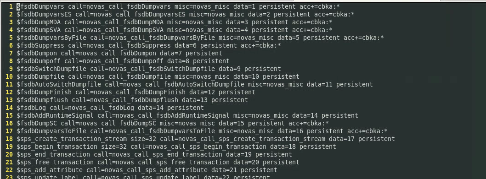
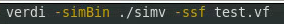

## VCS compile-time options

**-kdb**: Enables generating Verdi KDB database

**-lca**: Enables Limited Customer Availability feature, which is not fully test

**+vpi**: Enables the use of VPI PLI access routines. 

​	*Verilog PLI (Programming Language Interface) is a mechanism to invoke C or C++ functions from Verilog code.*

**-P <pli.tab>**: Specifies a PLI table file

​	`${VERDI_HOME}/share/PLI/VCS/LINUX64/novas.tb`



**+define+<macro_name>=<value>**: Define a text macro, Test for this definition in your Verilog source code using the ``ifdef`  compiler directive

`+define+SIMULATION` when compiling	

``ifdef SIMULATOIN` in code

**-debug_access**: Enables dumping to FSDB/VPD, and limited read/callback capability. Use `-debug_access+classs` for testbench debug, and `debug_access+all` for all debug capabilities. Refer the VCS user guide for more granular options for debug control under the switch `debug_access` and refer to `debug_region` for region control

**-y <directory_pathname>**: Specifies a Verilog library directory to search for module definitons

**-v \<filename\>**: Specifies a Verilog library file to search for module definitons

**+nospecify**: Suppresses module path delays and time checks in specify blocks

**-l \<filename\>**: (lower case L) Specifies a log file where VCS records compilation message and runtime messages if you include the -R, -RI, or -RIG option

**+vcs+fsdbon**:  A **compile-time** substitute for `$fsdbDumpvars` system task. The *+vcs+fsdbon*  switch enables dumping for the **entire design**. If you do not add a corresponding *-debug_access\** switch, then *-debug_access* is automatically  added.  Note that you must also set **VERDI_HOME**.

> $ ./simv
>
> FSDB Dumper for VCS, Release Verdi_S-2021.09-SP2-2, Linux x86_64/64bit, 05/22/2022
> (C) 1996 - 2022 by Synopsys, Inc.
> \*Verdi\* : Create FSDB file 'novas.fsdb'
> \*Verdi\* : Begin traversing the scopes, layer (0).
> \*Verdi\* : End of traversing.

**+vcs+vcdpluson**: A **compile-time** substitute for `$vcdpluson` system task. The *+vcs+vcdpluson* switch enables dumping for the **entire design**. If you do not add a corresponding *-debug_access\** switch, then *-debug_access* is automatically added

> $ ./simv
>
> VCD+ Writer S-2021.09-SP2-2_Full64 Copyright (c) 1991-2021 by Synopsys Inc.

**+incdir+\<directory\>**: Specifies the directories that contain the files you specified with the ``include` compiler directive. You can specify more than on directory, separating each path name with the `+` character.


### Compile time Use Model

Just add the `-kdb` option to VCS executables when running simulation

- Three steps flow:

  - `vlogan/vhdlan/syscan -kdb`

    Compile design and generate un-resolved KDB to *./work*

  - `vcs -kdb -debug_access+all <other option>`

    Generate elaborated KDB to *./sim.dadir*

- Two steps flow:

  - `vcs -kdb -debug_access+all <other option>`

    Compile design and generate elaborated KDB to *./simv.dadir*


### Common `simv` Option

`-gv <gen=value>`:  override runtime VHDL generics *

`-ucli`: stop at Tcl prompt upon start-up

`-i <run.tcl>`: execute specified Tcl script upon start-up

`-l <logfile>`: create runtime logfile

`-gui`: create runtime logfile

`-xlrm`: allow relaxed/non-LRM compliant code

`-cm <options>`: enable coverate options


## Verdi

### Verdi binkey

`SHIFT+A`: *Find Signal/Find Instance/Find Instport*

`SHIFT+S`: *Find Scope*

<span style="color:white; background-color:black">**module traverse**</span>


> *Show Calling*
>
> *Show Definition*
>
> Double-Click **instance name**  is same with click *Show Definition*
>
> Double-Click **module name** is same with click *Show Calling*


<span style="color:white; background-color:black">**signal traverse**</span>


> *Driver*
>
> *Load*
>
> Double-Click **signal name** is same with click *Driver*


### Verdi options

`-ssf fastFile(s)|dumpFile(s)|fastFile list(s)`: Load FSDB (\*.fsdb), virtual FSDB (\*.vf) , gzipped FSDB (\*.fsdb.gz), bzip2 FSDB (\*.fsdb.bz2), waveform dump (\*.vcd, \*.vcd.gz) files, or FSDB file list (\*.flst)

`-simBin <simv_executable>`: Specify the path of the simulation binary file.



`-dbdir`: Specify the daidir (simv.daidir ) directory to load

> In the VCS two-step flow, the VCS generated KDB (kdb.elab++) is saved under the simv.daidir/ directory (like `simv.daidir`/kdb.elab++).

`-f file_name / -file file_name`: Load an ASCII file containing design source files and additional simulator options


### Import Design from UFE

> **Knowledge Database (KDB)**: As it compiles the design, the Verdi platform uses its internal synthesis technology to recognize and extract specific structural, logical, and functional information about the design and stores the resulting detailed design information in the KDB

The Unified Compiler Flow (UFE) uses VCS with the `-kdb` option and the generated `simv.daidar` includes the **KDB** information

1. `verdi -dbdir simv.daidir`

   Use the new -dbdir option to specify the simv.daidir directory

2. `verdi -simBin simv`

   Load `simv.daidir` from *the **same directory** as `simv`* and invoke Verdi if `simv.daidir` is available

3. `verdi -ssf novas.fsdb`

   Load KDB automatically from FSDB

> For 2 and 3, use the `-dbdir` option to load *simv.dadir* if you have move it to somewhere else

---

`module load vcs`

`module load verdi`

> both vcs and verdi are needed for design import


### Reference Design and FSDB on the Command Line

```
verdi -f <source_file_name> -ssf <fsdb_file_name>
```

> Where, source_file_name is the source file name and fsdb_file_name is the name of the FSDB file


## Icarus Verilog (iverilog)

1. compile a SystemVerilog design and testbench file

```bash
iverilog -g2012 -o simulation_output.vvp design.sv testbench.sv
```


2. After successful compilation, you can run the simulation using the `vvp` runtime engine:

```bash
vvp sim.vvp +VCDFILE=output.vcd
```

`+VCDFILE=output.vcd`: This is the custom plusarg.

`"$value$plusargs("VCDFILE=%s", filename)"`: The simulator searches for `+VCDFILE=`. It extracts the string after the `=` sign and saves it into the `filename` variable.

`$dumpfile(filename)`: This opens a VCD file named `output.vcd`.

`$dumpvars(0, DUT)`: This dumps all signals inside the module instance named `DUT` and everything below it

```verilog
string filename;

initial begin
   if ($value$plusargs("VCDFILE=%s",filename)) begin
      $dumpfile(filename);
      $dumpvars(0, DUT);
   end
end
```


3. open `vcd` file with `gtkwave`

```bash
gtkwave output.vcd
```


## questasim sim flow

> A Short Intro to ModelSim Verilog Simulator [[https://users.ece.cmu.edu/~jhoe/doku/doku.php?id=a_short_intro_to_modelsim_verilog_simulator](https://users.ece.cmu.edu/~jhoe/doku/doku.php?id=a_short_intro_to_modelsim_verilog_simulator)]

```bash
vlib work
vlog -f filelist tb.sv
# "-c": command line mode
vsim -voptargs=+acc -c -do "run 100ns; exit" work.topmodule
```

> `-voptargs=+acc`:  Add the option `-voptargs=+acc` to the *vsim* command, This enables full visibility into every aspect of the design.


```verilog
module topmodule;
    ...
endmodule
```

**uvm**:

```bash
> vlog test_pkg.sv tb_top.sv -L $QUESTA_HOME/uvm-1.2
> vsim -c -do "run -all;exit" +UVM_TESTNAME=my_test work.tb_top  -L $QUESTA_HOME/uvm-1.2
```


## verilog-mode.el

> Emacs Online Documentation [https://doc.endlessparentheses.com/](https://doc.endlessparentheses.com/)
>
> Emacs verilog-mode 的使用 URL: [https://www.wenhui.space/docs/02-emacs/verilog_mode_useguide/](https://www.wenhui.space/docs/02-emacs/verilog_mode_useguide/)


```bash
emacs --no-site-file --load path/to/verilog-mode.el --batch filename.v -f verilog-auto-save-compile
```

> CAUTION: *filename.v* is **overwrite** by command

### verilog-mode.el

```verilog
/*AUTOINPUT*/
/*AUTOWIRE*/
/*AUTOINST*/
/*AUTO_TEMPLATE*/
```

<span style="color:white; background-color:black">`-f verilog-batch-auto`</span>

> For use with `--batch`, perform automatic expansions as a stand-alone tool. This sets up the appropriate Verilog mode environment, updates automatics with M-x verilog-auto on all command-line files, and saves the buffers.
> For proper results, multiple filenames need to be passed on the command line in bottom-up order.

<span style="color:white; background-color:black">`-f verilog-auto-save-compile`</span>

> Update automatics with M-x verilog-auto, save the buffer, and *compile*


### Emacs

<span style="color:white; background-color:black">`--no-site-file`</span>

Another file for site-customization is `site-start.el`. Emacs loads this *before* the user's init file (`.emacs`, `.emacs.el` or `.emacs.d/.emacs.d`). You can inhibit the loading of this file with the option ``--no-site-file``

<span style="color:white; background-color:black">`--batch`</span>

The command-line option `--batch` causes Emacs to run noninteractively.  The idea is that you specify Lisp programs to run; when they are finished, Emacs should exit.

 `--load, -l FILE`, load Emacs Lisp FILE using the load function;

`--funcall, -f FUNC`, call Emacs Lisp function FUNC with no arguments

<span style="color:white; background-color:black">`-f FUNC`</span>

`--funcall, -f FUNC`, call Emacs Lisp function FUNC with no arguments

<span style="color:white; background-color:black">`--load, -l FILE`</span>

`--load, -l FILE`, load Emacs Lisp FILE using the load function

> Verilog-mode is a standard part of GNU Emacs as of 22.2.


### multiple directories

**AUTOINST** only search in the file's directory default.

You can append below `verilog-library-directories` for multiple directories search

```
// Local Variables:
// verilog-library-directories:("." "subdir" "subdir2")
// End:
```


## reference

Verdi使用总结 URL: [https://www.wenhui.space/docs/07-ic-verify/tools/verdi_userguide/](https://www.wenhui.space/docs/07-ic-verify/tools/verdi_userguide/)

[Using Verdi for Design Understanding - Driver/Load Tracing in Verdi | Synopsys](https://www.youtube.com/watch?v=cFHKjDzoPyY&ab_channel=Synopsys)

[Using Verdi for Design Understanding - Connectivity Tracing and FSM Extraction in Verdi | Synopsys](https://www.youtube.com/watch?v=yjs7R5UWOEw&ab_channel=Synopsys)

